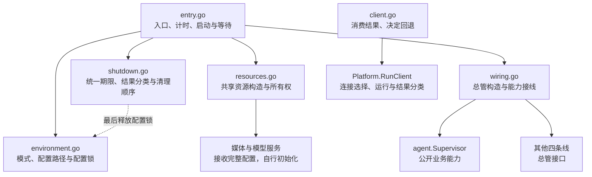

# App 包设计

App 使用六文件组织公共运行流程，按下层接口已存在来编写调用；下层按照这些契约实现。Agent 已通过真实公开接口接入，配置独占已实现；其他四条线、媒体和模型构造入口、平台客户端接口及进程入口适配仍待完成。完整应用的编译与运行验证需待这些接口接入。

## 职责与边界

App 负责共享资源、总管构造、跨线接线和启停协调。每条业务线接收完整配置，在内部拆分配置、创建组件并持有自己的订阅；App 不取得内部 Registry、Manager、Session 或执行协调器，不增加工厂或兼容层。权限管理及现行调用方统一使用 `security.Permission`。

| 文件 | 职责 |
|---|---|
| `entry.go` | 完整运行流程、部分失败清理、启动顺序、平台运行等待、总耗时及四阶段 debug 统计 |
| `environment.go` | 验证 TUI／Service 模式，定位并规范化配置路径，取得同配置本地实例的独占锁 |
| `resources.go` | 加载配置、构造共享资源并交付依赖；失败仍交回已取得的资源 |
| `wiring.go` | 构造五条线总管，交付共享资源和公开业务能力；连接 Hook、Platform 与 Agent |
| `shutdown.go` | 停止新工作、按结果枚举协调清理；全部步骤共享独立的 30 秒期限 |
| `client.go` | 明确运行客户端和自动尝试；消费平台分类结果，返回错误或回退信号 |

## 运行与所有权

环境阶段按显式路径、`ELBOT_CONFIG_FILE`、默认位置的优先级定位配置，转为绝对路径并解析符号链接。`gofrs/flock` 对规范化配置路径追加 `.lock` 后执行非阻塞 `TryLock`；TUI 和 Service 都必须取得锁，同配置已被占用或取锁失败时立即返回错误。不同配置分别取得锁，纯客户端不取得本地实例锁。

锁句柄以 `io.Closer` 交给 `Run` 持有，在资源构造前取得，由统一退出流程最后释放。锁文件保留，避免配置替换保存或删除锁文件造成互斥失效；进程退出时由操作系统释放锁。统一退出超时后不提前释放锁，等待进程退出。

构造和接线完成后，按 Tool → Agent → Hook → Platform → Background 启动。Platform 的 `Wait(ctx)` 汇总运行结果；TUI 退出结束应用，Service 不因所有消息平台循环退出而自动结束。正常停止返回 nil，独立故障和等待超时返回错误，Platform 自行解释内部停止原因。

环境、资源、装配或启动失败均进入同一退出流程。入口先取消运行上下文，再以 `context.WithoutCancel` 创建统一清理期限。纯外部取消视为正常停止，混合错误中的独立故障仍保留；运行和清理错误合并返回。

退出先请求各线停止新工作，等待平台接入与后台任务退出，再关闭 Agent、Hook、Tool，最后释放平台发送和历史查询能力。随后关闭模型管理、共享存储、日志和配置锁。媒体与权限没有独立关闭步骤。

App 用 `shutdownStep` 记录步骤名称和关闭调用，`runShutdownSteps` 顺序执行并汇总结果；`runShutdownStep` 负责单步等待和统一期限判断。下层 `Close` 保持返回 error，App 内部的 `stopResult` 将控制状态与错误详情分开：

| 状态 | 含义与处理 |
|---|---|
| `stopCompleted` | 步骤完成，继续清理 |
| `stopFailed` | 步骤返回错误，保留错误并继续清理 |
| `stopTimedOut` | App 的统一期限耗尽，保留此前错误并停止后续清理 |

业务自身返回超时错误不等于 App 的统一期限耗尽。关闭调用即使忽略取消，App 也只等待到统一期限；超时后不继续释放可能仍被使用的依赖。

共享存储由 App 持有，平台聊天历史及其存储归 Platform。App 通过 `media.NewMediaCenter(ctx, cfg, store)` 交付完整配置和共享存储，媒体侧负责后端、凭据、配置应用和中断恢复；通过 `modelmgr.NewModelManager(ctx, cfg)` 交付完整配置，模型侧负责协议客户端、请求参数和 providers 重载。两个构造入口均返回资源及错误，App 接收部分结果并统一清理，不拆解内部初始化。历史能力连接和历史引用对账等待平台公开能力接入。

## 对外调用契约

`agent.NewSupervisor(ctx, cfg, deps)` 接收 Store、Models、Media、Permission、Logs 及 Tool、Hook、Platform 能力，其中 Hook 能力仅供管理命令使用。公开业务入口为 `HandleMessage`、`RegisterHooks`、`StartHookRequest`、`Complete`、`Commands`、`ObserveStatusChanged`、`ObserveBindingChanged`；生命周期使用 `Start`、`BeginClose`、`Close`、`Done`。Hook 的 `ConnectAgent` 注册一组 `agent/hooks.Points` 回调并持有解除函数，每个实际 handler 通过 `StartHookRequest` 登记。其他接收方的 `ConnectAgent` 负责自身适配、订阅和释放。其余四条线通过根包 `Supervisor`、`SupervisorDeps`、`NewSupervisor` 及各自生命周期接口接入。
各条线的对外文件放各条线的根高，内部业务放子包。

`platform.RunClient(ctx, cfg, name)` 完成连接选择、运行和结果分类，返回 `ClientResult{Kind, Err}`：

| 结果 | 契约 |
|---|---|
| `ClientCompleted` | 正常结束，Err 为 nil |
| `ClientFallback` | 未指定连接名称时，默认连接未配置、被禁用或本机服务拨号失败；Err 保留原始错误 |
| `ClientFailed` | 其他失败，Err 保留原始错误 |

指定连接、远端失败、配置、认证、握手和取消均不归为可回退。App 不解析连接地址或重新判断失败性质。`RunClient` 直接返回 Err；`TryRunClient` 只将 `ClientFallback` 转换为 `ErrClientFallback`，其他结果返回 Err。实际本地启动由进程入口决定。

App 与 Agent 不承接 Doctor，配置诊断由配置侧负责。进程入口尚需适配已确认的 `client` 命名和新 App 参数。

## 验证与备份

`environment_test.go` 覆盖配置路径优先级、模式验证、相对路径与符号链接、配置替换保存、不同配置并行、取锁失败，以及 TUI／Service 各组合的跨进程互斥。子进程正常关闭和被终止后，锁文件保留且可重新取锁。环境测试可独立运行：`go test internal/app/environment.go internal/app/environment_test.go`。

资源测试保留部分失败所有权和提前取消，不在 App 验证模型协议或重载内部实现。退出测试覆盖结果分类、执行顺序、普通失败后继续、共享期限、超时后停止后续步骤，以及存储关闭失败后仍释放日志。期限测试使用 `synctest` 虚拟时间。

退出辅助函数和共享资源关闭测试可通过临时 overlay 隔离尚未实现的总管及资源构造调用，使用实际函数与共享资源类型，不提供假总管。完整 App 流程、资源构造及客户端链路仍需下层接口实现后验证。

同目录保留 13 份原生产文件和 12 份原测试文件的 `*.go.bak`，不参与构建，未恢复旧装配。

此重构不改用户文档
