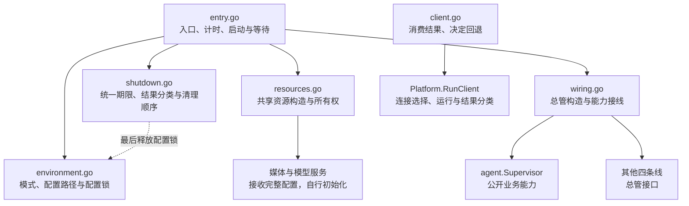
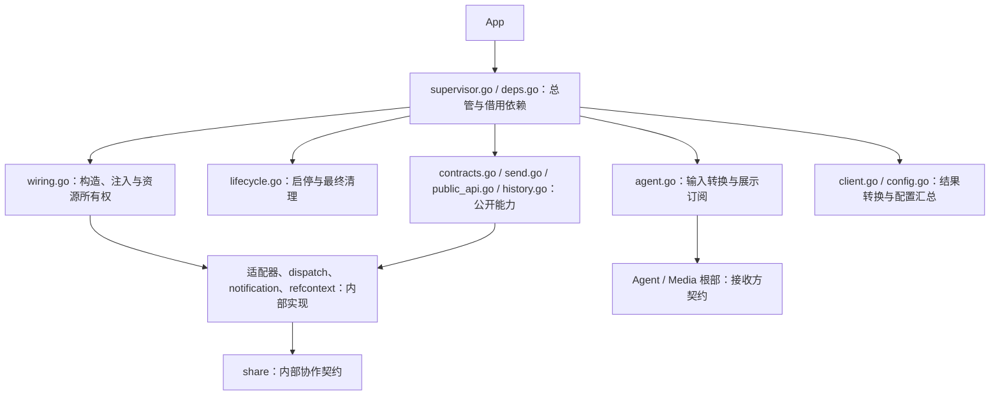

注：此重构不改用户文档

# App 包设计

App 使用六文件组织公共运行流程，按下层接口已存在来编写调用；下层按照这些契约实现。五条业务线已提供根包总管，配置独占已实现；Platform 下层与接收方契约、媒体和模型构造入口及进程入口适配仍待完成。完整应用的编译与运行验证需待这些接口接入。

## 职责与边界

App 负责共享资源、总管构造、跨线接线和启停协调。每条业务线接收完整配置，在内部拆分配置、创建组件并持有自己的订阅；App 不取得内部 Registry、Manager、Session 或执行协调器，不增加工厂或兼容层。权限管理及现行调用方统一使用 `security.Permission`。

| 文件 | 职责 |
|---|---|
| `entry.go` | 局部启动阶段列表、统一业务线集合、部分失败清理、按能力等待及耗时统计 |
| `environment.go` | 验证 TUI／Service 模式，定位并规范化配置路径，取得同配置本地实例的独占锁 |
| `resources.go` | 加载配置、构造共享资源并交付依赖；失败仍交回已取得的资源 |
| `wiring.go` | 构造五条线总管，交付共享资源和公开业务能力；连接 Hook、Platform 与 Agent |
| `shutdown.go` | 停止新工作、按结果枚举协调清理；全部步骤共享独立的 30 秒期限 |
| `client.go` | 明确运行客户端和自动尝试；消费平台分类结果，返回错误或回退信号 |



## 运行与所有权

环境阶段按显式路径、`ELBOT_CONFIG_FILE`、默认位置的优先级定位配置，转为绝对路径并解析符号链接。`gofrs/flock` 对规范化配置路径追加 `.lock` 后执行非阻塞 `TryLock`；TUI 和 Service 都必须取得锁，同配置已被占用或取锁失败时立即返回错误。不同配置分别取得锁，纯客户端不取得本地实例锁。

锁句柄以 `io.Closer` 交给 `Run` 持有，在资源构造前取得，由统一退出流程最后释放。锁文件保留，避免配置替换保存或删除锁文件造成互斥失效；进程退出时由操作系统释放锁。统一退出超时后不提前释放锁，等待进程退出。

`Run` 用局部 `startupStep` 列表声明 environment、resources、wiring、start，由 `runStartupSteps` 统一检查取消、执行、标注错误并记录成功阶段耗时。阶段先保存已取得的资源，再返回错误；失败停止后续阶段，统一进入清理。

App 消费 `Lifecycle`（Start、BeginClose、Close）和可选的 `Waiter`（Wait），下层通过方法集实现，不反向依赖 App。唯一的 `businessLines` 集合保存名称、总管和启动顺序，具体类型只在装配时接线。构造后立即登记非 nil 的部分结果；按 Tool → Agent → Hook → Platform → Background 启动。

`waitBusinessLines` 遍历集合筛选 Waiter，按实际数量并发等待；首个结果结束运行等待，取消并回收其余等待，保留独立故障。没有参与者时等待外部取消。Wait 必须响应等待上下文，取消等待不停止业务线。Platform 自行解释 TUI／Service 的退出语义；Background 的致命故障及时返回，实际清理由 Close 等待。

环境、资源、装配或启动失败均进入同一退出流程。入口先取消运行上下文，再以 `context.WithoutCancel` 创建统一清理期限。纯外部取消视为正常停止，混合错误中的独立故障仍保留；运行和清理错误合并返回。

退出先请求各线停止新工作，等待平台接入与后台任务退出，再关闭 Agent、Hook、Tool，最后释放平台发送和历史查询能力。随后关闭模型管理、共享存储、日志和配置锁。媒体与权限没有独立关闭步骤。

App 用 `shutdownStep` 记录步骤名称和关闭调用，`runShutdownSteps` 顺序执行并汇总结果；`runShutdownStep` 负责单步等待和统一期限判断。下层 `Close` 保持返回 error，App 内部的 `stopResult` 将控制状态与错误详情分开：

| 状态 | 含义与处理 |
|---|---|
| `stopCompleted` | 步骤完成，继续清理 |
| `stopFailed` | 步骤返回错误，保留错误并继续清理 |
| `stopTimedOut` | App 的统一期限耗尽，保留此前错误并停止后续清理 |

业务自身返回超时错误不等于 App 的统一期限耗尽。关闭调用即使忽略取消，App 也只等待到统一期限；超时后不继续释放可能仍被使用的依赖。

共享存储由 App 持有，平台聊天历史及其存储归 Platform。App 通过 `media.NewMediaCenter(ctx, cfg, store)` 交付完整配置和共享存储，媒体侧负责后端、凭据、配置应用和中断恢复；通过 `modelmgr.NewModelManager(ctx, cfg)` 交付完整配置，模型侧负责协议客户端、请求参数和 providers 重载。两个构造入口均返回资源及错误，App 接收部分结果并统一清理，不拆解内部初始化。历史能力连接和历史引用对账等待平台公开能力接入。

## 对外调用契约

`agent.NewSupervisor(ctx, cfg, deps)` 接收 Store、Models、Media、Permission、Logs 及 Tool、Hook、Platform 能力，其中 Hook 仅通过 `Commands() []command.Handler` 提供管理命令，由 Agent 使用标准注册入口接入。公开业务入口为 `HandleMessage`、`RunBackground`、`CopyBackground`、`CleanupSessions`、`SessionTakenOver`、`RegisterHooks`、`StartHookRequest`、`Complete`、`Commands`、`ObserveStatusChanged`、`ObserveBindingChanged`；生命周期使用 `Start`、`BeginClose`、`Close`、`Done`。Hook 的 `ConnectAgent` 注册一组 `agent.Points` 回调并持有解除函数，每个实际 handler 通过 `StartHookRequest` 登记。其他接收方的 `ConnectAgent` 负责自身适配、订阅和释放。其余四条线通过根包 `Supervisor`、`SupervisorDeps`、`NewSupervisor` 及各自生命周期接口接入。
各条线的对外文件放各条线的根部，内部业务放子包。Agent 的公开回调和事件定义在 contracts.go，内部共享载荷放 share，消费者按实际需要接收最小能力。Agent 根包与子包、Hook、Command、Completion 已通过相关回归；真实 Agent–Hook–Tool 总管接线覆盖命令注册、规则补全和输出回调。Hook 消费 Agent 与 Tool 根部类型，管理查询类型留在 Hook 内部。

Platform 根部十一文件已按目标下层契约实现。NewSupervisor 接收完整配置及 Mode、Store、Media、Permission、Logs，持有自有历史 SQLite、适配器、通知连接和 UI；部分失败仍交回总管，借用资源不由 Platform 关闭。公开发送、两类 API 和历史能力转交内部组件，不暴露 Repository 或 Router。旧 `platform.go`、`module/`、`builtin/` 保留迁移后删除标记；下层与旧消费者尚未接通。

Tool 根部创建媒体入口、技能目录与基础环境并一次注入 Skill Manager；Builtin、Skill、发现及 ELwisp 均接入必需的准备／执行契约，Skill 内部不依赖 Tool 根包。Cron 工具只使用 Tool 内部契约，根部 bridge 接入 Storage 和模型校验并发布任务定义变更；Background 根部持有订阅，Cron Manager 合并名称并串行读库刷新。Elnis 已通过自身媒体契约接入媒体中心。Background 整包已完成生命周期接线；完整 App 仍需 Platform 下层契约以及媒体、模型构造入口接通。

Background 根部按四文件组织：`supervisor.go` 定义对外总管并持有组件，`deps.go` 声明 Store、Models、Media、Logs、Agent、Tools、Platform 七项借用依赖，`wiring.go` 负责完整配置装配与边界适配，`lifecycle.go` 协调 Start、Wait、BeginClose、Close、Done。根部不公开内部 Runner 或 Cron CRUD；Cron 工具注册和管理归 Tool。

根部按消费方职责注入最小接口或函数，按需复用提供方根包的公开类型。Runner 的执行接口只包含 Agent.RunBackground，并接收沙盒根目录；Cron 分别接收模型最小接口、发送和会话复制函数；维护组件已接收日志最小接口、会话与历史清理函数、媒体清理接口；维护配置通过 share.MaintenanceJob 交给 Cron，注册回调直接使用函数，由根部接线。历史引用统一在媒体清理时对账。Elnis 分别接收工具声明展开接口、发送、平台 API 和模型选择函数，模型函数只返回 ModelSelection。cronBridge 将 Storage 转换为 Cron 自有 JobRepository 记录，保留原始 JSON 由 Cron 逐条解释；elnisBridge 将 Storage 事件与报告转换为 Elnis 自有 EventRepository 记录，通过 Media 的四项能力物化输入、导入附件和关联事件引用；导入只交付媒体 ID。Cron 与 Elnis 共用 share.ReportMessageMap 和 MapReportReceipt，回执映射仅使用实际 SentMessages。Cron 与 Elnis 共用 share.SessionTakenOver 查询契约，由根部注入 Agent 的公开方法。App 已通过 SupervisorDeps.Agent 交付总管，无需额外的 ConnectAgent。

Background 构造阶段建立外部订阅；Start 依次完成恢复、维护任务配置、Cron Manager 首次加载与启动、启用的 Elnis 就绪，最后调用 Cron Service.Start 放行平台通知。SetupCron 只配置任务。Manager 在调度启动前排空启动期间登记的任务变更，运行期间串行刷新，收尾只记录原任务 ID 的运行事实，次数由 SQLite 原子累加。Cron 旧管理入口已移除，定义管理归 Tool。

平台通知在 Service.Start 前按平台保留最新上下文，不创建 worker；启动后同平台串行、不同平台独立。启动失败不放行，关闭时清理缓存并停止接纳；Service.Start 不等待恢复任务执行完。BeginClose 取消工作并对订阅调用 BeginClose；Close 使用 App 清理期限，Done 等待组件、订阅回调及运行观察实际退出。

Elnis 的 `http.go` 构造 HTTP 路由和协议处理，`lifecycle.go` 管理同步监听就绪、队列、workers 和退出。关闭先停接入、取消并关闭连接，等待真实 handler、Serve 和 workers 退出，再批量失败化 accepted／queued／running，原子释放其媒体引用，保留持久化报告。数据库收尾隔离运行取消并限时 5 秒；未启动的 Runtime 不额外写入。故障由 Runtime.Wait → Background.Wait → App 上报；根部先发起整线关闭，Wait 不等待收尾。Close 只返回清理结果，单个事件或报告失败不升级为整线故障。

具体停止原因由产生结果的组件解释：Elnis 判断正常 HTTP 关闭与致命故障，Background 决定整线关闭，App 协调应用退出。等待上下文取消只代表结束本次观察。Background 的启动／等待取消路径使用已取消上下文向 Runtime 取得已发布结果，不依赖观察协程转存的时机，不解析 HTTP 错误；Runtime 发布启动结果时也保留已记录的运行故障。结果读取之后发生的新故障不属于本次观察范围。

Agent 公开 RunBackground、CopyBackground、CleanupSessions、SessionTakenOver，均连接调用方与 Agent 的取消信号。后台输入准备位于 input，复制、清理和接管查询复用自有 Session。复制元数据使用 map[string]json.RawMessage，接管查询只返回事实；Background 不取得会话存储记录。执行、会话清理、Cron 复制及共享接管查询已接通；Platform 公开能力已写入根部，仍待下层接通。App 等待后台调用退出后再关闭 Agent。

Elvena 请求、Elnis 声明生成与展开、Background 共享请求统一使用 Tool 根包公开类型。工具声明的 JSON 标签保持协议字段名和空值省略规则，CanonicalName、EventKey 由 Elnis 生成，不参与外部声明 JSON。Runner 只准备任务目录与后台来源，并调用 Agent.RunBackground；会话、权限、模型和工具预载归 Agent，报告解析和重试归 Cron、Elnis。

`platform.RunClient(ctx, cfg, name)` 完成连接选择、运行和结果分类，返回 `ClientResult{Kind, Err}`：

| 结果 | 契约 |
|---|---|
| `ClientCompleted` | 正常结束，Err 为 nil |
| `ClientFallback` | 未指定连接名称时，默认连接未配置、被禁用或本机服务拨号失败；Err 保留原始错误 |
| `ClientFailed` | 其他失败，Err 保留原始错误 |

指定连接、远端失败、配置、认证、握手和取消均不归为可回退。App 不解析连接地址或重新判断失败性质。`RunClient` 直接返回 Err；`TryRunClient` 只将 `ClientFallback` 转换为 `ErrClientFallback`，其他结果返回 Err。实际本地启动由进程入口决定。

App 与 Agent 不承接 Doctor，配置诊断由配置侧负责。进程入口尚需适配已确认的 `client` 命名和新 App 参数。

## Platform 下层目标契约

以下为根部当前调用的目标签名，供后续下层阶段实现。子包不导入根部或兄弟实现，外部不导入 `platform/share`；Media 已移除 Platform 依赖，Tool 历史桥接只消费 Platform 根部公开契约。Agent 入站与其余旧消费者仍需按各自边界迁移，不增加兼容别名。

```go
// share/adapter.go
type Runtime interface {
    Name() string
    Start(context.Context, MessageHandler) error
    BeginClose()
    Wait(context.Context) error
    Close(context.Context) error
    delivery.MessageSender
}
type MessageHandler func(context.Context, string, MessageContext) error
// 三个远程适配器；CLI、headless 保留现有构造入口。
NewFromPlatformConfig(map[string]any, share.AdapterDeps) (*Adapter, error)
refcontext.Apply(context.Context, refcontext.Options, share.ReferenceOptions) (share.ReferenceResult, error)
```

AdapterDeps 包含 Store、ChatHistory、Superadmins、CommandPrefixes、ConfigDir、AttachmentDir、MaxReceiveFileBytes、DownloadTimeoutSecs，类型沿用现有构造参数；另有 `ReferenceResolver func(context.Context, ReferenceOptions) (ReferenceResult, error)`。share.ReferenceOptions 只包含 Platform、ScopeID、ActorID、IsSuperadmin、ReplyID、Text、CommandPrefixes、Fetch、Enrich，不携带存储依赖；ReferenceResult、ReferencedMessage 保留现有结果字段，片段使用 share 类型。refcontext.Options 仅包含 Store、ChatHistory，根部装配时固定该依赖值，通过闭包注入引用函数，不新增 Resolver 组件。远程适配器保留 Enabled；所有非 nil 构造结果都纳入所有权，包括未启用与部分失败对象。

Start 同步完成本地启动，不等待远端连通；与 BeginClose 并发安全，关闭后不再接纳输入。正常停止由适配器返回 nil，独立故障返回 error；Wait 响应观察取消并优先返回已发布结果，启动失败仍可 Wait／Close。Close 响应期限且可重试。根部 BeginClose 只停止接入，Wait 等待所有已尝试启动的接入实际退出；服务模式即使全部平台退出也等待外部停止，本地 TUI 退出结束整线。取消等待不停止业务线，也不覆盖已经发布的独立故障。

最终 Close 按 UI → 通知管理与接线 → 适配器 → 历史清理。普通清理错误累计后继续，期限耗尽停在当前步骤并保留后续依赖，重试从该步骤继续；Done 仅在全部自有资源清理实际完成后关闭。发送、展示、通知与历史能力在停止接入后仍保留给尚未退出的使用方。

share/message.go 承接内部 MessageContext、MessageSegment、ReplyContext、Identity、Mention、MediaResolver 以及 WithMessageContext 等路由上下文方法，内部字段沿用旧定义。根部 contracts.go 的公开 MessageContext 独立定义，只含 RawText、PlatformMessage、Reply，引用和片段使用根部自有事实类型；不包含发送器、解析器、会话路由或续接／分叉等运行控制。根部投影和公开存取方法复制原始 JSON 与片段切片，消费者不会共享可变事实；存取不改写 contextinfo。旧消费者需迁移到各自输入契约，不增加兼容字段。

```go
// Agent 根包接收方契约。
HandleMessage(context.Context, agent.MessageRequest) error
type MessageRequest struct {
    Text, RawText string
    GroupRole contextinfo.GroupRole
    BufferAssistantOutput bool
    ForkFromMessageID, ResumeSessionID string
    Segments []MessageSegment
    ContextText string
    ContextSegments []MessageSegment
    Reply ReplyContext
    Bot Identity
    Mentions []Mention
    TriggerKeywords []string
    ResolveMedia func(context.Context, media.PlatformMedia, int64) (delivery.Source, error)
}
type MessageSegment struct { Type, Text, UserID string; Media media.PlatformMedia }
// Media 根包：来源描述，不依赖 Platform。
type PlatformMedia struct {
    Type, MediaID, URL, PlatformFileID, MIMEType, Name string
    Size int64
}
```

Agent 自有 ReplyContext 包含 MessageID、SenderID、SenderName、Text、Segments；Identity 包含 UserID、Username；Mention 包含 UserID、Username、Text。公共会话事实通过 contextinfo 传递。转换不下载媒体，ResolveMedia 保留延迟调用，唤醒与等待续接的物化时机保持不变。

CLI SetCompleter 接收 `func(context.Context, completion.Request) ([]completion.Item, error)`，命令消费者接收 `SetCommandCatalog([]command.Info)`。`cli.ConnectUI(cli.AgentEvents)` 返回 UI 和 error，部分 UI 交根部清理。CLI 自有 StatusChangedEvent、BindingChangedEvent、BindingSnapshot 与当前 Agent 公开事件字段对应，根部转换；订阅回调不接收 context，展示目标取自 Conversation。UI 持有订阅，最终 Close 解除订阅并等待展示退出。

dispatch.Options.Primary 和 Router 的 primary 字段只接收 `interface { Name() string; delivery.MessageSender }`，RegisterPlatform 的目标参数使用同一匿名接口，不包含 Start、BeginClose、Wait、Close。根部注册时也按该窄接口交付；完整 Runtime 仅由总管持有。路由通过可选的 share.CapabilityCaller、share.PlatformAPICaller 识别两类调用能力，不接管启停。Media 改为 dispatch 独用的最小接口（Metadata、ImportURL、ImportFile、ImportBytes、ResolveForOutput，沿用现有签名）。保留发送方法，增加 `CallCapability(ctx, platform, name, params)` 和 `CallPlatformAPI(ctx, platform, api, params)`，均返回 `(json.RawMessage, error)`，params 为 `map[string]any`。两个 share 调用接口分别提供去掉 platform 参数的同名方法。

通用入口仅承接已有 message.recall、member.mute、chat.leave，未知或不支持即报错；原生入口不登记名称清单、不映射业务名称，已知名称也不转入通用入口。认证、协议封装和传输错误归适配器。Elvena 映射保留在 dispatch/calls.go，待子包阶段拆入 capability_api.go；不增加头像等未使用能力。

通知沿用 New、AddPlatform、ConnectNotifications，NotificationReceiver 移入 share。Manager 增加 `NotifyPlatformFailure(context.Context, string, error, []events.NotificationTarget)`，负责格式化和异步投递；根部选择仍在运行的平台目标。CLI 增加 `RunClient(ctx, rawConfig, configDir, name) ClientResult` 和自身 ClientCompleted／ClientFallback／ClientFailed 分类，根部只转换为公开结果，规则见上节。



历史链路使用 Platform 根部 `ChatMessage`、`ChatHistorySearchRequest`、`ChatHistoryAroundRequest` 与 `ErrChatHistoryNotFound`，不向 Tool 交付存储记录。引用元数据编解码在 `share/reference.go`，引用展示归 Builtin。Media 的 `PlatformMedia`、`HistoryMessage` 只携带来源和历史身份；批量获取接受包含目标平台的解析函数。根部 `ResolveMedia` 转换参数并转发，dispatch 复用已有平台注册表选择解析器；未知或不支持的平台返回错误，不回退，不另设总管路由表。历史范围规则只在 Tool 历史组件校验，SQL 对昵称执行字面包含匹配。

## 验证与备份

Media、Tool 媒体组件、历史查询组件及共享编解码可独立验证。Platform 事实投影与 dispatch 媒体路由的隔离回归使用实际生产类型和函数；这不替代整包接线验证。Agent 旧入站调用、Platform 其余子包与 CLI 契约尚未完成，整包仍受其阻塞。

`environment_test.go` 覆盖配置路径优先级、模式验证、相对路径与符号链接、配置替换保存、不同配置并行、取锁失败，以及 TUI／Service 各组合的跨进程互斥。子进程正常关闭和被终止后，锁文件保留且可重新取锁。环境测试可独立运行：`go test internal/app/environment.go internal/app/environment_test.go`。

资源测试保留部分失败所有权和提前取消，不在 App 验证模型协议或重载内部实现。退出测试覆盖结果分类、执行顺序、普通失败后继续、共享期限、超时后停止后续步骤，以及存储关闭失败后仍释放日志。期限测试使用 `synctest` 虚拟时间。

App 的阶段执行、登记、启动、可选等待和退出测试可在临时包中隔离尚未实现的构造调用，使用实际函数与共享资源类型，不提供假生产总管。覆盖任意数量业务线、独立故障保留及阻塞关闭下的统一期限。Background 全包测试覆盖同步启动、部分构造、并发启动、订阅取消与实际退出，Elnis 测试覆盖真实监听故障、阻塞 worker／handler 和清理失败恢复；真实 SQLite 验证关闭后的终态、媒体引用及持久化报告保留。完整 App 流程、资源构造及客户端链路仍需下层接口实现后验证。

Platform 生命周期独立验证：`go test -race internal/platform/lifecycle.go internal/platform/lifecycle_test.go`。覆盖重复并发启停、未启动及部分失败清理、TUI／Service 差异、取消观察与故障保留、接入退出后保留资源、清理超时续接和普通失败继续。公开事实独立验证：`go test -race internal/platform/contracts.go internal/platform/contracts_test.go`，覆盖存入和读取的切片隔离、空值、上下文移除及无关上下文保留。agent_test.go 覆盖输入转换、延迟解析和公开事实投影，需目标类型落地后运行。API 分流、客户端结果、真实订阅与历史接线仍需整包验证；当前整包受旧反向依赖循环、CLI 旧 agent/events 引用及 share 缺失类型阻塞，旧消费者使用已移除的公开运行字段也需迁移。

同目录保留 13 份原生产文件和 12 份原测试文件的 `*.go.bak`，不参与构建，未恢复旧装配。
