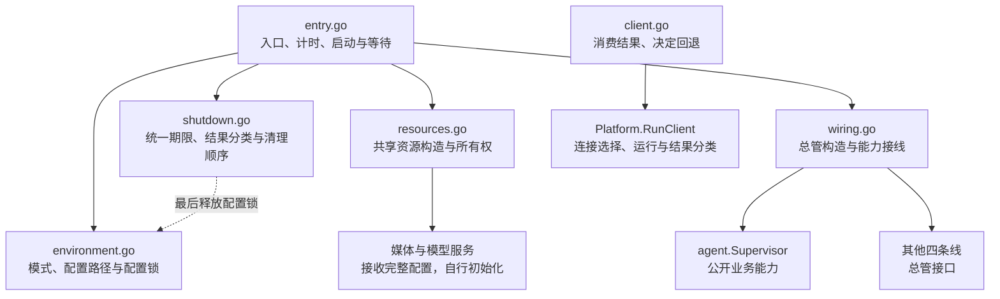
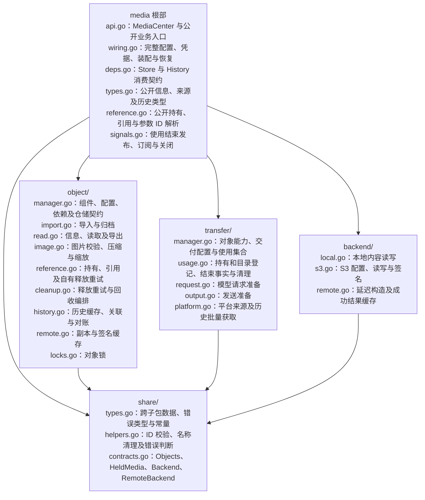
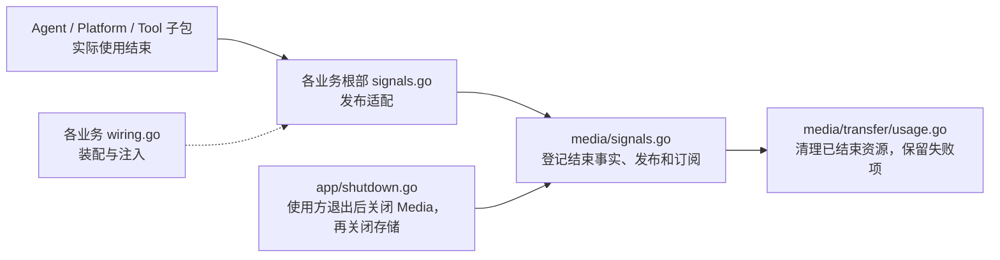
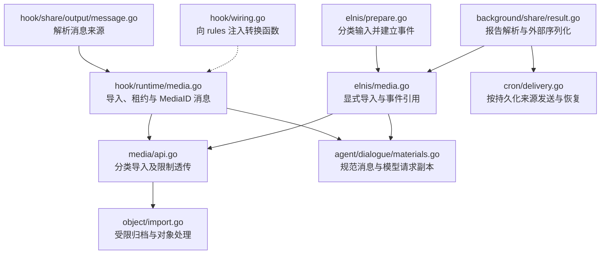
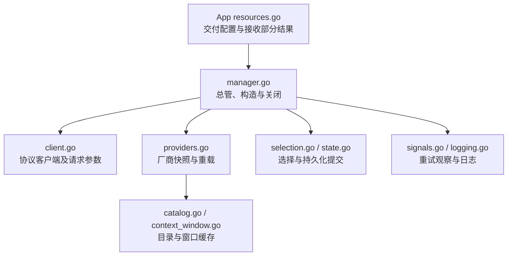

注：此重构不改用户文档
需要理解整体架构：读 `devdocs/architecture.md`。architecture-principles必读
旧代码需要删除或者改造，逻辑只做参考，不能强行兼容或者保留。
review时要看有没过度防御、有没旧逻辑代码，职责、边界是否清晰

# App 包设计

App 使用六文件组织公共运行流程，按下层接口已存在来编写调用；下层按照这些契约实现。五条业务线已提供根包总管，配置独占、Media 全包和消费者接线已实现。模型构造入口及 App 整包验证已完成；进程入口适配仍待完成。

## 职责与边界

App 负责共享资源、总管构造、跨线接线和启停协调。每条业务线接收完整配置，在内部拆分配置、创建组件并持有自己的订阅；App 不取得内部 Registry、Manager、Session 或执行协调器，不增加工厂或兼容层。权限管理及现行调用方统一使用 `security.Permission`。

| 文件 | 职责 |
|---|---|
| `entry.go` | 局部启动阶段列表、统一业务线集合、部分失败清理、按能力等待及耗时统计 |
| `environment.go` | 验证 TUI／Service 模式，定位并规范化配置路径，取得同配置本地实例的独占锁 |
| `resources.go` | 加载配置、构造共享资源并交付依赖；失败仍交回已取得的资源 |
| `wiring.go` | 构造五条线总管，交付共享资源和公开业务能力；连接 Hook、Platform 与 Agent |
| `shutdown.go` | 停止新工作、按结果枚举协调清理；全部步骤共享独立的 30 秒期限 |
| `client.go` | 明确运行客户端和自动尝试；消费平台分类结果，返回错误或回退信号 |



## 运行与所有权

环境阶段按显式路径、`ELBOT_CONFIG_FILE`、默认位置的优先级定位配置，转为绝对路径并解析符号链接。`gofrs/flock` 对规范化配置路径追加 `.lock` 后执行非阻塞 `TryLock`；TUI 和 Service 都必须取得锁，同配置已被占用或取锁失败时立即返回错误。不同配置分别取得锁，纯客户端不取得本地实例锁。

锁句柄以 `io.Closer` 交给 `Run` 持有，在资源构造前取得，由统一退出流程最后释放。锁文件保留，避免配置替换保存或删除锁文件造成互斥失效；进程退出时由操作系统释放锁。统一退出超时后不提前释放锁，等待进程退出。

`Run` 用局部 `startupStep` 列表声明 environment、resources、wiring、start，由 `runStartupSteps` 统一检查取消、执行、标注错误并记录成功阶段耗时。阶段先保存已取得的资源，再返回错误；失败停止后续阶段，统一进入清理。

App 消费 `Lifecycle`（Start、BeginClose、Close）和可选的 `Waiter`（Wait），下层通过方法集实现，不反向依赖 App。唯一的 `businessLines` 集合保存名称、总管和启动顺序，具体类型只在装配时接线。构造后立即登记非 nil 的部分结果；按 Tool → Agent → Hook → Platform → Background 启动。

`waitBusinessLines` 遍历集合筛选 Waiter，按实际数量并发等待；首个结果结束运行等待，取消并回收其余等待，保留独立故障。没有参与者时等待外部取消。Wait 必须响应等待上下文，取消等待不停止业务线。Platform 自行解释 TUI／Service 的退出语义；Background 的致命故障及时返回，实际清理由 Close 等待。

环境、资源、装配或启动失败均进入同一退出流程。入口先取消运行上下文，再以 `context.WithoutCancel` 创建统一清理期限。纯外部取消视为正常停止，混合错误中的独立故障仍保留；运行和清理错误合并返回。

退出先请求各线停止新工作，等待平台接入与后台任务退出，再关闭 Agent、Hook、Tool，最后释放平台发送能力。随后关闭模型管理，排空 Media 结束信号并执行最终清理，再关闭独立历史库、共享存储、日志和配置锁。权限没有独立关闭步骤。

App 用 `shutdownStep` 记录步骤名称和关闭调用，`runShutdownSteps` 顺序执行并汇总结果；`runShutdownStep` 负责单步等待和统一期限判断。下层 `Close` 保持返回 error，App 内部的 `stopResult` 将控制状态与错误详情分开：

| 状态 | 含义与处理 |
|---|---|
| `stopCompleted` | 步骤完成，继续清理 |
| `stopFailed` | 步骤返回错误，保留错误并继续清理 |
| `stopTimedOut` | App 的统一期限耗尽，保留此前错误并停止后续清理 |

业务自身返回超时错误不等于 App 的统一期限耗尽。关闭调用即使忽略取消，App 也只等待到统一期限；超时后不继续释放可能仍被使用的依赖。

共享存储及独立的历史 SQLite 均由 App 构造、持有和关闭。Platform 直接写历史库，Tool 根部直接查询；Agent、Media 借用单条历史身份查询，Background 借用过期清理。App 通过 `media.NewMediaCenter(ctx, cfg, store)` 交付完整配置和共享存储，媒体侧负责后端、凭据、配置应用和中断恢复；通过 `modelmgr.NewModelManager(ctx, cfg)` 交付完整配置，模型侧负责协议客户端、请求参数和 providers 重载。两个构造入口均返回资源及错误，App 接收部分结果并统一清理，不拆解内部初始化。App 在业务线构造前注入 Media.History 并执行历史引用对账，查询失败阻止启动；历史库在全部业务使用方退出后关闭，部分构造失败与正常退出共用清理流程。

## 对外调用契约

`agent.NewSupervisor(ctx, cfg, deps)` 接收 Store、ChatHistory、Models、Media、Permission、Logs 及 Tool、Hook、Platform 能力，其中 Hook 仅通过 `Commands() []command.Handler` 提供管理命令，由 Agent 使用标准注册入口接入。公开业务入口为 `HandleMessage`、`RunBackground`、`CopyBackground`、`CleanupSessions`、`SessionTakenOver`、`RegisterHooks`、`StartHookRequest`、`Complete`、`Commands`、`ObserveStatusChanged`、`ObserveBindingChanged`；生命周期使用 `Start`、`BeginClose`、`Close`、`Done`。Hook 的 `ConnectAgent` 注册一组 `agent.Points` 回调并持有解除函数，每个实际 handler 通过 `StartHookRequest` 登记。其他接收方的 `ConnectAgent` 负责自身适配、订阅和释放。其余四条线通过根包 `Supervisor`、`SupervisorDeps`、`NewSupervisor` 及各自生命周期接口接入。
各条线的对外文件放各条线的根部，内部业务放子包。Agent 的公开回调和事件定义在 contracts.go，内部共享载荷放 share，消费者按实际需要接收最小能力。Agent 根包与子包、Hook、Command、Completion 已通过相关回归；真实 Agent–Hook–Tool 总管接线覆盖命令注册、规则补全和输出回调。Hook 消费 Agent 与 Tool 根部类型，管理查询类型留在 Hook 内部。

Platform 根部按目标下层契约实现。NewSupervisor 接收完整配置及 Mode、Store、ChatHistory、Media、Permission、Logs，持有适配器、通知连接和 UI；历史库属于 App，Platform 只借用。部分失败仍交回总管。公开发送、原生 API 和媒体解析转交内部组件，不暴露 Repository 或 Router。失败通知已接通；配置定义统一由根部 ConfigDefinitions 提供。

Tool 根部创建媒体入口、技能目录与基础环境并一次注入 Skill Manager；Builtin、Skill、发现及 ELwisp 均接入必需的准备／执行契约，Skill 内部不依赖 Tool 根包。Cron 工具只使用 Tool 内部契约，根部 bridge 接入 Storage 和模型校验并发布任务定义变更；Background 根部持有订阅，Cron Manager 合并名称并串行读库刷新。Elnis 已通过自身媒体契约接入媒体中心。Background 整包已完成生命周期接线；App 整包已通过 race，完整进程运行仍需入口适配。

Background 根部按四文件组织：`supervisor.go` 定义对外总管并持有组件，`deps.go` 声明 Store、ChatHistory、Models、Media、Logs、Agent、Tools、Platform 借用依赖，`wiring.go` 负责完整配置装配与边界适配，`lifecycle.go` 协调 Start、Wait、BeginClose、Close、Done。根部不公开内部 Runner 或 Cron CRUD；Cron 工具注册和管理归 Tool。

根部按消费方职责注入最小接口或函数，按需复用提供方根包的公开类型。Runner 的执行接口只包含 Agent.RunBackground，并接收沙盒根目录；Cron 分别接收模型最小接口、发送和会话复制函数；维护组件已接收日志最小接口、会话与历史清理函数、媒体清理接口；维护配置通过 share.MaintenanceJob 交给 Cron，注册回调直接使用函数，由根部接线。历史引用统一在媒体清理时对账。Elnis 分别接收工具声明展开接口、发送、平台 API 和模型选择函数，模型函数只返回 ModelSelection。cronBridge 将 Storage 转换为 Cron 自有 JobRepository 记录，保留原始 JSON 由 Cron 逐条解释；elnisBridge 将 Storage 事件与报告转换为 Elnis 自有 EventRepository 记录，通过 Media 的信息查询、分类导入和引用能力归档输入、导入附件并关联事件引用；导入返回公开 MediaInfo。Cron 与 Elnis 共用 share.ReportMessageMap 和 MapReportReceipt，回执映射仅使用实际 SentMessages。Cron 与 Elnis 共用 share.SessionTakenOver 查询契约，由根部注入 Agent 的公开方法。App 已通过 SupervisorDeps.Agent 交付总管，无需额外的 ConnectAgent。

Background 构造阶段建立外部订阅；Start 依次完成恢复、维护任务配置、Cron Manager 首次加载与启动、启用的 Elnis 就绪，最后调用 Cron Service.Start 放行平台通知。SetupCron 只配置任务。Manager 在调度启动前排空启动期间登记的任务变更，运行期间串行刷新，收尾只记录原任务 ID 的运行事实，次数由 SQLite 原子累加。Cron 旧管理入口已移除，定义管理归 Tool。

平台通知在 Service.Start 前按平台保留最新上下文，不创建 worker；启动后同平台串行、不同平台独立。启动失败不放行，关闭时清理缓存并停止接纳；Service.Start 不等待恢复任务执行完。BeginClose 取消工作并对订阅调用 BeginClose；Close 使用 App 清理期限，Done 等待组件、订阅回调及运行观察实际退出。

Elnis 的 `http.go` 构造 HTTP 路由和协议处理，`lifecycle.go` 管理同步监听就绪、队列、workers 和退出。关闭先停接入、取消并关闭连接，等待真实 handler、Serve 和 workers 退出，再批量失败化 accepted／queued／running，原子释放其媒体引用，保留持久化报告。数据库收尾隔离运行取消并限时 5 秒；未启动的 Runtime 不额外写入。故障由 Runtime.Wait → Background.Wait → App 上报；根部先发起整线关闭，Wait 不等待收尾。Close 只返回清理结果，单个事件或报告失败不升级为整线故障。

具体停止原因由产生结果的组件解释：Elnis 判断正常 HTTP 关闭与致命故障，Background 决定整线关闭，App 协调应用退出。等待上下文取消只代表结束本次观察。Background 的启动／等待取消路径使用已取消上下文向 Runtime 取得已发布结果，不依赖观察协程转存的时机，不解析 HTTP 错误；Runtime 发布启动结果时也保留已记录的运行故障。结果读取之后发生的新故障不属于本次观察范围。

Agent 公开 RunBackground、CopyBackground、CleanupSessions、SessionTakenOver，均连接调用方与 Agent 的取消信号。后台输入准备位于 input，复制、清理和接管查询复用自有 Session。复制元数据使用 map[string]json.RawMessage，接管查询只返回事实；Background 不取得会话存储记录。执行、会话清理、Cron 复制及共享接管查询已接通；Platform 公开能力已通过根部接入下层。App 等待后台调用退出后再关闭 Agent。

Elvena 请求、Elnis 声明生成与展开、Background 共享请求统一使用 Tool 根包公开类型。工具声明的 JSON 标签保持协议字段名和空值省略规则，CanonicalName、EventKey 由 Elnis 生成，不参与外部声明 JSON。Runner 只准备任务目录与后台来源，并调用 Agent.RunBackground；会话、权限、模型和工具预载归 Agent，报告解析和重试归 Cron、Elnis。

Elvena 保留公共协议与来源契约，Call 只包含 Platform、API、Params；Elnis 持有内部 Event，targets.go 的 toDeliveryTarget 转换投递目标，media.go 的 directText 组装正文。direct.go 按顺序通过注入的 CallPlatformAPI 转发原始 API、参数与上下文；显式平台优先，否则使用首个解析目标的平台。调用失败或取消时停止后续调用及消息发送，calls-only 不额外发送消息。具体文件归属见 [Elnis 内部架构](elnis-elwisp.md#依赖边界)。

`platform.RunClient(ctx, cfg, name)` 完成连接选择、运行和结果分类，返回 `ClientResult{Kind, Err}`：

| 结果 | 契约 |
|---|---|
| `ClientCompleted` | 正常结束，Err 为 nil |
| `ClientFallback` | 未指定连接名称时，默认连接未配置、被禁用或本机服务拨号失败；Err 保留原始错误 |
| `ClientFailed` | 其他失败，Err 保留原始错误 |

指定连接、远端失败、配置、认证、握手和取消均不归为可回退。App 不解析连接地址或重新判断失败性质。`RunClient` 直接返回 Err；`TryRunClient` 只将 `ClientFallback` 转换为 `ErrClientFallback`，其他结果返回 Err。实际本地启动由进程入口决定。

App 与 Agent 不承接 Doctor，配置诊断由配置侧负责。进程入口尚需适配已确认的 `client` 命名和新 App 参数。

<!-- locator:media -->
## Media 根部与下层契约

`internal/media/` 根部实现公开入口、类型转换、持有包装、参数 ID 解析与完整配置装配；share 提供内部契约、ID 校验、名称清理及不可用错误判断，backend 实现本地读写、S3 传输与签名及延迟构造，object 实现导入读取、图片处理、持有引用、历史关联、远端副本及回收，transfer 实现平台来源导入、模型交付、发送准备与历史批量获取。15 个生产文件和 12 个测试文件原样保存在同目录的 `*.go.bak` 中，不参与构建。App、Agent、Tool、Hook、Platform、Background 均消费 MediaCenter、MediaInfo、HeldMedia、UsageID 及使用结束信号。



### 根部与公开契约

- `MediaCenter` 私有持有 object、transfer、使用结束信号及订阅连接，并公开借用的 History。`NewMediaCenter(ctx, cfg, store)` 接收完整配置与仅提供 Media／MediaReferences 仓储的 Store；内部配置及中断恢复归 Media，部分失败保留已构造结果，Close 不关闭借用存储。
- App 构造后注入 `History`，再调用 `ReconcileHistory`。根部调用 object 的 `ReconcileHistory(ctx, history)`、`Cleanup(ctx, history)` 时传入当前最小查询接口，object 不保存 History，也不通过闭包回取总管。
- `Info` 返回值类型 `MediaInfo{ID, Name, MIMEType, Size}`，只查询信息，不读取内容或取得持有；`ValidateImage` 额外验证可解码与图片 MIME。导入、读取、导出及历史批量结果使用同一四字段快照，不暴露存储位置、后端、来源记录或删除状态。
- `Reference{MediaID, OwnerType, OwnerID, Purpose}` 表达业务引用身份，持久化时间由 object 负责。Agent 的会话引用仍随自己的消息事务提交。
- `Hold(ctx, id)` 返回 `*HeldMedia`，提供 Info／Open 和 UsageID；公开 Open 返回实际读取器、信息与使用 ID。读取器由使用者关闭，随后发布结束事实；持有释放及失败处理归 Media。不同请求使用同一媒体时拥有独立使用 ID。
- `AcquireForLLM`、`ResolveForOutput` 返回 UsageID；无资源时为空。准备失败由 Media 标记结束并清理，不交回补清责任。`Workspace(base)` 创建并登记调用私有目录；Tool 负责路径范围与相对路径转换，目录释放归 Media。
- `ImportURL / ImportFile / ImportBytes / ImportReader` 统一接收末尾参数 `ImportLimits`，零值使用配置限制，非零值只收紧本次导入。`Input / Source / ImportLimits / PlatformMedia / HistoryMessage` 等公开类型独立定义；Source 表达持久化来源事实，share 契约仅供内部协作。

### 使用结束信号

Media 根部的 `signals.go` 建立并持有订阅，`wiring.go` 在交出实例前完成接线。消费者根部的 `agent/signals.go`、`platform/signals.go`、`tool/signals.go` 提供发布适配，各自 wiring 仅装配注入；子包在实际使用结束处触发。

`PublishUsageFinished(ctx, event)` 先在 transfer 登记结束事实，再隔离业务取消并通过现有 signal 唤醒清理。队列拒收或执行超时后记录仍在，既有维护继续处理；清理错误由 Media 记录。重复通知不重复释放已成功项目。全部消费者退出后，`MediaCenter.Close(ctx)` 停止接纳新使用、排空 Drain 信号，再解除订阅并清理 transfer 和 object 的剩余自有资源；超时保留状态供后续关闭继续等待。



### 内部契约

- `object.Options` 包含 Backend、MaxImportBytes、DownloadTimeout、Media、Now；Backend 只表达规范化后的 local／s3 导入位置。`Deps` 交付最小 MediaRepository、仅 Add／Remove 的 ReferenceRepository、Local 和 Remote；Manager 保存私有依赖、配置、两组对象锁，以及由 releasesMu 保护的 pendingReleases 自有待释放集合。存储记录、持有凭据、图片内部属性、远端副本与签名缓存只在 object 内部使用。
- `transfer.Options` 包含 Backend、MaxDirectBase64Bytes、MaxImportBytes、DownloadTimeout；Backend 表达 base64／s3／hybrid 交付策略。Manager 保存 share.Objects、配置和使用集合，不接收仓储、后端或凭据。集合锁不覆盖 I/O，每份使用记录串行清理，结束事实独立登记；成功项目移除，失败项目保留给维护。
- `share.Objects` 包含 Info、Hold、四项带 ImportLimits 的导入、LoadHistoryMedia、AssociateHistory。`HistoryKey` 包含四项历史身份；`HistoryEntry` 只包含 MediaInfo、Associated、Kind，表达有效缓存与匹配关联。平台来源和批量获取参数只在 transfer 使用，不进入 share。
- `share.ValidID` 严格接受 `media:` 加 64 位小写十六进制；`SanitizeName` 清理路径或 URL 中的展示名称，处理两种路径分隔符并只进行一次百分号解码；HTTP／HTTPS／file URL 解析失败时返回 `file`，查询参数与片段不进入名称。普通名称中的非法百分号编码保留原文；空值、退化路径及 data／base64 来源返回 `file`。根部公开函数直接转发。
- `share.UnavailableError{Err}` 只包装明确的对象记录、持有资格或归档内容缺失，保留原始原因；定义在 types.go，方法及 IsUnavailable 在 helpers.go。IsUnavailable 检查普通包装和组合错误，只有全部独立分支均不可用才允许降级。S3 读取将 NoSuchKey／NotFound 转为可匹配 fs.ErrNotExist 的错误，保留 SDK 原因；桶、权限、上传及签名错误不作此转换。SQLite 引用插入的媒体外键／删除保护拒绝及 Touch 无匹配行返回可匹配 storage.ErrNotFound 的错误；object 在相应读取、持有边界转换，transfer 不识别数据库或 SDK 错误。签名缓存未命中仍正常刷新，关闭和回滚错误不包装为不可用。
- 内部 `share.HeldMedia` 额外提供 `SignedURL(ctx)`。transfer 通过已有持有选择 Open 或 SignedURL；上传副本、记录更新和缓存维护均由 object 完成，公开句柄不开放签名能力。
- `Backend.Put` 返回位置字符串，Open／Remove 只接收位置；本地位置是文件路径，S3 位置是对象键。有效内容 ID、内容及大小和位置选择由 object 负责，后端不重复校验或补全位置。`RemoteBackend` 额外提供 PresignGet；LocalBackend 不提供签名方法，后端不接收 storage.Media。
- LocalBackend 将内容写入 `Root/哈希前两位/剩余哈希`；同目录临时文件写完并关闭后重命名，失败清理临时路径，重命名错误直接返回。操作开始及写入提交前检查取消；文件操作同步执行，不承诺中断已阻塞的 I/O。删除不存在的文件视为完成。
- `S3Options` 只包含 Endpoint、Region、Bucket、Credentials；S3Backend 直接使用这些选项构造 SDK 客户端，自定义端点采用路径式寻址，不加载 AWS 默认配置链，不重复校验根部已解析的凭据。Put 使用 `media/哈希` 对象键，可 Seek 输入直接交付 SDK，其余输入同步暂存到系统临时文件，支持 HTTP／HTTPS 的签名、校验和与重试；暂存前后检查取消，调用结束关闭并删除临时文件，原输入由调用方关闭。读取、删除和签名使用交付的位置，签名期限直接传给 SDK，副本与签名缓存归 object。
- `LazyBackend` 保存 factory、backend、mu，getBackend 在 mutex 内构造并只缓存成功结果；取得锁后检查取消，失败允许后续调用重试，实际后端操作在锁外执行。根部保证 factory 有效且成功时返回可用后端。
- object 构造保存已裁剪的配置与依赖并执行中断恢复，失败仍返回组件。四种导入统一进入 ImportReader，逐次限制只能收紧默认大小上限；名称与来源只在导入入口清理，MIME 规范化为媒体类型，图片内容识别优先，压缩后按实际内容生成 ID。同 ID 的去重与提交在对象锁内进行；入库失败使用独立期限回滚内容并保留回滚错误。
- Info 直接投影四字段快照，不清洗旧记录；Hold 在对象锁内取得临时引用，存储原子协调引用与回收。内部持有 Open 不新增引用，Close(ctx) 可取消地等待释放资格并使用传入上下文删除引用；失败保留，成功不重复释放。公开 Open 返回真实读取器和 UsageID，读取器关闭后发布结束事实。清理预算由信号、维护或 App 关闭入口交付；准备失败和便捷读取收尾各建立一次独立五秒预算，底层不重新计时。usage 逐项检查取消，保留失败及未开始资源；文件删除只在操作边界检查取消。
- Read、Export、ValidateImage 独占本次持有，先关闭读取器，再通过 releaseOwned 释放引用，汇总业务与关闭错误。引用释放失败的持有由 object 托管，Cleanup 在历史对账前通过 retryReleases 重试一个快照；关闭操作在集合锁外执行，成功项移除，失败、未开始项和执行期间新登记项均保留。取消等待当前关闭结束，存在释放故障或取消则终止本轮后续清理；仅读取器关闭失败不登记托管项。不增加后台任务，进程重启仍由中断恢复清除遗留临时引用。
- 图片压缩按配置调整边长与 JPEG 质量，透明区域合成白底；ValidateImage 验证声明的图片 MIME 和实际解码。图片内部属性不进入 share 或公开结果。
- SignedURL 在对象锁内重读副本事实，缺少远端副本时上传并保存实际位置；失败回滚保留独立错误。签名缓存剩余超过 5 分钟复用，否则按 1 小时刷新；签名失败保留原缓存。读取与删除使用已存位置，不推导旧路径或对象键。
- 历史缓存按 ID 去重查询，合并匹配历史身份的关联和未过期输出；仅保留与最终媒体匹配的关联标记。对账按所有者分页，只有确认缺失或身份更替才删除关联，查询错误立即返回。Cleanup 完成自有释放重试后，依次对账、清理过期输出并核对引用，再认领孤立对象；最后引用释放后保留 1 小时，每轮至多并行删除 4 个对象，按远端、本地、记录顺序执行，取消等待已开始工作退出，失败记录留待重试。
- 来源入口调用明确的 Import 方法，逐次限制原样传入 object。进入 Agent 的媒体消息携带 MediaID；Dialogue 克隆消息并清除请求 URL，缺少 ID 时返回错误。模型交付 URL 仅由 AcquireForLLM 在请求副本中生成。
- AcquireForLLM 克隆消息并按 ID 复用持有，名称及 MIME 采用持有快照，大小按实际出现次数累计；base64 超限失败，s3 使用远端，hybrid 超限才使用远端。每个 ID 只读取或签名一次，最多八个远端 worker；硬错误或取消停止派发并取消同批工作，等待已开始操作退出后再释放，独立故障汇总保留。纯不可用结果替换为含名称和 ID 的文本，不回退交付方式；仅取得持有失败的提示名称使用片段名称清理。
- ResolveForOutput 只取得一次持有，通过 held.Open 流式写入系统临时目录，关闭读取器和输出文件后交付本地路径与使用 ID。临时目录和持有分别尝试清理；失败项目由 transfer 保存，维护只处理已结束的使用。
- ImportPlatform 已有 ID 直接查询，否则先检查已知大小，使用直接 URL 或注入解析器，按 MediaID／URL／Path／Data 分派来源；解析器接收上下文和配置大小上限。GetHistoryMediaBatch 按完整历史身份缓存查询、按身份及序号复用结果，缓存不占额度，未缓存失败也占次数；来源中的 ID 保留，不强制重新下载。缺失或 Kind 变化的关联才保存，导入和关联错误逐项返回，缓存查询故障或调用取消终止批量。

### 根部装配与验证

`wiring.go` 消费配置包已处理默认值和路径的配置，不重复补默认值或修改输入。base64／hybrid 的对象导入位置为 local，s3 为 s3；交付组件保留原模式。本地目录取沙盒根目录同级的 media。base64 不读取远端凭据；s3／hybrid 通过 ConfigEnv 解析凭据，失败立即返回构造错误，成功后将配置快照和静态凭据交给延迟远端构造。object 构造返回的部分结果先保存再判断错误，中断恢复归其构造入口，随后装配 transfer。History 由 App 后注入。

根部转换公开与内部数据，平台回调保留 nil、上下文及限制；历史批量转换保留顺序、重复位置和逐项错误。公开历史错误与 transfer 使用同一错误值，HeldMedia 仅暴露读取能力和使用 ID，不携带清理回调或重试控制。

backend 使用真实文件与本地 HTTP／HTTPS 服务验证读写、签名、失败清理、取消和 S3 错误分类；object 使用真实 SQLite 和可控后端验证导入、图片、持有、签名缓存、历史、回收及存储错误语义；share 验证名称、ID 和组合错误判断。transfer 覆盖限制透传、消息隔离、模式选择、持有去重、并发取消、独立故障及清理重试、历史额度与关联。根部真实接线覆盖成功构造、base64／s3／hybrid 导入和模型交付、发送临时文件与引用释放、受限导入及历史缓存。消费者回归覆盖入口分类、Hook 批次租约、Elnis 去重与报告引用、Cron 持久化恢复、SQLite 引用事务与审计、Tool 使用结束及平台真实回执。新增回归覆盖取消、重复通知、队列拒收、关闭超时、失败清理维护，以及 Hook 独立调用、租约互斥和同链有序执行。

gofmt、Media、Agent、Tool、Hook、Platform、Background 及 SQLite 的 race 回归通过。Hook runtime 的测试子进程需要使用 `GORACE=atexit_sleep_ms=0`，避免 race 默认退出等待与一秒关闭期限冲突；竞态检测保持开启。

### 来源入口与消费者

外部协议保留原字段；入口一次解析 URI scheme、校验多来源冲突并输出 `delivery.Output/Source`，HTTP(S) 只规范化 scheme 大小写。内部按 URL、Path、Data、MediaID 调用明确能力，不把类型重新压回混合字符串。实际导入限制、图片处理及名称清理归 object。

- Hook 的 share/output 解析 URL／Path／Base64；runtime.BuildMessageSegments 导入并登记租约，再生成 MediaID 消息。完整调用在 runtime/manager.go 登记到已有关闭取消链和在途计数，下载、导入不占用租约集合锁；纯文本不接触租约锁。同租约操作独占且等待可取消，维护跳过正在使用的租约，清理前标记、锁外执行、成功项移除。关闭取消并等待在途调用，随后清理租约；失败资源保留供后续关闭处理。Worker 直接调用，rules 通过根部注入同名函数；pipeline 继续按优先级与同优先级注册顺序串行等待、传递更新结果。
- Elnis 的 prepareEvent 分类输入，Event.Segments 保存明确来源。原始 Request 供协议记录、去重与审计；确认事件身份后才导入并关联输入引用，record 模式不下载。
- 后台 ParseJSONResult 将附件转换为明确来源；JSONResult 的外部序列化投影协议字段。Cron 持久化相同结构并据此恢复发送，HTTP(S) 直接转交，本地 Path 相对任务目录解析；SQLite 触发器及审计读取 `report_segments[].Source.media`；第 26 次迁移更新触发器，既有报告记录原样保留。Elnis 报告本地附件通过 os.Root 受限打开，归档和关联引用后保存 MediaID。
- Tool 保留调用内 HeldMedia 复用集合、导出状态及共享缓存策略；私有目录和媒体持有都由 Media 登记。Chat、Responses、压缩、重放与 Platform 在实际使用结束后发布使用 ID；实际读取器先关闭，模型流取消后等待退出。清理失败不改写模型、工具或发送结果，平台保留实际回执。



## Platform 下层目标契约

以下为根部与下层已接入的契约。子包不导入根部或兄弟实现，外部不导入 `platform/share`；Media 已移除 Platform 依赖，Tool 历史桥接直接消费 Storage 查询与编解码，平台媒体解析只通过根部最小接口注入。Agent 使用自己的 MessageRequest。

```go
// share/runtime_contracts.go
type Runtime interface {
    Name() string
    Start(context.Context, MessageHandler) error
    BeginClose()
    Wait(context.Context) error
    Close(context.Context) error
    delivery.MessageSender
}
type MessageHandler func(context.Context, string, MessageContext) error
// OneBot 自有依赖；CLI、headless 保留现有构造入口。
qqonebot.NewFromPlatformConfig(map[string]any, qqonebot.Deps) (*qqonebot.Adapter, error)
qqofficial.NewFromPlatformConfig(map[string]any, qqofficial.Deps) (*qqofficial.Adapter, error)
telegram.NewFromPlatformConfig(map[string]any, telegram.Deps) (*telegram.Adapter, error)
refcontext.Apply(context.Context, refcontext.Options, share.ReferenceOptions) (share.ReferenceResult, error)
```

share/config.go 的 CommonConfig 包含 Superadmins、CommandPrefixes、ConfigDir、AttachmentDir、MaxReceiveFileBytes、DownloadTimeoutSecs；share/history_contracts.go 定义 ChatHistoryWriter（Append）和 ChatHistoryReader（GetByPlatformMessage）。OneBot 在 adapter.go 声明自有 Deps，嵌入 CommonConfig，历史只组合这两项能力，另接收 ReferenceResolver、FindByPlatformMessage 和 FindOutputs。根部直接注入存储方法值，不交付完整 Store，不增加查询转发层。

根部 SupervisorDeps.ChatHistory 按实际使用接收 Append、GetByPlatformMessage、MapPlatformMessageAlias、ResolvePlatformMessageAlias；总管不保存仅用于中转的 history 字段。refcontext.Options.ChatHistory 只包含 GetByPlatformMessage。Telegram 的 Deps 嵌入 CommonConfig，历史只接收 ChatHistoryWriter，另接收 ReferenceResolver；旧 share/adapter.go 与根部共用依赖装配已删除。QQ Official 的 Deps 嵌入 CommonConfig，历史只组合 ChatHistoryWriter 和两项别名方法，另接收 ReferenceResolver；不持有完整历史仓库。Storage 参数和返回类型保持一致。

share.ReferenceOptions 只包含 Platform、ScopeID、ActorID、IsSuperadmin、ReplyID、Text、CommandPrefixes、Fetch、Enrich，不携带存储依赖；ReferenceResult、ReferencedMessage 保留现有结果字段，片段使用 share 类型。refcontext.Options 仅包含 Store、ChatHistory，根部装配时固定该依赖值，通过闭包注入引用函数，不新增 Resolver 组件。远程适配器保留 Enabled；所有非 nil 构造结果都纳入所有权，包括未启用与部分失败对象。OneBot、QQ Official、Telegram 已删除旧 New、Run 和完整历史字段，仅保留 NewFromPlatformConfig。QQ Official 的凭据与默认值在构造阶段确定，不保留闲置媒体配置或运行期环境凭据兜底。Telegram 只在启用时解析凭据与代理并创建自有 HTTP 连接池，默认值及格式只在构造阶段确定；禁用对象跳过凭据解析，不创建 HTTP 客户端，仍可正常关闭。

Start 同步完成本地启动，不等待远端连通；与 BeginClose 并发安全，关闭后不再接纳输入。正常停止由适配器返回 nil，独立故障返回 error；Wait 响应观察取消并优先返回已发布结果；独立运行故障已记录而业务仍在收尾时，取消观察仍返回该故障，不提前宣告退出。启动失败仍可 Wait／Close。Close 响应期限且可重试。根部 BeginClose 只停止接入，Wait 等待所有已尝试启动的接入实际退出；服务模式即使全部平台退出也等待外部停止，本地 TUI 退出结束整线。取消等待不停止业务线，也不覆盖已经发布的独立故障。

最终 Close 按 UI → 通知管理与接线 → 适配器清理，不关闭借用的历史库。普通清理错误累计后继续，期限耗尽停在当前步骤并保留后续依赖，重试从该步骤继续；Done 仅在全部自有资源清理实际完成后关闭。发送、展示与通知能力在停止接入后仍保留给尚未退出的使用方；App 保持历史库存活直到全部业务使用方退出。

share/message.go 承接内部 MessageContext、MessageSegment、ReplyContext、Identity、Mention、MediaResolver 以及 WithMessageContext 等路由上下文方法，内部字段沿用旧定义。根部 contracts.go 的公开 MessageContext 独立定义，只含 RawText、PlatformMessage、Reply，引用和片段使用根部自有事实类型；不包含发送器、解析器、会话路由或续接／分叉等运行控制。根部投影和公开存取方法复制原始 JSON 与片段切片，消费者不会共享可变事实；存取不改写 contextinfo。Agent 输入已迁入自有契约，不增加兼容字段。Platform.RestoreMessageContext(ctx, source) 复制或清除平台公开事实与内部路由，不改变目标的取消、期限或 contextinfo；Agent 根部注入该函数，后台入口清除继承的平台状态，前台接管恢复新来源。普通后台输出和默认通知静默，显式目标投递保持可用。

```go
// Agent 根包接收方契约。
HandleMessage(context.Context, agent.MessageRequest) error
type MessageRequest struct {
    Text, RawText string
    GroupRole contextinfo.GroupRole
    BufferAssistantOutput bool
    ForkFromMessageID, ResumeSessionID string
    Segments []MessageSegment
    ContextText string
    ContextSegments []MessageSegment
    Reply ReplyContext
    Bot Identity
    Mentions []Mention
    TriggerKeywords []string
    ResolveMedia func(context.Context, media.PlatformMedia, int64) (delivery.Source, error)
}
type MessageSegment struct { Type, Text, UserID string; Media media.PlatformMedia }
// Media 根包：来源描述，不依赖 Platform。
type PlatformMedia struct {
    Type, MediaID, URL, PlatformFileID, MIMEType, Name string
    Size int64
}
```

Agent 自有 ReplyContext 包含 MessageID、SenderID、SenderName、Text、Segments；Identity 包含 UserID、Username；Mention 包含 UserID、Username、Text。公共会话事实通过 contextinfo 传递。转换不下载媒体，ResolveMedia 保留延迟调用，唤醒与等待续接的物化时机保持不变。

CLI 的本地 Adapter 与 RemoteServer 已实现 share.Runtime；lifecycle.go 管理本地启停，remote_lifecycle.go 管理监听与连接的分阶段释放。Start 同步等待监听绑定或终端就绪；BeginClose 停止新接入并取消已接纳工作，Wait 等待监听、握手和业务交付退出。TUI 与已认证 WebSocket 的展示／协议读取保留到最终 Close，期间不再交付新业务。stdin 管道通过 cancelreader 取消读取，不关闭借用的 os.Stdin；终端使用正常退出消息等待输入读取结束。旧 Run 和 StopAppOnExit 已移除。

Headless 在 headless.go 实现无状态的 share.Runtime，保留 New 和名称 service。Start 只返回传入 context 的错误，不保存或调用 MessageHandler；BeginClose 无操作，Wait／Close 立即成功，观察上下文取消不覆盖完成结果。它没有接入、自有资源或常驻协程，两种发送入口保持拒绝输出。根部将其登记为不启动的主发送占位，只在最终清理时调用 Close；Service 持续运行由根部协调。旧 Run 与对 Platform 根包的依赖已移除。

OneBot 的 lifecycle.go 管理分阶段生命周期：Start 完成本地初始化后异步拨号，连接或读取失败按原退避策略重连；BeginClose 停止输入、重连与新临时拨号，取消已接纳业务及正在进行的临时拨号。Wait 等待接入驱动与业务回调实际退出，已建立连接继续读取 API 响应，断开后不再重连。Close 最终并行释放主连接及临时连接，等待协议读取、在途请求和临时发送退出；观察超时可重试，不关闭借用依赖。

OneBot 的 transport.go 由 newTransport 初始化。请求登记与连接快照、响应投递与 pending 清理分别在同一锁内完成；disconnect 只处理捕获到的故障连接，迟到错误不影响新连接。Transport.Close 永久拒绝新操作并等待真实清理。等待写入资格和响应可取消；帧开始写入后使用隔离调用方取消且有期限的上下文，调用需等帧写完或超时后返回，最终关闭仍可释放连接。send.go 保持发送与回执行为，message.go 通过显式 MessageHandler 参数交付事实并直接写历史。

QQ Official 的 lifecycle.go 统一管理接入和完整发送调用：Start 完成本地初始化后异步连接网关；BeginClose 停止输入、拨号和重连并取消已接纳业务，HTTP 发送保留。Wait 等待网关、心跳及入站处理实际退出，取消观察保留已记录的独立故障；Close 等待接入退出后拒绝新发送、取消在途发送，等待回执别名入库等完整调用退出后释放自有 HTTP 连接池，超时可重试。运行故障不阻止清理，借用历史库不由适配器关闭。gateway.go 同步心跳序号并等待心跳退出，心跳失败关闭对应连接，重连分类决定下一次恢复或重新鉴权。token.go 通过可取消的 refreshGate 串行访问缓存和刷新，取消等待不影响正在执行的刷新；网关停止不必等待收尾发送的令牌请求，HTTP 401 最多刷新并重试一次。消息和通知使用 Share 契约，不提供额外的通用或原生 API。

Telegram 的 adapter.go 定义自有依赖与状态，config.go 提供唯一构造入口；lifecycle.go 管理轮询、入站和完整操作，commands.go 接收命令目录并在锁外同步，send.go 承担普通发送与回执，stream.go 管理流式更新。Start 完成本地启动后异步 getMe 与长轮询，失败沿用退避重试；BeginClose 停止轮询与输入接纳并取消已接纳处理，Wait 等待实际退出。发送、原生 API、媒体解析及每次流式操作登记完整调用，保留到最终 Close；Close 取消在途操作并等待退出，再释放自有连接池，等待超时可重试。流式串行资格等待可取消，闲置流对象不阻塞清理。机器人身份以 share.Identity 快照随消息传递；入站、通知和引用恢复使用 Share 契约，不关闭借用历史库。

CLI SetCompleter 接收 `func(context.Context, completion.Request) ([]completion.Item, error)`；CLI 通过补全入口消费命令信息，没有单独保存命令目录。其他实际命令目录消费者仍接收 `SetCommandCatalog([]command.Info)`。入站每条消息以 share.MessageHandler 交付原文、身份和 Sender，私有目标固定原终端或原连接。

`cli.ConnectUI(cli.AgentEvents)` 返回 UI 和 error，部分 UI 交根部清理。event_contracts.go 定义 CLI 自有 StatusChangedEvent、BindingChangedEvent、BindingSnapshot，由根部转换 Agent 公开事件；订阅回调不接收 context，展示目标取自 Conversation，日志事实取自 Execution。状态发布版本与绑定变更版本分别处理，终态释放待发正文但保留版本水位；换绑／解绑清除旧绑定待发状态并拒绝迟到事件；worker 在锁内取出状态即开始发送，在途发送允许完成，新状态随后串行发送。发送上下文保留事件事实并隔离展示停止，远程写入沿用 15 秒超时。UI 消费已交付的独立快照，持有订阅和展示 worker；BeginClose 停止接纳并清空待发状态，Close 解除订阅并等待在途发送及 worker 实际退出，等待超时可重试。

dispatch.Options.Primary 和 Router 的 primary 字段只接收 `interface { Name() string; delivery.MessageSender }`，RegisterPlatform 使用同一匿名接口。完整 Runtime 仅由总管持有，dispatch 不接管启停。Media 接收 Info、ImportURL、ImportFile、ImportBytes、ResolveForOutput 五项能力；SaveMediaOutput 接收 `func(context.Context, storage.MediaOutput) error`，根部直接注入 Store.Media().SaveOutput。媒体准备、发送副本解析、使用结束通知与实际回执关联归 media.go，临时资源释放归 Media；部分发送仅缓存真实回执；回执身份必填校验归存储入口，dispatch 不重复检查并静默跳过，缓存失败记录警告，不改变发送结果或重发。

通用能力使用 SendChat、SendTo、StartStream、ResolveMedia 等固定方法；引用恢复沿用 refcontext 入站链路，不提供字符串能力分发表。原生入口 `CallPlatformAPI(ctx, platform, api, params)` 返回 `(json.RawMessage, error)`，params 为 `map[string]any`。calls.go 按显式平台取得适配器、释放注册表锁，再通过 share.PlatformAPICaller 转交原始上下文、接口名和参数；未知或不支持的平台报错，不回退当前或默认平台。OneBot、Telegram 的 capability_api.go 保留原生传输，分别返回原生 Data／result；认证、协议封装和操作生命周期归适配器。Hook platform.call 与 Elnis direct 负责各自的平台选择，Elnis direct 直接消费原生调用声明。

通知沿用 New、AddPlatform、ConnectNotifications。share/notification.go 定义 NotificationReceiver 和 NotificationTarget；接收契约只连接发送端，连接由根部持有和释放，目标转换在匹配来源时保留原生回复路由。CLI、OneBot、QQ Official、Telegram 已使用 Share 通知契约。Manager 的 `NotifyPlatformFailure(context.Context, string, error, []events.NotificationTarget)` 使用既有 NotificationRequested 信号逐目标异步提交 ERROR 通知，不等待发送结果、不重试。根部选择仍在运行的其他平台，使用构造时的管理员配置快照去重目标并记录一次故障日志。Platform.BeginClose 只停接入，通知保留到最终 Close；Manager 关闭时停止接纳、取消排队与在途工作，等待回调实际退出，等待超时可重试。

CLI client.go 提供 `RunClient(ctx, rawConfig, configDir, name) ClientResult` 和自身 ClientCompleted／ClientFallback／ClientFailed 分类，根部只转换为公开结果，回退规则见上节。本机判断只接受有效 WebSocket URL 的 localhost 或回环 IP；已连接后断线结束 TUI 并返回失败，不自动重连或回退。客户端统一收回读循环、展示与补全等待，保留独立错误。

Share 的 Runtime、MessageHandler、PlatformAPICaller 和 NotificationReceiver 已定义；运行与入站契约位于 runtime_contracts.go，共同配置及最小历史契约位于 config.go、history_contracts.go，可选原生 API 接口位于 adapter_api.go，不并入 Runtime。Share 不实现生命周期状态机、协议映射或发送调度；CLI 已接入运行、入站与通知契约，Headless 已接入无状态运行契约，OneBot 与 Telegram 已接入运行、入站、通知与原生 API，QQ Official 已接入运行、入站与通知。


历史链路使用 Storage 的 `ChatMessage`、查询契约及 `ErrNotFound`；`storage/chat_history.go` 的 `ChatSegment`、`ChatReply` 和编解码函数维护持久化事实。适配器将内部片段转换后直接入库；Tool 根部查询并转换为内部消息，Builtin 仅负责展示。Platform 不保留历史查询、清理包装或历史专用公开类型。Media 的 `PlatformMedia`、`HistoryMessage` 只携带来源和历史身份；批量获取接受包含目标平台的解析函数。根部 `ResolveMedia` 转换参数并转发，dispatch 复用已有平台注册表选择解析器；未知或不支持的平台返回错误，不回退，不另设总管路由表。历史范围规则只在 Tool 历史组件校验，SQL 对昵称执行字面包含匹配。

## 模型根部契约

modelmgr 保持根包组织；公开总管为 `ModelManager`，唯一构造入口为 `NewModelManager(ctx, cfg)`。App 交付已加载的完整配置并接收部分结果，模型侧构造协议客户端、请求参数、厂商快照和重试日志连接。`ReloadProviders(ctx)` 读取指定 providers 文件，使用主配置目录重新解析凭据；不重读主配置与 state，不改当前模型选择。全部客户端及缓存准备成功后一次发布，在途调用保留旧快照。

公开选择通过 `Selection` 固定客户端、来源与窗口缓存。`ObserveModelRetrying(handler, options)` 只返回观察连接，不交出信号对象；Agent 关闭自己的连接，App 在消费者退出后关闭模型总管。总管关闭等待实际回调退出，超时可以继续等待。llm 协议实现维持现有生命周期，本层不增加工厂或兼容入口。

App 持有具体 `ModelManager`。Agent、Background、Tool 在各自 `deps.go`，Session 在 `title.go`，Contextmgr 在 `service.go` 声明本包 `ModelCapabilities`。Agent 接入模型选择、管理命令及重试观察；Background 只接入模式选择与校验，Tool 只接入校验，Session 只接入命名选择，Contextmgr 只接入选择解析。装配时直接赋值给消费接口，子包继续接收已有最小接口或函数；`SelectionForTurn` 仅要求模式选择能力。窗口解析器由构造入口提供查询回调，按远端元数据、手工配置、配置层补齐的默认窗口取值。



## 验证与备份

Modelmgr、App、Agent、Session、Contextmgr、Command/Builtin、Tool 和 Background 相关包已通过 race。模型覆盖真实 Chat／Responses 构造与参数透传、重载凭据、快照隔离、保存失败、构造取消与部分结果、观察连接及关闭超时续接；跨包模型测试使用本地 HTTP 服务和临时 providers 文件，不通过生产工厂注入客户端。

媒体结束信号与 Hook 租约并发修复已通过 Media、Agent、Platform、Tool、Hook、Background 全部 52 个包的 race 回归。覆盖独立使用 ID、取消后结束登记、失败维护、重复通知、队列拒收、信号关闭超时，以及慢导入不阻塞其他调用、同租约等待取消、维护不释放在用资源、关闭收尾与同链 Hook 优先级和结果依赖。App 整包已通过 race 验证。

Media、Tool、Agent、Hook、Platform、Background 及 SQLite 的验证范围见上文。原媒体文件保存在 `.go.bak` 中。模型构造与 App 整包已通过 race。全仓编译仍有 launcher 引用旧 App 运行模式常量，以及 security 测试的 string／contextinfo.Role 类型不匹配。

CLI 整包与 Share、refcontext、dispatch、notification 的 race 回归通过。CLI 覆盖真实管道和 Linux 伪终端的停止／最终关闭、真实 WebSocket 收尾发送、同步监听失败、并发启停及超时重试、原连接回复、事件乱序与绑定失效、WebSocket 背压期间换绑和展示关闭后连接保留、UI 关闭超时重试、回调收尾期间取消观察仍返回已发布故障、部分 UI 所有权、客户端分类及断线退出。CLI 不再依赖旧 agent/events、Platform 根包或兄弟实现；Headless 整包也通过 race，覆盖无状态生命周期、取消上下文、重复及并发调用、发送失败契约；OneBot、Share、refcontext 的 race 回归通过，覆盖分阶段关闭、临时拨号取消、在途写入取消隔离、关闭重试、重连隔离及原生 API 透传；OneBot 不再依赖根包或兄弟实现。QQ Official、Share、refcontext、notification 的 race 回归通过，覆盖实际 HTTP／WebSocket、心跳序号同步及失败退出、恢复与重新鉴权、并发启停、取消观察与独立故障、收尾发送、完整发送及别名入库等待、关闭超时重试。QQ Official 不再依赖根包或兄弟实现。Telegram、Share、refcontext、notification 与 Background/Cron 的 race 回归通过，覆盖异步远端连接、分阶段关闭、完整操作取消与退出等待、流式等待取消隔离、关闭超时重试、独立连接池释放、身份快照、命令目录并发、引用恢复、配置边界及原生 API。Telegram 生产代码与包内测试均不依赖 Platform 根包或兄弟实现；Background 报告测试通过发送契约注入回执。

媒体来源转换、回执顺序与重复关联、部分成功和缓存失败测试位于 dispatch/media_receipt_test.go，使用真实媒体中心与 SQLite；身份缺失覆盖存储校验告警及发送结果保留。Agent 的 SendOutputs 日志测试直接注入发送契约，只验证来源日志透传；回执日志格式由 dispatch 验证。

dispatch、Share、OneBot、Telegram、refcontext、Agent/execution 与 Hook/rules 的 race 回归通过。覆盖显式平台原生转发、参数与结果保留、错误及取消传播、调用期间注册表可写，以及媒体回执函数注入、部分发送、缓存失败不重发和临时资源释放。Platform 根包、notification、Share 与 Agent/execution 的 race 回归通过。通知覆盖故障文案与显式目标、异步返回、慢平台隔离、失败不重试、空目标和取消上下文；根部接线覆盖管理员配置快照、去重、排除故障及已停止平台、停止接入后继续投递和最终释放订阅；关闭覆盖取消排队及在途工作、等待实际退出、超时重试。Elvena、Background 根包及全部子包、dispatch 的 race 回归通过，覆盖原生调用 JSON、平台选择、参数与上下文透传、HTTP 顺序执行、失败及取消后停止、calls-only、目标转换和正文组装，以及真实 SQLite 去重恢复、报告回执、媒体引用与借用资源生命周期。

`environment_test.go` 覆盖配置路径优先级、模式验证、相对路径与符号链接、配置替换保存、不同配置并行、取锁失败，以及 TUI／Service 各组合的跨进程互斥。子进程正常关闭和被终止后，锁文件保留且可重新取锁。环境测试可独立运行：`go test internal/app/environment.go internal/app/environment_test.go`。

资源测试覆盖部分失败所有权、历史库构造失败后保留共享存储和提前取消，新增真实模型构造成功与构造失败后保留部分模型对象的清理验证；协议与重载内部实现由 modelmgr 测试覆盖。退出测试覆盖结果分类、执行顺序、普通失败后继续、共享期限、超时后停止后续步骤、存储关闭失败后仍释放日志，以及历史使用方退出前保留历史库、部分失败仍关闭历史库、退出超时不释放历史库。期限测试使用 `synctest` 虚拟时间。

App 的阶段执行、登记、启动、可选等待、资源构造和退出测试已在实际 App 整包中通过 race 验证，使用实际函数、共享资源类型和真实历史 SQLite。覆盖任意数量业务线、独立故障保留及阻塞关闭下的统一期限。Background 的历史清理依赖通过根部直接注入仓库，相关测试及借用资源关闭断言已随整包 race 回归通过。完整进程运行与客户端跨根部链路仍需后续验证。

Platform 根包整包 race 验证覆盖重复并发启停、未启动及部分失败清理、TUI／Service 差异、取消观察与故障保留、接入退出后保留资源、清理超时续接、普通失败继续及故障通知接线。公开事实测试覆盖存取切片隔离、空值、上下文移除，以及平台事实与公共会话事实互不改写；agent_test.go 覆盖输入转换、延迟解析和公开事实投影。原生 API 跨根部接线、客户端结果和真实历史接线仍需补充集成验证；完整 App 与剩余接线验证见 [任务清单](tasks.md#platform-剩余接线)。

同目录保留 13 份原生产文件和 12 份原测试文件的 `*.go.bak`，不参与构建，未恢复旧装配。
