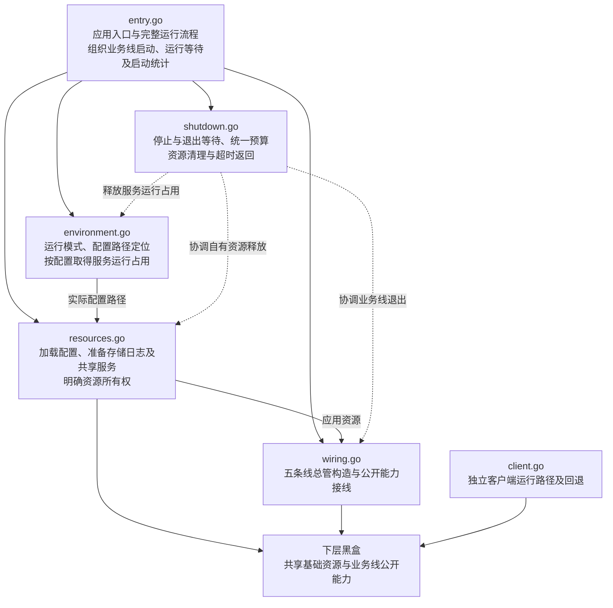

# App 包设计

本文记录 `internal/app` 已确认的文件职责，任务状态见[任务清单](tasks.md#app-包架构梳理)。六文件骨架中已填写 Agent 的总管构造、能力接线及启停调用；其余四条业务线、共享资源准备和公共流程仍待实现，当前没有可运行的 App 入口。

## 修改原则

五条业务线统一按 Agent 的方式组织：对接 App 的 `Supervisor`、依赖、装配和生命周期放在各自根包，内部业务放子包，线内共享内容放 `share`，不反向依赖使用方。各线管理并释放自有组件和订阅，只借用其他线及 App 的资源；权限命名统一为 `Permission`，旧 `Policy` 随改造迁移。

App 沿用已确认的六文件骨架和函数划分，不额外拆分或增加工厂层；只负责共享资源、总管构造、跨线接线及启停协调，业务内部装配和配置拆分留给各线。业务依赖接口由使用方声明，总管直接实现并交付这些能力；App 不获取下属组件，也不创建跨线适配对象。构造和接线完成后统一启动，失败保留部分结果交入口清理，退出沿用统一 30 秒预算。

文档只保留最新状态；每个文件的设计确认后及时记录。

## 已确认的文件划分

| 文件 | 负责什么 | 不负责什么 | 与其他文件的关系 |
|---|---|---|---|
| `entry.go` | 应用入口与完整运行流程，组织准备、装配、启动、等待和退出，以及启动耗时统计 | 资源构造细节及下层业务实现 | 调用环境、资源、接线及退出协调；业务线启动与运行等待由入口组织 |
| `environment.go` | 本地运行模式、实际配置路径定位，以及按配置取得服务运行占用 | 配置内容加载、业务线内部环境适配 | 向入口返回实际配置路径和服务占用句柄；路径交给资源准备，句柄纳入统一退出协调 |
| `resources.go` | 按已定位的路径加载配置，准备共享存储、日志、媒体、权限和模型管理，明确资源所有权 | 平台聊天历史的存储生命周期、业务线启动顺序与内部接线 | 消费环境阶段定位的配置路径，向接线步骤提供基础依赖；部分准备失败时也明确已取得资源的清理责任 |
| `wiring.go` | 五条线总管的创建与公开能力接线，构造和接线分步组织 | 下属组件实现、内部对象分配、应用退出策略 | 消费准备结果，向入口交付已构造的业务线 |
| `shutdown.go` | 业务线停止、退出等待、统一退出预算及资源清理顺序 | 越过资源所有者释放其下属对象 | 协调业务线、应用资源和进程级资源的退出与释放 |
| `client.go` | 独立客户端运行与自动尝试的回退判断 | 构造本地业务线、直接回退启动本地应用 | 向进程入口返回客户端结果或回退信号，由入口决定是否启动本地应用 |

六个文件代表职责划分，不意味着每个文件都需要独立对象或一套 Factory、Request、Components。入口的业务线集合只持有五条线总管；环境准备直接返回配置路径和服务占用句柄，不新增环境结果结构体。共享资源由资源准备阶段创建，部分准备失败时也交回入口统一清理；共享存储由 App 协调生命周期，数据读写规则归各使用方。平台聊天历史及其存储生命周期归平台总管，由接线阶段连接查询与清理能力。接线产生的订阅等对象由对应总管或服务持有和释放，全部构造与接线完成后再由入口启动业务线。

## 文件协作关系

下图表示已确认的职责方向；当前仅填写 Agent 的构造、启动和关闭部分，完整调用链尚未实现。

## 备份与当前进度

`internal/app` 下共有 25 份原样备份：13 个生产文件和 12 个测试文件，均使用原文件名加 `.bak`，例如 `app.go.bak`、`runner_test.go.bak`。备份不参与 Go 构建，仅供新架构确认后参考。

生产备份包括 `app.go.bak`、`runner.go.bak`、`dependencies.go.bak`、`environment.go.bak`、`foundation.go.bak`、`models.go.bak`、`services.go.bak`、`wiring.go.bak`、`platforms.go.bak`、`integrations.go.bak`、`lifecycle.go.bak`、`cli_client.go.bak`、`service_marker.go.bak`。

Agent 通过 `NewSupervisor(ctx, cfg, deps)` 接收完整配置、五项共享资源和三类业务能力。`agent/deps.go` 声明 `ToolCapabilities`、`HookCapabilities`、`PlatformCapabilities`，不暴露内部组件 getter 或总管生命周期方法；`agent/wiring.go` 拆分配置、创建线内组件，并把业务能力交给各消费位置。权限字段为 `Permission`，当前底层仍使用 `security.Policy`，权限侧实现待迁移。

Agent 对外提供消息处理 `HandleMessage`、唤醒判断 `HookWakeup`、补全 `Complete`、命令元数据 `Commands`、Hook 请求跟踪 `ObserveHookRun`，以及状态和绑定的订阅入口 `ObserveStatusChanged`、`ObserveBindingChanged`。元数据与订阅快照独立复制，绑定只暴露 Scope、SessionID 和变更原因，不返回内部组件或信号源。集成测试使用真实总管装配，覆盖 Chat／Responses 工具轮次、补全、回滚、取消、Hook 与订阅契约；组件单测保留在所属包。

App 直接传入 Tool、Hook、Platform 总管，并通过其 `ConnectAgent` 接入 Agent；具体适配和订阅由接收方持有。构造失败保留部分结果，启停调用为 `Start`、`BeginClose` 和经 `runShutdownStep` 调用的 `Close`。其余四条业务线的总管实现仍为空，完整装配尚不可运行。App 与 Agent 不承接 Doctor，配置诊断由配置侧负责。

入口的总耗时与四阶段 debug 统计、独立客户端及回退、统一 30 秒退出预算仍按既定骨架实现；当前 `runShutdownStep` 也保留占位，尚不能运行或验证完整退出流程。

## 后续顺序

1. 按同样原则改造其余四条线和权限接口，补齐 Agent 的外部依赖与跨线接线；参考 `.bak` 中的相关逻辑，不按旧文件整块恢复。
2. 完善公共流程和进程入口，包括已确认的 `client` 命令命名。
3. 随对应职责与接口实现补充适用测试，删除过时测试；App、Agent 没有 Doctor 专属测试，配置诊断和命令测试保留在所属包。
