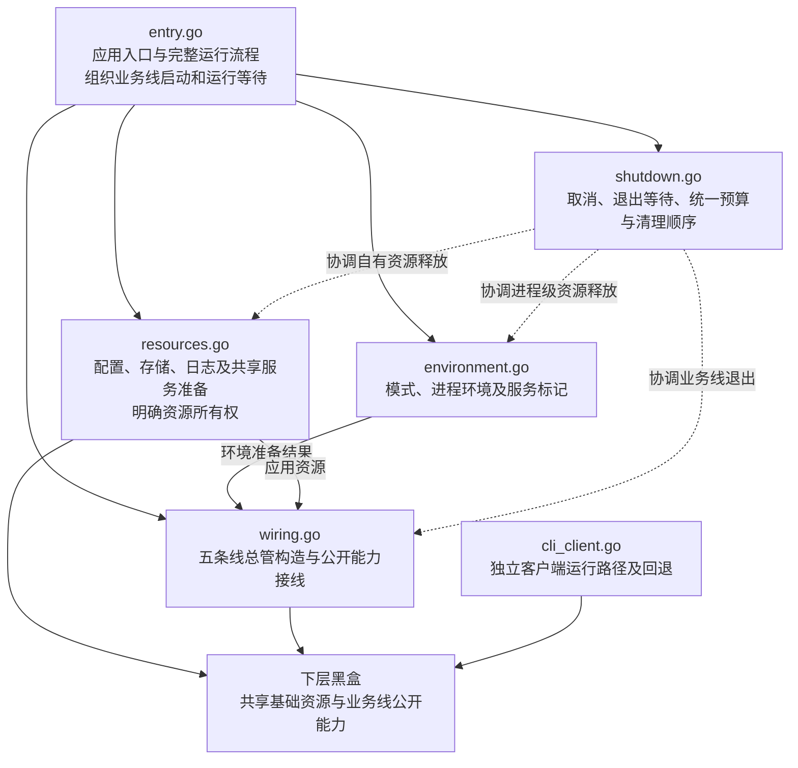

# App 包设计

本文记录 `internal/app` 已确认的文件职责，任务进度见[任务清单](tasks.md#app-包架构梳理)。`entry.go` 已写入启动参数、业务线集合和三个入口侧函数的占位骨架，其余五个文件仅有包声明与职责注释，当前没有可运行的 App 入口。

## 范围与原则

- 从入口向下设计，App 内部采用扁平文件组织，不新增子包或层层工厂。
- 五条业务线和共享基础资源均作为黑盒，当前不展开下层实现或接线细节。
- 六个文件的名字和职责已确认；字段、函数名和签名从 `entry.go` 开始逐项讨论，在对应 Go 文件中记录，不在本文展开。
- 完整骨架确认前不填入实现。后续函数体先写几句职责说明和 `pass`，暂不处理未实现代码导致的报错。
- 原生产文件与测试文件同样备份为 `原名.bak`；测试随对应职责与接口确定后再讨论。
- 更新该文档时，有新的进度就直接把之前的中间进度或者临时进度删了，只保留最新状态

## 已确认的文件划分

| 文件 | 负责什么 | 不负责什么 | 与其他文件的关系 |
|---|---|---|---|
| `entry.go` | 应用入口与完整运行流程，组织准备、装配、启动、等待和退出 | 资源构造细节及下层业务实现 | 调用环境、资源、接线及退出协调；业务线启动与运行等待由入口组织 |
| `environment.go` | 运行模式、进程环境及服务进程标记 | 业务线内部环境适配 | 向入口提供环境结果，已取得的进程级资源纳入退出协调 |
| `resources.go` | 配置、存储、日志和共享服务准备，明确资源所有权 | 业务线启动顺序与内部接线 | 向接线步骤提供基础依赖；部分准备失败时也明确已取得资源的清理责任 |
| `wiring.go` | 五条线总管的创建与公开能力接线 | 下属组件实现、内部对象分配、应用退出策略 | 消费准备结果，向入口交付已构造的业务线 |
| `shutdown.go` | 取消、等待退出、统一退出预算及资源清理顺序 | 越过资源所有者释放其下属对象 | 协调业务线、应用资源和进程级资源的退出与释放 |
| `cli_client.go` | 独立 CLI 客户端运行路径及回退处理 | 默认启动本地完整业务线 | 与本地应用入口区分运行路径，具体协作接口待讨论 |

六个文件代表职责划分，不意味着每个文件都需要独立对象或一套 Factory、Request、Components。入口的业务线集合只持有五条线总管；环境和共享资源的结构与持有关系继续在对应骨架讨论中确认。

## 文件协作关系

下图表示已确认的职责方向，不是当前已经实现的调用链；入口函数仍以职责注释和 `pass` 占位。

## 备份与当前进度

`internal/app` 下共有 25 份原样备份：13 个生产文件和 12 个测试文件，均使用原文件名加 `.bak`，例如 `app.go.bak`、`runner_test.go.bak`。备份不参与 Go 构建，仅供新架构确认后参考。

生产备份包括 `app.go.bak`、`runner.go.bak`、`dependencies.go.bak`、`environment.go.bak`、`foundation.go.bak`、`models.go.bak`、`services.go.bak`、`wiring.go.bak`、`platforms.go.bak`、`integrations.go.bak`、`lifecycle.go.bak`、`cli_client.go.bak`、`service_marker.go.bak`。

`entry.go` 已记录当前确认的字段、签名和运行约定，函数体均以职责注释和 `pass` 占位。总管按各业务线根包的目标类型 `Supervisor` 引用，下层类型声明尚未调整；运行模式定义、启动顺序及其余五个文件的骨架仍待讨论。此阶段暂不处理未完成代码的报错，不运行编译或 Go 测试。

## 后续顺序

1. 从 `environment.go` 继续讨论字段、函数名、签名及资源持有关系，在对应 Go 文件中写明职责注释和 `pass` 占位。
2. 自顶向下补齐其余文件的骨架，结合接线依赖确定启动顺序，检查准备、装配、运行和退出是否连贯，资源归属是否明确。
3. 全部架构与骨架确认后，再参考对应 `.bak` 文件，按新职责填入实现；参考来源可以与新文件不同名，不按旧文件整块恢复。
4. 对应职责与接口确定后，再讨论适用的测试；旧测试保留作参考。
