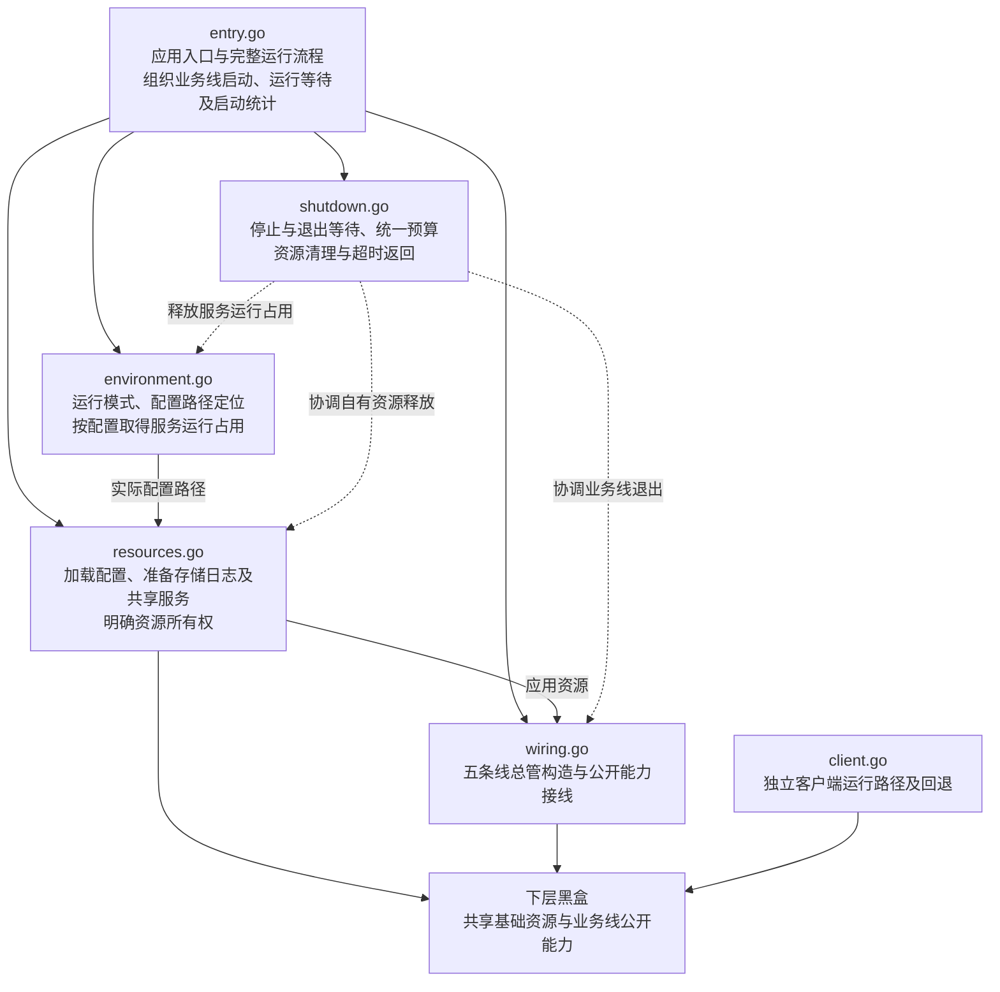

# App 包设计

本文记录 `internal/app` 已确认的文件职责，任务状态见[任务清单](tasks.md#app-包架构梳理)。六个文件的骨架已完成，包含启动耗时统计与业务线启停约定；函数体仅保留职责注释和 `pass`，当前没有可运行的 App 入口。

## 范围与原则

- 从入口向下设计，App 内部采用扁平文件组织，不新增子包或层层工厂。
- 五条业务线和共享基础资源均作为黑盒，当前不展开下层实现或接线细节。
- 六个文件的名字、职责、类型、字段和函数签名已确认，具体定义记录在对应 Go 文件中，不在本文展开。
- 当前仅保留骨架，函数体使用职责注释和 `pass`；实现阶段按已确认职责参考备份填充，暂不处理未实现代码导致的报错。
- 原生产文件与测试文件同样备份为 `原名.bak`；测试随对应职责与接口确定后再讨论。
- 更新该文档时，有新的进度就直接把之前的中间进度或者临时进度删了，只保留最新状态
- 每讨论完一个文件就先写入

## 已确认的文件划分

| 文件 | 负责什么 | 不负责什么 | 与其他文件的关系 |
|---|---|---|---|
| `entry.go` | 应用入口与完整运行流程，组织准备、装配、启动、等待和退出，以及启动耗时统计 | 资源构造细节及下层业务实现 | 调用环境、资源、接线及退出协调；业务线启动与运行等待由入口组织 |
| `environment.go` | 本地运行模式、实际配置路径定位，以及按配置取得服务运行占用 | 配置内容加载、业务线内部环境适配 | 向入口返回实际配置路径和服务占用句柄；路径交给资源准备，句柄纳入统一退出协调 |
| `resources.go` | 按已定位的路径加载配置，准备共享存储、日志、媒体、权限和模型管理，明确资源所有权 | 平台聊天历史的存储生命周期、业务线启动顺序与内部接线 | 消费环境阶段定位的配置路径，向接线步骤提供基础依赖；部分准备失败时也明确已取得资源的清理责任 |
| `wiring.go` | 五条线总管的创建与公开能力接线，构造和接线分步组织 | 下属组件实现、内部对象分配、应用退出策略 | 消费准备结果，向入口交付已构造的业务线 |
| `shutdown.go` | 业务线停止、退出等待、统一退出预算及资源清理顺序 | 越过资源所有者释放其下属对象 | 协调业务线、应用资源和进程级资源的退出与释放 |
| `client.go` | 独立客户端运行与自动尝试的回退判断 | 构造本地业务线、直接回退启动本地应用 | 向进程入口返回客户端结果或回退信号，由入口决定是否启动本地应用 |

六个文件代表职责划分，不意味着每个文件都需要独立对象或一套 Factory、Request、Components。入口的业务线集合只持有五条线总管；环境准备直接返回配置路径和服务占用句柄，不新增环境结果结构体。共享资源由资源准备阶段创建，部分准备失败时也交回入口统一清理；共享存储由 App 协调生命周期，数据读写规则归各使用方。平台聊天历史及其存储生命周期归平台总管，由接线阶段连接查询与清理能力。接线产生的订阅等对象由对应总管或服务持有和释放，全部构造与接线完成后再由入口启动业务线。

## 文件协作关系

下图表示已确认的职责方向，不是当前已经实现的调用链；已定义的函数仍以职责注释和 `pass` 占位。

## 备份与当前进度

`internal/app` 下共有 25 份原样备份：13 个生产文件和 12 个测试文件，均使用原文件名加 `.bak`，例如 `app.go.bak`、`runner_test.go.bak`。备份不参与 Go 构建，仅供新架构确认后参考。

生产备份包括 `app.go.bak`、`runner.go.bak`、`dependencies.go.bak`、`environment.go.bak`、`foundation.go.bak`、`models.go.bak`、`services.go.bak`、`wiring.go.bak`、`platforms.go.bak`、`integrations.go.bak`、`lifecycle.go.bak`、`cli_client.go.bak`、`service_marker.go.bak`。

六个文件的骨架已完成。入口负责启动总耗时与四个阶段的 debug 耗时统计，按已确认依赖顺序启动业务线；退出阶段先停止新工作，等待使用方收尾后再释放依赖。退出使用独立清理上下文和统一 30 秒预算，超时立即返回具体业务线或资源的错误，由进程入口输出到 stderr 后强制退出。独立客户端的明确运行与自动尝试分为两个入口，实际回退由进程入口决定。函数实现、下层目标类型及进程入口适配尚未完成，此阶段不运行编译或 Go 测试。

## 后续顺序

1. 按已确认的骨架职责参考 `.bak` 文件填入实现，参考来源可以与新文件不同名，不按旧文件整块恢复。
2. 实现时衔接下层目标类型和进程入口，包括已确认的 `client` 命令命名。
3. 随对应职责与接口实现补充适用测试，旧测试保留作参考。
