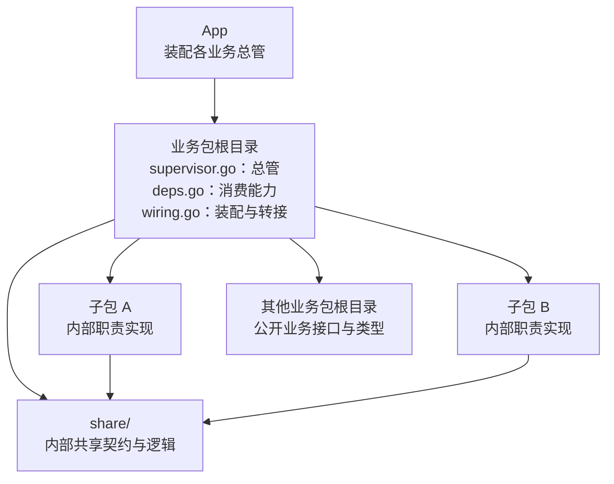
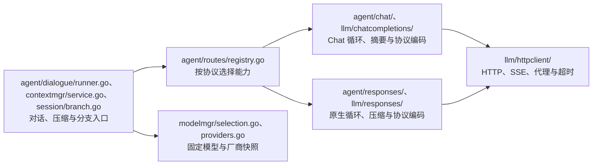
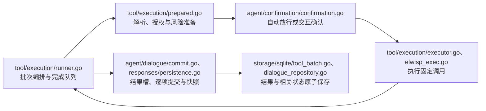

# ElBot 架构说明

本文说明当前模块职责、调用链和关键约束；文件入口见[代码地图](code-map.md)。

<!-- locator:architecture-principles -->
## 架构原则

> **保护规则：除非用户明确要求，否则不得修改或删除本节任何内容，包括本保护规则、以下原则及依赖图。**

以业务包为边界：根目录负责对外和装配，子包负责内部实现，`share` 负责内部协作契约。这里的业务包指 Agent、Tool、Background 等模块；标准库和公共基础设施依赖不属于“兄弟子包必须通过 `share` 协作”的限制范围。

1. **根目录是业务包的管理与对外边界。** 总管持有内部组件，统一负责构造、接线和生命周期。外部通过根目录提供的业务能力使用这个包。

2. **对外接口和类型定义在根目录。** 提供方在根目录公开业务方法及请求、结果类型；消费方在自己的根目录声明所需能力接口。只暴露实际需要的业务能力，不通过 getter 泄露内部 Manager、Registry、Runner 等组件，也不把内部操作逐项包装成公开方法。

3. **`share` 只服务本业务包内部。** 放置多个子包共同使用的类型、接口、常量及必要的共享逻辑。不是跨业务包的公共 API，也不是子包独有逻辑。若太大，可以考虑拆分。

4. **同一业务包的子包通过 `share` 协作。** 子包不直接依赖兄弟子包的实现。需要协作时，通过 `share` 中的契约表达所需能力，由根目录连接实现。普通接口调用即可完成协作，不要求引入消息总线。
5. 外部能力按实际需要接入。子包确实需要某个外部包公开服务的完整业务能力时，可以直接引用其公开接口或服务类型。若只需要部分能力，应由本业务包根目录接入并裁剪，通过最小接口或函数注入子包，不向子包交付完整服务，也不提供取得完整服务的 getter。单个子包独用的消费契约放在该子包。完整能力以当前实际职责为依据，不以接线方便或未来可能使用为依据。
6. **依赖方向保持单向。**根目录可以依赖本包子包和 `share`；子包可以依赖本包 `share`；`share` 不反向依赖根目录或具体子包。子包不能为了获得能力而反向引用总管，跨业务包也不能形成循环依赖。

图中箭头表示代码依赖方向。运行时子包可以调用注入的能力，但不因此依赖能力的具体实现包。

## 定位方法

按[代码地图的定位方法](code-map.md#定位方法) 搜索 locator，只读对应章节。

<!-- locator:startup -->
## 启动与装配

App 加载配置、持有共享存储和独立历史库、装配各业务总管并协调启停；媒体和模型服务接收完整配置，自行初始化。Platform 写入历史，Tool 直接查询。

- 启动顺序为 Tool → Agent → Hook → Platform → Background。构造失败时，部分对象也纳入清理；订阅由接收方持有和释放，借用资源由所有者关闭。
- 退出先停止接入，等待在途工作，再释放依赖；平台发送能力、媒体和存储须保留到使用方退出。统一关闭预算为 30 秒，普通错误汇总后继续，预算耗尽则停止后续释放。取消或 Close 超时不代表实际退出，Done 必须等待工作结束。
- TUI／Service 按解析后的配置路径取得独占锁，防止同配置重复启动；锁在资源关闭后释放，超时交由进程退出释放。
- Platform 负责客户端连接与回退分类；只有默认入口收到明确回退信号才启动 TUI，显式 client 不回退。main 处理进程信号与退出码，Launcher 只解析命令。

<!-- locator:contextinfo -->
## 公共上下文事实

`contextinfo` 提供 Conversation（平台会话与来源）、Actor（身份与权限角色）、Execution（执行关联）、Model（固定模型选择）和 BackgroundKind（后台来源）快照；缺失事实不补全局默认值，不携带凭据、服务或原生载荷。

- 平台会话与 ElBot Session 分开；公共事实不能替代权限、binding 或 attempt 校验。平台私有路由归 Platform，Agent 只消费自有输入。
- 接管替换来源、身份、模型及输入，通过 Platform 恢复平台上下文；来源缺失时清除，保留取消链。后台普通输出静默，显式目标发送可用。
- 后台来源与路径限制独立；接管清除后台来源及调用级路径范围，保留 Session 工作目录。

### 公共工作路径

`workspace` 统一目录选择与路径解析：调用级 PathScope → Session 目录 → 进程工作目录。受限范围缺目录必须报错，不能回退；失效 Session 目录按原值条件清除，避免覆盖并发切换。

Background 创建任务目录并注入范围，文件工具与 Shell 共用目录规则。受限路径拒绝绝对路径及 `..` 等越界形式；路径解析不替代实际打开边界，媒体与报告附件通过 `os.Root` 打开。媒体缓存独立于 Session 工作目录；持久化与清理由所属业务负责。

<!-- locator:signal -->
## 信号与订阅

来源拥有信号，消费者拥有订阅。关键提交、权限、Hook、用量及工具记录同步完成，观察信号不承担业务提交。

- 分发有界、同 key 串行，队满拒绝；取消或超时不提前释放仍在运行的执行槽。断开不撤销已取得的订阅快照，关闭等待已接纳回调真实退出。
- 平台连接事件不缓存或重放，消费者自行排队、去重和管理生命周期。
- 日志由来源确定身份、等级、结果与正文，业务错误与日志结果独立；日志失败不改变重试或业务判断，错误转交不重复记账。日志中心负责有界排队、落盘及查询，设施故障直接报告 stderr，关闭超时不释放仍在使用的资源。

<!-- locator:config -->
## 配置与运行数据

配置包统一默认值、合并与校验，不依赖具体业务模块。查找顺序为 `--config → ELBOT_CONFIG_FILE → 平台配置目录`；文件职责及生效时机见[配置文档](../docs/configuration.md)。

- app.toml 管主配置，providers.toml 管模型客户端，state.toml 管命令修改的模型状态；协议 chat／response 与 Session 模式 chat／work／background 独立。
- 厂商刷新只重读厂商配置、模型元数据及凭据，不重读主配置或模型状态；准备失败保留旧快照。
- `/doctor` 为超管只读诊断，不初始化文件或启动 runtime。

<!-- locator:agent-chat -->
## Agent 对话链路

`平台输入 → 唤醒／入站 Hook → 命令或输入准备 → 执行准入 → 单轮准备 → 模型／工具循环 → 回复提交 → 跨轮收尾`。

| 层 | 职责 |
|---|---|
| Input | 消息、命令、补全及前后台输入准备 |
| Execution | 准入、Request／attempt、确认、pending、压缩交接与跨轮结果 |
| Dialogue | 单轮准备、路线选择、公共协作、回复提交与失败报告 |
| Chat／Responses | 协议上下文及模型／工具循环 |

- 准入固定模型 Selection 和执行归属；普通模型切换不影响在途循环，前台接管刷新后续调用的模型、工具与来源。
- 工具阶段的新输入进入 pending，在下次模型请求前合并；最终模型调用期间的 pending 留到下一轮。
- 用户输入、工具记录和状态通过共同提交口保存，事务内复核 binding、活跃 Execution／attempt；Responses 同时复核 checkpoint。
- 单轮成功后合并保存活动时间与用量，再处理压缩、pending、命名及跨轮结果。单轮 Runner 不结束跨轮 Execution。

### Agent 包边界

Agent 总管持有 Session、Request、Turn、协议路线与订阅，对外提供对话、后台执行、会话复制／清理及 Hook 接入能力，不暴露内部组件。Background 只准备任务目录和来源，复用 Agent 执行链。

输入、执行协调、确认、Hook、输出、工具桥接与协议循环分工；公共 Prompt、ToolRun、消息事务及回复提交由 Dialogue 提供，协议私有状态留在各路线。工具目录、预载和 schema 由 Tool 提供，Agent 不维护另一套来源。

<!-- locator:protocol-routing -->
## 协议路线与原生上下文

模型 Selection 固定客户端、模型、Origin 与窗口快照。主对话按当前 Origin 选择路线，压缩和分支按持久化源 Origin 选择能力；独立文本生成不续主会话或执行工具。

Chat 可跨 Chat provider 切换；Responses 只允许同一 provider 节点内换模型，跨协议或涉及 Responses 的跨 provider 切换拒绝。provider 节点名表示厂商身份，URL 变化不抹去历史来源。

### 主调用链

### 公共协作与事件

两条路线共用 Prompt、Hook、ToolRun、媒体与提交能力。每次实际模型请求结束时发布一次原始用量与完成事实，先于 response Hook；准备失败不计调用，恢复请求独立计量，HTTP 重试另记事实。

### Responses

- 业务消息保存正文与 segments，原生记录保存 items、推理材料及 checkpoint；保留未知 items。失败、取消、incomplete 或提前 EOF 不推进 checkpoint，也不执行中断流中的工具调用。
- 默认沿 previous_response_id 发送增量；store=false 发送完整窗口且不带旧链 ID。URL 改变或明确旧链失效且尚无新内容时，才可按已存材料重建；旧链失效仅重试一次，不重跑历史工具。网络、鉴权、含糊错误或部分流不触发恢复。
- 工具定义以 developer additional_tools 冻结并随历史回放，同名定义变化要求新会话；不发顶层 tools，调用仍按当前权限校验。Hook 不得改工具调用集合、ID、名称及参数。
- 副作用前保存原生响应和固定结果槽，逐项提交结果，最后封存不可变批次快照。中断批次保留完成项，其余标为未知，不自动重跑工具、完成 Hook 或发送；Fork／后台副本只使用封存批次。
- 原生窗口在同一读取事务取得；首个 checkpoint 成功才消费 seed。恢复依赖归档材料，缺推理或原生材料时拒绝，不从历史 HTTP 正文反向恢复。

<!-- locator:commands -->
## 命令链路

`CommandExecutor → Router → command.Handler → 领域服务`。Agent 统一注册内置及 Hook 提供的命令，执行器统一发送结果和错误通知；用法见[命令文档](../docs/commands.md)。

- 改变 Session 的命令声明 SessionEffect，执行器协调压缩／确认冲突，Session 判断绑定规则。
- 普通用户查询与停止限定当前 Session，超管可管理全局；取消仍复核原 binding 和目标请求。
- 结果成功发送后才执行 Continuation；通知保留原会话与连接，不依赖可能失效的旧 binding。

<!-- locator:request-turn -->
## Request、Turn 与状态

Request 管请求树、取消及超时；Turn 管单轮阶段、pending、确认及工具计数；Execution 管跨确认／压缩的执行身份、接管快照和一次性结果，attempt 隔离迟到完成。

- 取消仅进入 stopping，实际工作退出后才释放归属。续跑在会话锁外等待旧 attempt，重新核验 binding，不重复输入准备或 Hook；续接期间的 pending 仍算忙碌。
- 确认先登记等待对象，再锁外发提示；响应、取消及迟到清理必须对应同一对象。
- StatusRecorder 唯一持有当前 usage，校验执行归属并发布单调版本；展示、压缩判断及轮末持久化读同一来源。未知用量不覆盖已知值，退役执行的迟到事件不能重建状态。

<!-- locator:tool-flow -->
## 工具调用链路

`初始化结果槽 → 顺序准备／确认 → 并发执行 → 按返回顺序逐项提交 → 按原调用顺序续跑模型`。

- 准备不产生业务写入，固定参数、目标、风险和预览；等待确认不持有锁。自动确认及已授权直接调用也不绕过准备，执行前复核取消和批准内容，业务提交再核验目标、revision 与权限绑定。
- 通过确认即启动 worker，后续准备／等待期间继续处理完成队列。协调器唯一修改共享 Session 状态；单工具失败不停止其他调用，整轮取消则取消并等待全部 worker。
- 副作用前保存整批调用及稳定结果槽；结果、统计、媒体引用与发现状态逐项原子提交，全部完成才续跑模型。返回后但提交前中断仍视为未知，保存失败不重做已完成动作。
- 准备及完成处理前应用接管快照；已准备调用的权限与沙箱固定，发送使用最新去向。完成 Hook 只处理实际执行结果；Chat 可改工具参数，Responses 保持原生调用不变。
- 请求拥有的外部命令由 processenv 统一取消进程树，并等待输出收集退出；已脱离进程组的守护进程和远端已提交动作不在取消保证内。
- 实际调用的开始／结束审计先于后续发送、Hook 和提交，保留原始执行结论，日志摘要不截断业务结果。

<!-- locator:tool -->
## Tool Runtime、工具状态与文件

Tool 拥有目录、schema、风险准备、执行与工具状态；Permission 决定拒绝、放行或确认，Agent 承接交互。内置工具表达业务规则，根部适配存储、模型、媒体等外部能力。

- 首次 Skill 扫描由目录消费方共享等待，单个等待者取消不取消扫描；加载错误不能解释为工具不存在，重载失败保留旧目录。
- Session 的 discovered_tools 完整声明是已发现工具的唯一事实，不按当前目录重建 schema。发现／预载状态与对应材料或工具结果原子提交，成功后才更新执行快照。
- Registry 统一筛选协议、模式与权限资格。Chat 不开放工具，Work 可通过基础 discover_tool 发现，Background 使用预载声明；标签授权声明不因当前运行资格而缩减。
- fileops 统一编辑／撤销。提交锁顺序为目标路径 → Scope → SessionID → 备份状态；复核绑定、取消、权限、真实目标及 revision 后写入批准内容。等待确认不持锁，成功写入才登记撤销，后台不登记前台备份。
- ELyph 首次展示状态与携带规则的消息一起提交，同 Session 共享，压缩后的新 Session 重置。Cron 定义由 Tool 写入并发布变更事实，调度归 Background。

### 公共资料与媒体边界

数据库是已提交会话的事实来源。来源入口归档媒体后交出 MediaID；Dialogue 负责公共消息投影与请求副本，Chat／Responses 负责协议编码。

工具完整正文与 segments 提交成功后才进入活跃上下文。URL／base64 只用于当次请求，不回写归档；Chat 工具图片派生为后续 user 多模态输入，不另存派生消息，Responses 编码原生工具结果。

<!-- locator:media -->
### 媒体引用与清理

Media 统一管理内容寻址对象及使用生命周期：object 管对象、引用和回收，transfer 管来源导入及模型／发送交付，backend 管存储读写。

- 内部归档与协作使用 MediaID，外部来源在协议入口分类。会话、工具参数及后台引用随所属业务事务提交，Media 不接管这些写入。
- 请求与发送取得媒体持有，使用者关闭读取器并在实际结束后报告 UsageID；清理失败保留待重试，不因业务取消丢失释放记录。App 等消费者退出后关闭 Media，再关闭存储。
- 对象不可用可按交付规则降级为文本，关闭、回滚等独立故障不能混入降级吞掉。
- 清理认领与新增引用互斥；历史对账只删除确认失效的关联，查询或引用释放失败则停止后续回收。最后引用释放后保留宽限期，按远端、本地、记录顺序删除，失败可重试。

<!-- locator:skill -->
## Skill

Skill 将文档或可执行技能接入 Tool 目录。Manager 负责扫描、注册、修改及重载；扫描只发现候选，注册成功后才发布新目录，失败保留旧目录。

- 修改操作串行协调，准备／确认及普通运行不持写锁；文件修改复用 fileops，manifest 提交后重载失败恢复原文件。
- 命令与 Go runner 在技能根目录执行，环境合并遵循[配置文档](../docs/configuration.md#环境变量与进程环境继承)。
- 媒体在执行阶段准备，输出经受限打开导入 Media。共享导出缓存由维护任务清理，调用私有目录随媒体使用结束释放；超限输出继续排空，不解析残缺 JSON。

<!-- locator:hook -->
## Hook

Hook 根部负责外部接入与装配；pipeline 编排续接、规则及错误钩子，rules 执行动作，runtime 管进程、RPC、waiting 和共享状态，control 管查询与重载。协议及配置见 [Hook 文档](../docs/hooks.md)。

- Agent 注册一组业务回调，只交付事实与数据，不构造插件协议 Event 或维护第二套规则流水线；每个实际 handler 独立登记 Request。
- 入站先计算唤醒并检查原始取消命令，再尝试 waiting 续接和普通规则，完成后才进入命令／模型流程。改写不重新计算唤醒，改写后的取消命令仍须检查。
- 同一 pipeline 按优先级及注册顺序串行运行；只读策略逐动作校验，llm.messages 只读，turn／request Hook 分别只改初始 user／新 pending，保存后才调用模型。
- 重载先验证候选再替换，异步进程失败交 runtime 恢复。关闭停止新接入，保留在途生产者需要的回调，等待进程、请求及媒体租约操作实际退出后清理。

<!-- locator:output -->
<!-- locator:notification -->

## 输出与发送

`platform/dispatch.Router → 平台发送器` 统一路由正文、媒体、Hook 输出和后台报告。SendChat 回复原会话，SendTo 使用明确目标，返回实际回执；推理流通过公共 delivery 契约交给平台展示。

- `delivery.MessageSender` 是普通发送契约；`Manager` 在发送前校验输出并复用校验返回的批次目标，显式目标优先。表情名称在该边界校验为非空。
- `Output.Delivery` 使用值类型 `DeliveryInfo` 保存发送时机与 Hook 来源；降级文案由 `FallbackText` 统一计算。
- 回复先执行展示 Hook 并发送正文，再保存模型原文与成功回执关联，最后发送附加输出。部分失败保留已成功回执，不重发成功内容。
- Dialogue 统一归一终态并报告失败，前置失败由负责入口报告，错误转交不重复通知；通知保留原会话并解除请求取消和旧 binding。是否静默取消依据实际请求状态，不能只看错误类型。
- 通知只接纯文本，显式目标优先；各平台独立排队、同目标有序，共用覆盖排队与发送的期限，队满拒绝不自动重试。入队不等于送达，观察状态不承担提交。
- 思考流按实际增量刷新接管来源，不重放历史；展示失败不改变业务结果。

<!-- locator:platform -->
## 平台适配

Platform 负责输入归一化、历史落库、引用恢复及实际发送，支持 CLI、OneBot、QQ Official、Telegram 和 headless。根部持有适配器，向消费者交付最小发送、原生 API 或媒体能力。

- 原始 segments 先写历史，仅在唤醒或 waiting 续接时物化媒体。引用依次从输出关联、历史和平台能力恢复；最后一条同身份／平台／scope 的 assistant 引用触发 Resume，较早回复触发 Fork。
- 停止接入后保留发送能力，WaitIngress 等待接入及回调退出，Close 最终释放资源。Service 中各平台退出互不影响，全部退出仍等外部停止；本地 TUI 退出结束整线，headless 不承担常驻等待。
- CLI 默认回复固定原连接，断开即失败；展示按绑定和状态版本拒绝迟到事件，已开始发送允许完成。其他平台也须保留部分成功回执，协议私有身份映射留在适配器内。
- Chat History 由 App 持有，Tool 直接查询，Media 负责对象与历史关联；Platform 不包装历史查询／清理服务，Agent 通过输入携带的延迟解析能力取得媒体。

<!-- locator:session -->
## Session 生命周期

Session 唯一管理 current 与 Binding：control 管会话业务及过期，binding 管准入，branch 管 Fork／压缩／后台复制，naming 管命名。

- 切离使旧 binding 永久失效，切回建立新 binding；删除使相关绑定全部失效。准入锁顺序为 Scope → 排序 SessionID → 状态锁，模型、工具、Hook、发送及一般信号在锁外。
- ForegroundActivated 是例外：接管提交后、释放准入前同步交付，仅更新执行内存，不做 I/O 或再次准入；派发失败不回滚接管。展示用 BindingChanged 在锁外发布，必要释放不依赖观察者成功。
- 后台身份只由 Mode 决定，不从来源或接管历史猜测。后台准备不激活 current；永久接管转为前台 work，保留历史与 workspace，在途调用不重启，后续调用和发送刷新来源，并解除后台自动汇报要求。
- 管理访问中 CLI 可跨用户／平台，其余入口要求同用户及平台，后台限私聊、前台限同 scope；Fork 和后台压缩仍检查归属，CLI 不豁免。
- 首次主对话准入持久化协议及厂商归属，失败拒绝调用；派生会话继承归属。Fork／复制锁外准备、提交复核状态与 checkpoint，Session、消息、seed 和媒体引用原子保存；副本不继承运行状态，不重跑工具。
- 活动事实包含 Request、Turn、独立 Hook、确认等待及 stopping。过期计时由有效输入和真实执行收尾驱动，忙碌项等待退出；过期仅解绑、保留历史，恢复不恢复旧授权。
- 命名归应用生命周期，Turn 结束不取消；取消后不写标题或 fallback，命名不刷新闲置期限。

<!-- locator:llm -->
## 模型服务与客户端

modelmgr 唯一管理模型模式／槽位、厂商客户端、目录与窗口快照。App 负责关闭，消费者只取得所需能力；httpclient 管传输、代理、重试和 SSE，协议客户端管鉴权、编解码及终态。

- 厂商重载全部准备成功后原子发布；在途请求继续使用旧快照，旧请求不回写新缓存。模型切换先持久化 state.toml，再发布内存，失败保留旧选择。
- 窗口按远端元数据 → 手工配置 → 配置默认值解析。命名与摘要固定自己的模型及 fallback，Prepared Hook 不改模型身份。
- 只重试可取消的初始交换，断流不重放；Extra 只补字段，重名发送前拒绝。
- 用量使用可空 int64：未知与明确零分开，不推算缺失总量，非法用量不使响应失败。

<!-- locator:context -->
## 上下文与压缩

contextmgr 管历史、用量、阈值和压缩分派；协议 Compactor 准备材料，Execution 交接，Session 保存并切换会话。公共 Prompt 组合 Soul、记忆与工具等材料，不写入对话历史。

- 压缩中拒绝输入、允许停止；交接复核取消、binding、接管及 checkpoint，先保存新 Session 再切 current，后台保持无 current。新会话继承 workspace 与命名信息，清除旧用量。
- Chat 用文字摘要并保留历史用户原话；Responses 用当前模型执行原生加密压缩，不带旧链 ID、不执行工具，首个 checkpoint 成功才消费 seed，保留根材料供恢复。
- 原生压缩失败不降为文字摘要或切换会话。自动压缩后继续已接受输入，手动压缩不自动聊天。
- 轮末合并保存用量与活动时间；未返回用量时保留已知值，保存失败不丢失内存已观测值。

<!-- locator:storage -->
## Storage 与 SQLite

Storage 定义领域模型和仓储契约，SQLite 实现消息、Session、工具、后台任务及原生状态事务。

- 主库使用单连接，工具状态随 Session metadata 合并更新，以保持事务和状态合并简单可靠；实测出现连接等待或编码瓶颈后再调整。
- 新库直接创建最新结构，已有库通过迁移升级。Mutate 在短事务中读最新行、只改负责字段，不做外部 I/O 或嵌套仓储操作；metadata 保留未知字段与数值精度，损坏数据拒绝读写。
- segments 是结构来源，content 是文本投影；工具调用与结果保持稳定关联，复制时重映射 ID。
- 原生材料独立保存，关键提交比较 checkpoint，原子合并消息、seed 消费和媒体引用。查询保留平台及派生范围隔离。

<!-- locator:elnis -->
## Elnis / Elvena / Elwisp

Elnis 接收事件，Elvena 定义公共协议，Elwisp 提供外部事件与工具；Elnis 复用 Background 执行入口和公共发送能力。

Elnis 解释协议与业务状态，Background 根部适配存储、媒体和平台能力，Storage 完成回执及引用事务。接收、去重、outbox 与恢复见 [Elnis 架构](elnis-elwisp.md)，配置和示例见[使用文档](../docs/elnis-usage.md)。

<!-- locator:cron -->
## Cron 与后台任务

Background 管调度、执行入口、报告投递及维护。execution 准备目录和后台来源并调用 Agent，cron／elnis 负责各自报告解析与恢复，maintenance 执行清理；不取得 Agent 的内部 Session 或执行器。

- Tool 写任务定义并发出变更事实，Cron 串行重读最新记录刷新调度，启动期间变更不能丢失。执行记账只更新本次任务 ID 的运行事实，不覆盖配置或记入同名重建任务。
- 启动先恢复与加载调度，再开放平台恢复消费；同平台通知串行。致命运行故障及时交 App，单次任务或投递失败不升级为整线故障；关闭等待执行、投递和收尾真实退出，不关闭借用资源。
- 每次调度新建后台 Session，同轮修正复用会话、首轮工具与模型；前台接管后等待真实 Execution 结果，停止后台修正、自动报告及未开始补投递。后台沙箱非 critical Shell 可自动确认，critical 拒绝。
- 任务执行与报告投递分开：已有报告恢复时直接复用，不重跑模型；报告状态与实际回执原子提交，迟到回执保留消息映射但不覆盖新状态。一次性任务在待投递内容完成后才禁用。
- NeedReport 仅控制正文，附件仍投递；禁止正文时，附件失败不降级为文字。附件通过任务目录内的受限打开导入 Media，下游只接收 MediaID。
- 报告落库前可能重新执行，发送成功但回执未落库时可能重复投递；不承诺恰好一次。
