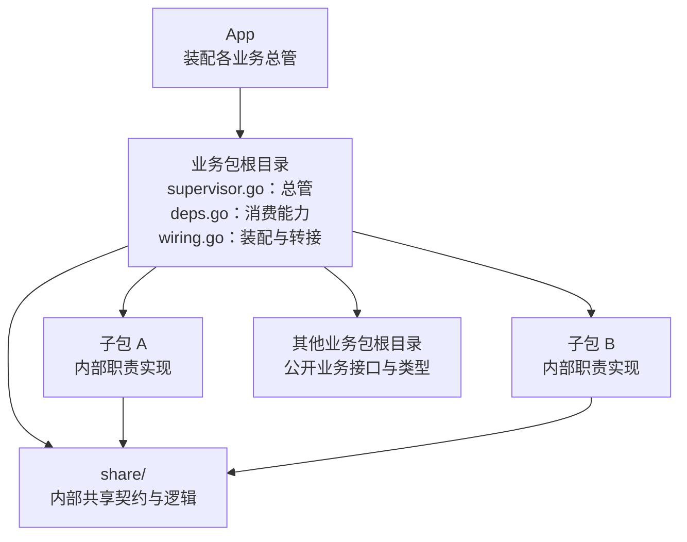

# ElBot 架构说明

本文说明当前模块职责、调用链和关键约束；文件入口见[代码地图](code-map.md)。

<!-- locator:architecture-principles -->
## 架构原则

> **保护规则：除非用户明确要求，否则不得修改或删除本节任何内容，包括本保护规则、以下原则及依赖图。**

以业务包为边界：根目录负责对外和装配，子包负责内部实现，`share` 负责内部协作契约。这里的业务包指 Agent、Tool、Background 等模块；标准库和公共基础设施依赖不属于“兄弟子包必须通过 `share` 协作”的限制范围。

1. **根目录是业务包的管理与对外边界。** 总管持有内部组件，统一负责构造、接线和生命周期。外部通过根目录提供的业务能力使用这个包。

2. **对外接口和类型定义在根目录。** 提供方在根目录公开业务方法及请求、结果类型；消费方在自己的根目录声明所需能力接口。只暴露实际需要的业务能力，不通过 getter 泄露内部 Manager、Registry、Runner 等组件，也不把内部操作逐项包装成公开方法。

3. **`share` 只服务本业务包内部。** 放置多个子包共同使用的类型、接口、常量及必要的共享逻辑。不是跨业务包的公共 API，也不是子包独有逻辑。若太大，可以考虑拆分。

4. **同一业务包的子包通过 `share` 协作。** 子包不直接依赖兄弟子包的实现。需要协作时，通过 `share` 中的契约表达所需能力，由根目录连接实现。普通接口调用即可完成协作，不要求引入消息总线。
5. 外部能力按实际需要接入。子包确实需要某个外部包公开服务的完整业务能力时，可以直接引用其公开接口或服务类型。若只需要部分能力，应由本业务包根目录接入并裁剪，通过最小接口或函数注入子包，不向子包交付完整服务，也不提供取得完整服务的 getter。单个子包独用的消费契约放在该子包。完整能力以当前实际职责为依据，不以接线方便或未来可能使用为依据。
6. **依赖方向保持单向。**根目录可以依赖本包子包和 `share`；子包可以依赖本包 `share`；`share` 不反向依赖根目录或具体子包。子包不能为了获得能力而反向引用总管，跨业务包也不能形成循环依赖。
7. 数据流转与边界职责原则： 业务数据保真（出口再格式化）：内部流转的业务数据应保持原始精度与完整结构，仅在最终消费端出口处按需转换格式，避免下游被迫反向拆解或猜测。上行状态定性（源头即封装）：自下而上传递的报错、日志等，必须在产生源头直接明确、规范文案及上下文信息，禁止将未定性的半成品抛给上游去判断。

图中箭头表示代码依赖方向。运行时子包可以调用注入的能力，但不因此依赖能力的具体实现包。

## 定位方法

按[代码地图](code-map.md#定位方法)的 locator 查入口；本文只说明职责、依赖、关键数据流和约束。

<!-- locator:startup -->
## 启动与装配

App 持有配置、共享资源及业务总管，负责装配和启停；业务包自行管理内部组件，不关闭借用资源。媒体与模型服务自行解释完整配置。

- 启动：Tool → Agent → Hook → Platform → Background；构造失败也清理已取得资源。
- 关闭：停止接入 → 等待在途工作 → 释放依赖；发送、Media、存储保留到消费者退出。`cancel / Close 超时 ≠ exited`，Done 只表示真实退出。
- main 管信号和退出码，Launcher 管参数解析。相同配置独占运行；仅默认入口可按 Platform 的明确回退信号进入 TUI。

<!-- locator:contextinfo -->
## 公共上下文事实

`contextinfo` 传递 Conversation、Actor、Execution、Model、BackgroundKind 快照，不携带凭据、服务或原生载荷；缺失事实不补全局默认值。平台会话 ≠ ElBot Session，事实快照不能替代权限、binding 或 attempt 校验。

接管刷新来源、身份、模型和输入，保留取消链及 Session 工作目录，清除后台来源与调用级路径限制；平台私有上下文由 Platform 恢复。

### 公共工作路径

`workspace` 统一目录选择：调用级 PathScope → Session 目录 → 进程目录。受限范围缺目录即失败，不回退；路径解析不能替代实际打开边界，受限附件用 `os.Root` 打开。Background 创建任务目录；媒体缓存独立于 Session 工作目录。

<!-- locator:signal -->
## 信号与订阅

来源拥有信号，消费者拥有订阅；观察信号不承担权限判断、业务提交或必要释放。

- 分发有界，同 key 串行；取消不提前释放仍在运行的执行槽，关闭等待已接纳回调退出。平台连接事件不重放。
- 日志源头确定身份、等级、结果及结构化事实，出口只渲染，不反向解析文案。业务错误与日志结果独立，日志失败不改变业务裁决，转交错误不重复记账。
- 用量保留 API 原始值；未知 ≠ 0，不推算缺失值。展示、统计、压缩判断与持久化共用执行状态来源。

<!-- locator:config -->
## 配置与运行数据

Config 统一默认值、合并与校验，不依赖业务实现；文件职责及生效时机见[配置文档](../docs/configuration.md)。

厂商刷新先准备候选，全部成功才发布；失败保留旧快照。模型状态先持久化再发布，在途请求继续使用固定快照。Doctor 只读检查，不初始化文件或启动 runtime。

<!-- locator:agent-chat -->
## Agent 对话链路

`平台输入 → 唤醒／入站 Hook → 命令或输入准备 → 执行准入 → 单轮准备 → 模型／工具循环 → 回复提交 → 跨轮收尾`。

| 层 | 职责 |
|---|---|
| Input | 消息、命令、补全及前后台输入准备 |
| Execution | 准入、执行身份、确认、pending、压缩交接与跨轮结果 |
| Dialogue | 单轮准备、公共模型／工具协作、消息与回复提交 |
| Chat / Responses | 协议私有上下文与模型／工具循环 |

Agent 总管拥有内部组件，只公开业务能力。Background 准备目录与来源后复用 Agent 执行链；工具目录、预载和 schema 由 Tool 提供。

准入固定模型与执行归属。工具阶段的 pending 在下次模型请求前合并；最终模型调用期间的新输入留到下一轮。单轮结束不等于跨轮 Execution 结束。

<!-- locator:protocol-routing -->
## 协议路线与原生上下文

Routes 按 Origin 分派对话、压缩与派生能力；模型 Selection 固定客户端、模型、厂商及窗口快照。独立文本生成不续主会话或执行工具。

- Chat 可跨 Chat provider 切换；Responses 只允许同 provider 节点换模型。provider 节点表示厂商身份，URL 改变不抹去历史归属。
- 两条路线共用 Prompt、Hook、ToolRun、媒体及提交能力；原生材料留在各路线。每次实际模型调用独立计量，完成事实先于 response Hook；准备失败不计调用。

### Responses

业务消息与原生 items／checkpoint 分开保存，保留未知 items；失败或未完整结束的流不推进 checkpoint，也不执行其中的工具调用。

- 默认以 previous_response_id 续链；store=false 使用完整窗口。仅 URL 改变或明确旧链失效、且尚无新内容时可从归档材料重建；旧链失效只恢复一次，不重跑历史工具。材料不足即拒绝，不从 HTTP 日志恢复。
- 工具定义按名称去重并随历史冻结，不因当前定义变化拒绝续聊；执行仍校验当前权限。Hook 不得改变原生工具调用。
- 副作用前保存响应和结果槽；逐项提交后封存批次。中断批次保留完成项，其余视为未知，不自动重跑工具、完成 Hook 或发送；派生只使用封存批次。首个 checkpoint 成功才消费 seed。

<!-- locator:commands -->
## 命令链路

`CommandExecutor → Router → Handler → 领域服务`。Agent 注册命令，执行器统一发送结果；用法见[命令文档](../docs/commands.md)。

Config 拥有前缀规则，Command 提供纯解析／组装，根部向消费者注入能力；平台按钮消费结构化 Action，不解析展示正文。改变 Session 的命令声明 SessionEffect，由执行器协调冲突、Session 裁决绑定；结果成功发送后才执行 Continuation。

<!-- locator:request-turn -->
## Request、Turn 与状态

| 概念 | 职责 |
|---|---|
| Request | 请求树、取消、超时 |
| Turn | 单轮阶段、pending、确认与工具计数 |
| Execution | 跨确认／压缩的执行身份、接管快照与一次性结果 |
| attempt | 隔离同一 Execution 的不同尝试，拒绝迟到完成 |

取消先进入 stopping，真实退出后才释放执行归属。续跑锁外等待旧 attempt，再核验 binding，不重复输入准备或 Hook。

Turn lifecycle 唯一持有状态表和锁；确认先登记再锁外发提示，完成／取消／过期对应同一等待对象。状态读取使用一致快照；StatusRecorder 唯一持有当前 usage，迟到事件不得恢复退役状态。

<!-- locator:tool-flow -->
## 工具调用链路

`保存调用与结果槽 → 顺序准备／确认 → 并发执行 → 按完成顺序提交 → 按原调用顺序续跑模型`。

- 准备不产生业务写入，固定参数、目标、风险与预览；确认期间不持锁。自动放行也经过准备，提交时复核批准内容、目标与执行归属。
- 协调器唯一修改共享 Session 状态；单工具失败不终止其他调用，整轮取消则等待全部 worker 退出。
- 结果、统计、媒体引用及工具状态逐项原子提交，全部完成才续跑模型；动作完成但未提交视为未知，保存失败不重做动作。
- 接管不重启在途调用：已准备调用的权限与沙箱固定，后续调用和发送刷新来源。进程取消等待输出收集退出，不保证撤销远端动作或已脱离进程组的守护进程。

<!-- locator:tool -->
## Tool Runtime、工具状态与文件

Tool 拥有目录、schema、准备、执行和工具状态；Security 裁决拒绝／放行／确认，Agent 承接交互，根部适配外部能力。

- Session 已提交的工具声明是发现状态的唯一事实，不按当前目录重建历史 schema。发现／预载状态与相关材料原子提交后才更新执行快照；加载失败不等于工具不存在。
- Registry 统一筛选协议、模式和权限：Chat 不开放工具，Work 支持发现，Background 使用预载；授权声明不随当前运行资格缩减。
- `fileops` 统一编辑与撤销，准备后锁外确认，提交时复核实际目标、revision 和授权；锁顺序为目标路径 → Scope → SessionID → 备份状态，成功写入才登记撤销。ELyph 首次展示状态与携带规则的消息一起提交，压缩后的新 Session 重置。

### 公共资料与媒体边界

数据库是已提交会话的事实来源。入口归档媒体后传递 MediaID，Dialogue 生成公共消息投影，协议路线负责编码。完整工具结果提交后才进入活跃上下文；URL／base64 只用于当次请求，不回写归档。

<!-- locator:media -->
### 媒体引用与清理

Media 管内容寻址对象和使用生命周期：object 管对象／引用／回收，transfer 管来源导入与交付，backend 管存储读写。

业务引用随所属业务事务提交；使用者在真实结束后释放持有，释放失败保留待重试。清理认领与新增引用互斥，无法确认引用有效性时停止回收；按远端 → 本地 → 记录删除，失败可重试。对象不可用可降级，独立清理故障不能被降级吞掉。

<!-- locator:skill -->
## Skill

Skill 将文档或可执行技能接入 Tool 目录。Manager 管扫描、注册、修改及重载；只有注册成功才发布目录，失败保留旧目录。文件修改复用 fileops，重载失败恢复 manifest；普通执行不持修改锁。命令与 Go runner 在技能目录执行，媒体统一交给 Media。

<!-- locator:hook -->
## Hook

Hook 根部负责外部接入与装配；pipeline 编排，rules 执行动作，runtime 管进程／RPC／waiting／共享状态，control 管查询与重载。协议和配置见[Hook 文档](../docs/hooks.md)。

- Agent 交付业务事实，不构造插件协议或维护第二套规则流水线；每个实际 handler 独立登记 Request。
- 入站：唤醒及原始取消检查 → waiting 续接／普通规则 → 命令或模型。改写不重新计算唤醒，仍检查改写后的取消命令。
- 同 pipeline 按优先级及注册顺序串行；只读策略逐动作校验。重载先验证后替换，进程失败由 runtime 恢复。
- runtime 管等待对象和租约生命周期，取消／到期只处理匹配对象；关闭停止接入，保留在途回调，等待进程、请求和媒体操作真实退出再清理。

<!-- locator:output -->
<!-- locator:notification -->

## 输出与发送

Platform dispatch 统一路由正文、媒体、Hook 输出与后台报告；SendChat 回复原会话，SendTo 使用明确目标，返回实际回执。

回复顺序：展示 Hook → 发送正文 → 保存模型原文及成功回执关联 → 附加输出。部分失败保留已成功回执，不重发成功内容。错误由负责入口或 Dialogue 统一报告，转交不重复通知；通知保留原会话，不依赖已失效 binding 或请求取消链。

通知队列有界、同目标有序，入队 ≠ 送达；观察通知与思考流展示失败不改变业务结果。

<!-- locator:platform -->
## 平台适配

Platform 管输入归一化、历史落库、引用恢复和实际发送；适配器保留协议私有路由，根部公开最小发送、原生 API 与媒体能力。

原始 segments 先写历史，需要唤醒或续接时再物化媒体；引用从输出关联、历史和平台能力恢复，最新同身份／平台／scope 的助手回复触发 Resume，较早回复触发 Fork。停止接入与关闭发送分开，先等接入退出，再最终释放资源。

Chat History 由 App 持有、Tool 直接查询；Platform 不包装查询服务，Agent 通过输入中的延迟解析能力取得媒体。

<!-- locator:session -->
## Session 生命周期

Session 唯一管理 current 与 Binding：control 管会话业务及过期，binding 管准入，branch 管派生，naming 管命名；根部决定 ID 与创建来源，Storage 提供全局序号。

- 切离使旧 binding 永久失效，切回建立新 binding。锁顺序：Scope → 排序 SessionID → 状态锁；外部 I/O 在锁外。
- ForegroundActivated 是例外：接管提交后、释放准入前同步更新执行内存，不做 I/O 或再次准入；观察用 BindingChanged 在锁外发布。
- 后台身份由 Mode 决定，后台准备不激活 current；接管转为前台 work，保留历史与 workspace，停止后台自动报告。
- 首次主对话准入固定协议及厂商归属，派生继承；派生锁外准备，提交复核 binding／状态／checkpoint，原子保存 Session、消息、seed 与媒体引用，不复制运行状态或重跑工具。
- 管理访问中 CLI 可跨用户／平台；其他入口须同用户／平台，后台限私聊、前台限同 scope。Fork 与后台压缩始终检查归属。
- 过期只解绑、保留历史；真实活动与执行收尾驱动计时，忙碌项等待退出。命名属于应用生命周期，不刷新会话闲置期限。

<!-- locator:llm -->
## 模型服务与客户端

modelmgr 管模型选择、厂商客户端、目录及窗口快照；App 负责关闭。httpclient 管传输、代理、重试与 SSE，协议客户端管鉴权、编解码及终态。

只重试可取消的初始交换，断流不重放。命名与摘要固定自己的模型及 fallback；Prepared Hook 不改模型身份。

<!-- locator:context -->
## 上下文与压缩

contextmgr 管历史、用量、阈值及压缩分派；协议 Compactor 准备材料，Execution 交接，Session 保存并切换会话。公共 Prompt 不写入对话历史。

压缩中拒绝新输入、允许停止；交接复核取消、binding、接管及 checkpoint，先保存再切 current，后台保持无 current。Chat 使用文字摘要，Responses 使用原生加密压缩，失败不降为文字摘要。自动压缩续跑已接受输入，手动压缩不自动聊天。

<!-- locator:storage -->
## Storage 与 SQLite

Storage 定义领域模型和仓储契约，SQLite 实现事务。主库单连接、工具状态随 Session metadata 合并更新，以简化事务；出现实测瓶颈再调整。

- 短事务读最新行、只改负责字段，不做外部 I/O 或嵌套仓储操作；metadata 保留未知字段与数值精度，损坏数据拒绝读写。
- Session 与普通短 ID 分池领取全局序号，领取独立于业务事务，不回收；普通序号使用号段缓存，允许空洞。业务创建处决定前缀和时机，存储不补业务 ID，复制消息先重映射引用。
- segments 是结构来源，content 是文本投影；原生材料独立保存。消息、工具结果和状态提交复核 binding／活跃 Execution／attempt，Responses 额外比较 checkpoint，原子合并 seed 消费与媒体引用。

<!-- locator:elnis -->
## Elnis / Elvena / Elwisp

Elnis 接收并分发事件，Elvena 定义公共协议，Elwisp 提供外部事件与工具。宿主裁决授权、执行与投递，不管理外部监听器生命周期；Background 根部适配存储、媒体和平台能力。配置和协议见[使用文档](../docs/elnis-usage.md)。

- 接收：鉴权／规范化／授权 → 持久化去重 → record（只记录）／direct（请求内调用并发送）／llm（异步后台执行）。去重键为 `(elwisp.name, source, id)`，重复不分发，同键异内容不覆盖。
- 内部工具仍受宿主权限和风险策略约束；外部工具随事件显式注入，按无人值守 low 风险走 ToolRun，副作用属于远端环境。平台原生 API 与参数由平台解释，Elnis 不重复映射。
- 执行与报告投递分离：先原子保存结果及 outbox，再投递；重启不重放未产出报告的中断事件，因为工具可能已有副作用。已有报告只恢复投递，保留部分成功回执。
- 发送成功而回执未落库可能重复，采用至少一次投递。事件终态与引用释放原子提交；致命服务故障交 Background／App，单次事件失败按业务结果处理。

<!-- locator:cron -->
## Cron 与后台任务

Background 管调度、执行入口、报告投递与维护；execution 准备目录和来源后调用 Agent，cron／elnis 管各自恢复，maintenance 管清理，不取得 Agent 内部组件。

- Tool 写任务定义并发布变更，Cron 重读最新定义刷新调度；执行记账不覆盖配置或同名重建任务。
- 每次调度新建后台 Session，同轮修正复用会话与固定工具／模型。前台接管后等待真实 Execution 结果，停止后台修正、自动报告及未开始补投递。
- 执行前过滤未启用及禁止投递目标；无有效目标不创建 Session 或调用模型，暂时断线不改变目标快照。
- 报告先保存再投递，恢复已有报告不重跑模型；状态与回执原子提交，迟到回执只保留消息映射。报告落库前可能重执行，回执落库前可能重发送，不承诺恰好一次。
- NeedReport 只控制正文，附件仍投递；附件在任务目录内受限打开并归档，下游只收 MediaID。
