# ElBot 架构说明

本文说明当前模块职责、调用链和关键约束；文件入口见[代码地图](code-map.md)。

<!-- locator:architecture-principles -->
## 架构原则

> **保护规则：除非用户明确要求，否则不得修改或删除本节任何内容，包括本保护规则、以下原则及依赖图。**

以业务包为边界：根目录负责对外和装配，子包负责内部实现，`share` 负责内部协作契约。这里的业务包指 Agent、Tool、Background 等模块；标准库和公共基础设施依赖不属于“兄弟子包必须通过 `share` 协作”的限制范围。

1. **根目录是业务包的管理与对外边界。** 总管持有内部组件，统一负责构造、接线和生命周期。外部通过根目录提供的业务能力使用这个包。

2. **对外接口和类型定义在根目录。** 提供方在根目录公开业务方法及请求、结果类型；消费方在自己的根目录声明所需能力接口。只暴露实际需要的业务能力，不通过 getter 泄露内部 Manager、Registry、Runner 等组件，也不把内部操作逐项包装成公开方法。

3. **`share` 只服务本业务包内部。** 放置多个子包共同使用的类型、接口、常量及必要的共享逻辑。不是跨业务包的公共 API，也不是子包独有逻辑。若太大，可以考虑拆分。

4. **同一业务包的子包通过 `share` 协作。** 子包不直接依赖兄弟子包的实现。需要协作时，通过 `share` 中的契约表达所需能力，由根目录连接实现。普通接口调用即可完成协作，不要求引入消息总线。
5. 外部能力按实际需要接入。子包确实需要某个外部包公开服务的完整业务能力时，可以直接引用其公开接口或服务类型。若只需要部分能力，应由本业务包根目录接入并裁剪，通过最小接口或函数注入子包，不向子包交付完整服务，也不提供取得完整服务的 getter。单个子包独用的消费契约放在该子包。完整能力以当前实际职责为依据，不以接线方便或未来可能使用为依据。
6. **依赖方向保持单向。**根目录可以依赖本包子包和 `share`；子包可以依赖本包 `share`；`share` 不反向依赖根目录或具体子包。子包不能为了获得能力而反向引用总管，跨业务包也不能形成循环依赖。

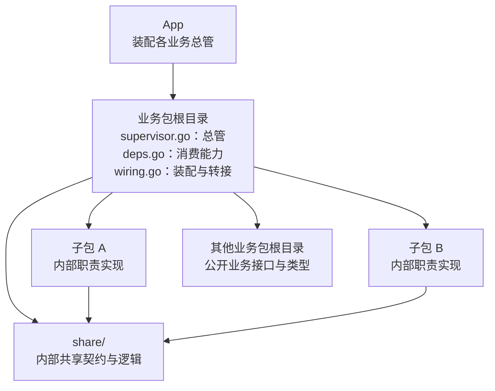

图中箭头表示代码依赖方向。运行时子包可以调用注入的能力，但不因此依赖能力的具体实现包。

## 定位方法

按[代码地图的定位方法](code-map.md#定位方法) 搜索 locator，只读对应章节。

<!-- locator:startup -->
## 启动与装配

App 按下层接口已存在来实现公共流程，下层按照调用契约实现。五条业务线已提供根包总管，配置独占已实现；Platform 下层与接收方契约、媒体和模型构造入口及进程入口适配仍待完成。完整应用的编译与运行验证需待这些接口接入。原 13 个生产文件和 12 个测试文件保存在同目录的 `*.go.bak` 中，不参与构建。

六文件职责及接口契约见 [App 包设计](app-design.md)。App 加载配置、构造共享资源和各线总管、交付公开能力并协调启停。媒体和模型服务接收完整配置，自行处理后端、凭据、协议客户端、请求参数及恢复／重载；App 不拆解这些初始化细节。共享存储和独立历史库均归 App，Platform 直接写入历史，Tool 直接查询；部分失败交回已取得对象统一清理，订阅由接收方持有和释放。权限管理使用 `security.Permission`，App 与 Agent 不承接 Doctor。

TUI 和 Service 在创建资源前，按配置文件的绝对路径及符号链接解析结果取得独立 `.lock` 文件的非阻塞独占锁；同配置重复启动立即报错，不同配置分别运行，纯客户端不取锁。入口持有锁，统一退出流程在资源关闭后释放；锁文件保留，退出超时则由进程退出释放锁。

入口用局部阶段列表统一执行环境、资源、装配和启动，记录成功阶段耗时；每步先保存部分结果再交回错误。唯一的业务线集合登记 Lifecycle、名称和启动顺序，按 Tool → Agent → Hook → Platform → Background 启动。App 自动筛选可选 Waiter 并发等待，首个结果触发取消并回收其余等待，保留独立故障。Platform 解释退出语义，Background 及时上报致命故障。退出先停止新工作、等待使用方收尾，再释放依赖；平台发送能力和 App 持有的历史库保留到使用方退出。

退出步骤共用独立的 30 秒预算。App 的 `runShutdownStep` 将结果分为完成、失败、超时，`runShutdownSteps` 按序执行并汇总；普通错误保留后继续清理，统一期限耗尽立即停止后续清理。下层 Close 保持返回 error，其业务超时错误不直接等同于 App 的统一期限耗尽。最终错误交回进程入口处理。

客户端通过 `platform.RunClient(ctx, cfg, name)` 一次获得 `ClientResult{Kind, Err}`。Platform 负责连接选择与结果分类；App 的明确运行入口直接返回错误，自动尝试入口只将 `ClientFallback` 转为回退信号。App 不解析 URL 或重新组合回退条件，实际本地启动由进程入口决定。

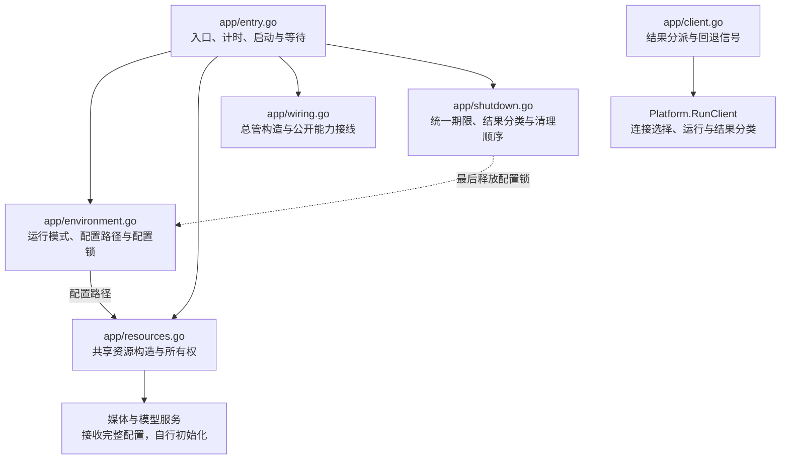

<!-- locator:contextinfo -->
## 公共上下文事实

`contextinfo` 定义五组事实，getter 返回快照和存在标记，缺失不补全局默认值。

| 分组 | 内容与来源 |
|---|---|
| Conversation | 平台会话、发送者、消息／回复 ID 与平台私有扩展，由入口提供 |
| Actor | ElBot 身份、角色及平台群角色，由 security 解析 |
| Execution | Session／当前、父、根 Request／Run／Attempt ID，由所属服务建立关联 |
| Model | 固定 Selection 及其 Origin 的 provider、model、protocol |
| BackgroundKind | 后台来源类型，由后台入口提供；事实存在表示后台执行，空值表示来源未分类 |

- 平台会话与 ElBot Session 分开表达；事实不替代权限、binding 或 attempt 校验。公共包不持有凭据、服务或原生载荷。
- Platform 内部 MessageContext 投影公共 Conversation，私有 context 保存协议路由；根部公开 MessageContext 仅保存原文、原生 JSON 与引用事实。Agent.MessageRequest 转为 Agent 自有输入上下文，不读取平台私有值。
- 接管替换 Conversation、Actor、Model 与 Agent 输入，通过根部注入的 Platform.RestoreMessageContext 恢复平台公开及私有状态；来源缺失时清除，保留执行取消链。后台普通输出静默，显式目标发送保持可用。
- 后台来源供权限、工具资格和日志使用；路径范围由 `workspace.PathScope` 独立表达。接管同时清除后台来源和调用级路径范围，保留 Session 工作目录。

### 公共工作路径

`workspace` 负责工作目录选择、路径解析和目录状态契约。`PathScope{Dir, Restricted}` 固定本次调用使用的目录及限制；未指定调用目录时读取 Session，最后回退进程工作目录。受限范围缺少目录时返回错误，不能回退到其他目录。Session 目录失效时按原值条件清除，避免覆盖并发切换。

配置负责沙盒根目录的默认值与相对路径归一化。Background 通过 `SandboxDir` 计算并创建任务目录，再注入 PathScope 和后台来源。文件工具与 Shell 使用同一工作目录规则；报告附件按受限范围解析。路径解析只检查路径组成和目标类型，实际文件打开与资源生命周期由消费方负责，媒体导入导出保留 `os.Root` 的打开边界。

`NormalizeRestrictedPath` 统一相对路径字符串规则：两种斜杠均作为分隔符，拒绝绝对路径、~、冒号和任意 `..` 路径段，允许 `report..txt` 等普通文件名。`RequireRegularFile` 在统一目标检查中要求已存在目标为普通文件。公共结果只返回路径事实；工具在前台使用绝对路径时根据 `WasAbs` 附加 Share 中的提示，后台与 Shell 自行组织业务说明。

媒体缓存使用配置根目录下的 `media-inputs/`，不跟随 Session 工作目录切换；Tool 的 RuntimeInfo 不保存沙盒根目录。维护任务负责缓存保留期，Session 负责目录状态落库，Workspace 不承担这些业务。

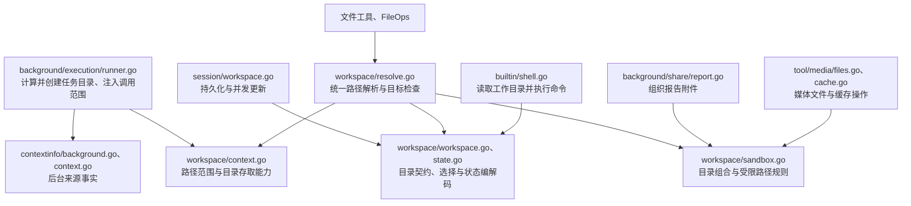

<!-- locator:signal -->
## 信号与订阅

来源拥有业务实例信号；关键提交、权限、Hook、用量和工具记录同步完成，信号供事实观察。Dialogue 管通知订阅，CLI 管展示订阅，命名和模型重试由来源维护同步日志连接。

- `Signal[T,R]` 使用原子订阅快照；Emit 等待实际结果，EmitAsync 返回入队错误与可等待结果，回执按订阅顺序排列。Observe 用于无业务返回值的消费者。
- 每个信号默认 8 个执行槽、256 个等待项、30 秒总期限；按 key 串行，满时拒绝。超时取消调用，但回调实际退出前保留执行槽和 key。
- Disconnect 不撤销已取得的快照；Connection.Close 等待已接纳回调退出。信号关闭选择 CancelPending 或 Drain，Done 表示真实退出。
- 平台直接发布全局 PlatformConnected；消费者自行订阅、按平台排队并管理关闭，Agent 不代持 Hook 的平台消费者。事件不缓存或重放，重复连接交业务处理。
- `events.EmitLog` 校验九字段 LogRecord 并复制显式 Identity；发布解除请求取消，身份不从 context 补值。来源决定等级、结果和唯一正文；业务 error、Receipt 与 LogResult 独立传递，nil error 不覆盖日志失败，取消不覆盖独立故障，日志结果不改变重试或业务判断。
- 日志中心接收时记时，以 runtime／audit／elnis 三个容量 256 的队列背压写入，入队等待最多 500 毫秒，关闭排空。text 默认限 256 个 Unicode 字符，JSON 保留原生字段顺序和数值；JSONL 含行尾最多 64 KiB。
- 设施故障直接报告 stderr；短写按 io.ErrShortWrite 处理，后续记录继续。关闭超时保留仍在使用的文件和活动中心名额。
- Reader 按日期与写入位置倒序、有界分块查询，兼读 JSONL 和历史文本；公共字段与正文条件匹配后计数，坏行单独报告。工具来源按固定 run_source 查询，不从正文猜测；用量统计保留整数精度，未知或溢出只影响相关项。

<!-- locator:config -->
## 配置与运行数据

- 配置查找顺序为 `--config → ELBOT_CONFIG_FILE → 平台配置目录`；完整配置见[配置文档](../docs/configuration.md)。
- app.toml 是主配置，同目录 providers.toml 定义客户端；api_mode 为 chat／response，独立于 Session 的 chat／work／background 模式。
- state.toml 持久化命令修改的模型状态，不自动重读外部修改；tool_tags.toml 保存工具标签。记忆、Skill 和插件资产位于配置目录。
- api_key_env 优先读进程环境，再读配置目录 .env。`/models --fresh`／`--refresh` 沿启动路径重读厂商、model_metadata 和密钥，不重读主配置或 state；准备失败保留原快照，远端目录失败按厂商报告。
- 模块声明配置要求，Load 与 Inspector 共用默认值、合并及校验；配置包不依赖具体业务模块。`/doctor` 仅超管可用，只读诊断配置和资产，不初始化文件或启动 runtime。

<!-- locator:agent-chat -->
## Agent 对话链路

`平台输入 → 唤醒／入站 Hook → 命令或输入准备 → 执行准入 → 单轮准备 → 模型／工具循环 → 回复提交 → 跨轮收尾`。

| 层 | 职责 |
|---|---|
| 入口组件 | agent/input 的 MessageHandler 分发，InputCoordinator 准备与预加载，CommandExecutor 执行命令，BackgroundHandler 准备后台会话与工具 |
| ExecutionCoordinator | 准入、attempt／Request、追加确认、pending、压缩交接与 Execution 完成 |
| dialogue.Runner | 选择路线、加载材料、准备输入、收敛 Loop 结果、提交回复与统一失败报告 |
| Chat／Responses Loop | 协议上下文、模型／工具循环、pending 与接管刷新 |
| 公共协作 | Prompt、模型 Hook、ToolRun、消息事务与 ReplyCommitter |

- 准入检查客户端能力和模型兼容性，固定 Selection 并登记会话归属及 attempt；后续准备使用 Request context。普通模型切换不影响在途循环，前台接管刷新模型、工具和来源。
- 工具阶段的输入进入 pending，在下次模型请求前合并；最终模型调用期间收到的 pending 在本轮结束后开启下一轮。
- 用户／pending 和工具记录通过共同提交口保存。ToolBatch 初始化时按模型调用顺序保存 assistant 调用数组、稳定结果 ID 和未知结果槽；最终结果逐项更新原槽，与统计、媒体引用、发现状态同事务提交。参数媒体引用在初始化时按批次去重；Chat 参数变化时，随对应结果补入新增引用与最终参数。全部完成后才续跑模型。
- CommitGate 在事务内复核 binding 与活跃 Execution／attempt；Responses 同时比较 checkpoint，提交原生状态。API 审计独立保存。
- 回复前刷新接管来源；Loop 和回复提交成功后，RecordTurn 一次合并保存活动时间与用量，再处理状态、压缩、pending、Execution 结果及命名。单轮 Runner 不结束跨轮 Execution。

### Agent 包边界

`Supervisor` 的业务出口为 `HandleMessage`、`RunBackground`、`CopyBackground`、`CleanupSessions`、`RegisterHooks`、`StartHookRequest`、`Complete`、`Commands`、`ObserveStatusChanged`、`ObserveBindingChanged`；生命周期出口为 `Start`、`BeginClose`、`Close`、`Done`。内部组件不通过 getter 暴露。`Commands` 返回独立的命令元数据；状态订阅复制用量，绑定订阅只返回 Scope、SessionID 等绑定事实，每个订阅者获得独立快照。调用方只持有自己的订阅连接，不能发射或关闭源信号。

Agent 总管持有模型完成、状态变化、视觉降级三个线内事件信号。`BeginClose` 拒绝两类公开入口的新订阅，但保留信号供在途工作发布收尾事件。App 等待平台接入和后台生产者退出后调用 Agent 的 `Close`；`Close` 等待内部组件收尾，再关闭信号，沿用各订阅的关闭策略。`Done` 等待信号回调实际退出，单独调用 `BeginClose` 不会完成 `Done`，`Close` 超时也不会提前完成它。外部消费者自行管理其异步工作的生命周期。

工具预加载和补全标签由 Tool 能力提供；执行 Schema 统一经工具执行能力生成，提示词只消费工具名称。Agent 不另设自定义 Schema Provider 或 Registry 回退。整链路测试通过真实 `NewSupervisor` 构造，子组件单测在各所属包中维护。

根包 `agent.Supervisor` 接收完整配置和借用依赖，持有 Session、Request、Turn、协议路线及订阅。公开 Hook 回调及嵌套数据、状态和绑定事件定义在 `contracts.go`；根部转换为内部契约，每个订阅者获得独立快照。后台请求、结果与复制请求也在此定义；background.go 提供执行、复制与过期清理入口，连接调用方与 Agent 的取消信号。input/background.go 准备身份、会话、模型上下文和新会话预载，复用现有执行协调器；复制与清理委托自有 Session，复制元数据使用 JSON 原始值。调用方提供已准备的工作目录范围与后台来源，并在 Close 前等待这些同步调用退出。Background Runner 只准备任务目录和后台来源，通过 Agent.RunBackground 进入这条执行链。

`wiring.go` 负责组件构造、协议接线、Completion 装配及 Workspace 工厂；消费者只接收实际使用的 Session、Turn、Request、Models、Contexts、Media、存储和命令能力。身份能力也按实际调用裁剪。外部公开数据和足够小的公开接口直接使用，不复制同义类型。Agent 的 Tool 调用统一使用 Tool 根包类型。

兄弟子包通过消费接口及 `share` 协作。Loop、准备结果、提交、消息转换及接管提示归 `share/dialogue.go`；Hook 载荷与调用上下文辅助归 `share/hooks.go`。ExecutionView、Preparer、CallProcessor、MessageStore、CommitGate 和 ToolTranscriptCommitter 的实现保留在 Dialogue；Chat／Responses 只取得所需能力。信号源统一由根部构造，模型完成事实归 Share，状态事实归 Execution，视觉降级事实归 Dialogue。

Hook、Command、Completion 已消费根包公开契约，Agent 根部与真实 Tool 接线的回归可独立运行；Background 的会话复制、清理及其余业务线仍待接入，完整应用尚不能运行。

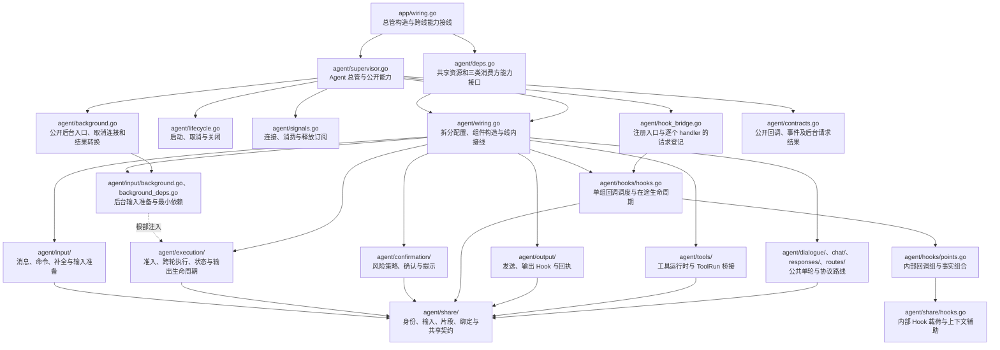

<!-- locator:protocol-routing -->
## 协议路线与原生上下文

- llm/chatcompletions 与 llm/responses 编解码原生协议，httpclient 提供传输；agent/chat 与 agent/responses 各自实现 Loop、Compactor 和材料准备。
- 公共 llm.Client 提供模型列表与独立 GenerateText，独立文本不续主会话或执行工具。Selection 固定客户端、模型、Origin 与窗口快照。
- routes.Registry 按 APIType 登记 Loop／Compactor／Material；主对话按 Selection.Origin 选路线，压缩和分支按持久化源 Origin 选能力。
- CanSwitch 纯比较来源：Chat 可跨 Chat provider；Responses 可在同一 provider 节点内换模型；跨协议或涉及 Responses 的跨 provider 切换拒绝。命令、执行与接管分别在自己的准入边界检查。
- provider 节点名表示厂商身份，URL 变化按已有材料重放；Session 和原生记录保留历史来源。
- Usage 四项计数为可空 int64：nil 未知，零是明确零，不推算缺失总量；快照复制指针，非法用量不使响应失败，Chat 非法或 null 别名继续回退。

### 主调用链

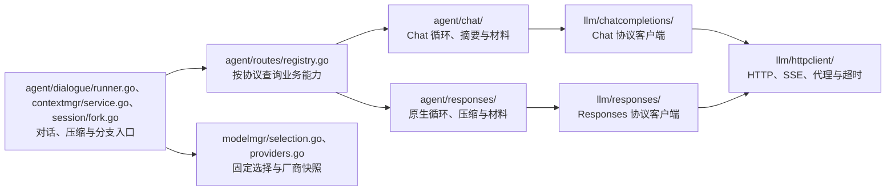

### 公共协作与事件

Chat／Responses 共用 Dialogue 的 Prompt、Hook、ToolRun、媒体与提交能力，协议私有状态留在各自路线。CallObservation 在厂商响应终止时发布原始 usage、正文摘要和完成事实，先于 response Hook；每次实际请求记录一次 llm_usage，准备失败不计调用，恢复请求分别结束观察。HTTP 重试单独发布重试事实，最终失败统一交 Dialogue。

### Responses

- 业务消息保存完整正文和 segments，原生记录保存 items、推理材料与 checkpoint。请求前归档参数和有序 input_refs；InputIDsJSON 仅含本次新消费输入，审计不保存展开后的 HTTP 正文。
- 请求显式获取 reasoning.encrypted_content，保留未知 items。失败、取消、incomplete 或提前 EOF 不推进 checkpoint；中断增量不成为完成响应或可执行工具调用。
- 每次构建 instructions；默认沿 previous_response_id 发送增量，store=false 时发送完整窗口且不带旧链 ID。主对话默认 store=true，独立文本固定 false。
- base_url 改变或明确旧链失效且尚无新内容时，按已有材料重建；旧链失效只重试一次。网络、鉴权、含糊错误及部分流不触发恢复；重建复用已准备的输入、Hook 结果与 Selection，不重跑历史工具。缺推理或原生材料时拒绝，缺失媒体按公共媒体规则处理。
- 工具定义以 developer additional_tools 输入冻结、随历史回放；同名定义变化要求新会话。请求不发顶层 tools，当前权限与 tool_choice 决定允许集合，响应调用再次校验。
- Hook 不能改工具调用集合、ID、名称和参数；Chat 允许改参数。副作用前保存原生响应及整批固定结果槽；原生输出与展示结果逐项更新，最后一项的事务同时保存不可变快照。
- 工具批次的历史快照供 Fork 使用，不推进活动游标；下一次对话将中断批次一次封存，保留完成结果，其余标为结果未知，不自动重跑工具、完成 Hook 或发送。Fork／后台副本只使用封存批次。
- LoadNativeWindow 在同一读取事务取得 seed、checkpoint 祖先链及关联材料；窗口按已提交输入／输出重建。首个本地 checkpoint 成功才消费 seed，Fork 使用不可变快照；恢复不读取历史 HTTP 正文或重做工具副作用。

<!-- locator:commands -->
## 命令链路

`CommandExecutor → Router → command.Handler → 领域服务`。内置命令由 builtin 提供；`/hooks` 由 Hook 的 `control/command.go` 提供，根部 `Commands` 返回命令切片副本，Agent 统一注册。通用补全 token、候选和替换范围工具位于 `command/completion.go`。Dispatch 返回的命令错误由 CommandExecutor 统一发布一条 ERROR 通知，并保留原始错误；通知发往原会话且不绑定可能失效的旧 session。参数帮助归 command.Info.Help，补全使用 completion，CLI 本地文件补全优先；用户用法见[命令文档](../docs/commands.md)。

- 改变 Session 的命令声明 SessionEffect，执行器处理压缩／确认冲突，Session 服务判断绑定规则。
- 普通用户的请求查询与停止限定当前 Session，超管可管理全局；取消复核原 binding 和目标请求。列表选择按 Scope 隔离。
- 命令结果通过同步通知发送，成功后才交 InputCoordinator 执行 Continuation；发送清除旧 Session binding，保留原会话与连接。

<!-- locator:request-turn -->
## Request、Turn 与状态

- Request 拥有活动请求树、父子关系、取消、超时和清理；LLM、工具、压缩与后台请求均登记。取消或超时只进入 stopping，由执行方的 done 确认工作退出后移除请求。
- Turn 拥有阶段、pending、确认与工具计数；Execution 拥有跨确认／压缩的 RunID、接管快照和一次性结果，attempt 隔离迟到完成。stopping 保留执行归属，AttemptDone 在实际收尾后关闭；输入在会话锁外等待，重新核验 binding 后准入，不重复输入准备。追加确认的续跑同样等待旧 attempt 退出。续接间隙的 pending 仍保持忙碌。
- 首次启动竞争时，AcceptInput 只对尚未执行的输入重新准入，保留 binding 与准备结果，不重跑 Hook；后续执行错误不触发输入重放。
- 风险确认先在锁内登记等待对象，再锁外发提示；响应、取消及迟到清理固定同一等待对象。追加确认等待和过期提示受应用生命周期管理。
- StatusRecorder 同步校验执行归属、保存并发布单调版本；CLI 按 Session 与原始展示目标合并状态，绑定失效清理积压。后台无 CLI 展示目标，接管仅展示之后的状态与增量。
- 当前 usage 唯一由 StatusRecorder 持有；CLI、`/status`、压缩判断和轮末持久化均读此处。首次从已加载的 Session 元数据恢复，厂商返回后立即更新，nil usage 保留已知值；contextmgr 仅负责轮末持久化。工具统计分别显示已持久化累计与当前 Turn，不相加。

<!-- locator:tool-flow -->
## 工具调用链路

`路线 → ToolBatch 初始化 → 顺序准备／确认 → 并发执行 → 按返回顺序处理并逐项提交 → 按原调用顺序续跑模型`。

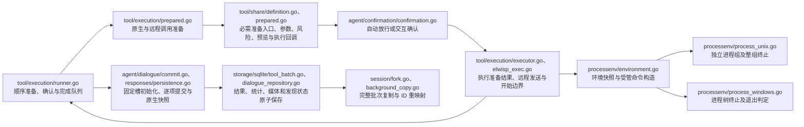

- ToolRun 按 prepared Hook 后的参数顺序解析、授权、确认和登记，通过一个即启动一个 worker；协调器按返回顺序处理输出、完成 Hook 和最终结果，等待后续准备／确认时仍消费完成队列。共享 Session 状态只由协调器修改，准备与执行持有独立快照；Flush 仅汇总模型上下文，不再写库。
- N 个调用的正常批次有 1 次初始化事务和 N 次结果事务，最后一次同时封存批次与原生快照；不单独写 started 状态。此计数不含工具自身业务写入、模型请求归档、异常恢复和轮末收尾。原始返回至最终结果提交之间中断时，该项仍为未知。
- 单工具失败、拒绝或超时不停止其他调用；整轮取消或确认过期取消并等待所有 worker。完成 Hook 只处理实际执行的结果，Content／Segments 回灌模型，Data 供内部消费。
- 请求拥有的外部命令统一通过 processenv 配置终止行为：Unix 使用独立进程组，Windows 使用 taskkill /T /F；取消后等待命令和 stdout／stderr 收集结束。Skill、Shell、编译、一次性 Hook 和 ripgrep 共用此行为；常驻 Hook 的单次调用仍使用 event.cancel，关闭其进程时复用进程树终止。主动脱离进程组的守护进程和已提交给远端的动作不在取消保证内。
- PreparedCall.Call 返回业务 Result、独立日志正文和原始 error。实际调用前发布 tool_call_start，返回后立即发布 tool_call_end，先于发送、Hook 与持久化；Hook 规则／插件对应 hook_tool_call_started 和 hook_tool_call。开始无结果，结束有摘要与耗时，共享调用 ID；审计为追加文件日志。调用前固定 run_source；已进入调用记 INFO／succeeded，业务错误保留在正文，调用统计保留原始执行结论。
- 参数日志限 512 rune，工具自行将摘要限为 1024 rune；日志不截断业务结果，也不把 Segments 自动转成日志正文。
- Tool 接口只保留 Name、Info、Schema 和必需的 PrepareCall；准备不执行业务写入，成功时必须返回非 nil 的 PreparedCall。完整风险由工具准备阶段确定；Execution 从准备结果读取风险，原生批次调用使用 Permission.CheckTool 判断放行或确认。目录替换、注销影响后续解析，不改变已准备的调用。
- NewPreparedCall 复制调用参数与风险原因，保存预览和执行回调；Preview 只提供展示文本，RiskAssessment 返回独立风险结果。回调使用固定业务数据和执行阶段传入的 context，不保留准备阶段的 context 或锁。Execution 执行前校验取消与 Matches，只执行 PreparedCall，不提供绕过准备的调用分支。
- 自动确认只跳过展示和等待，不跳过准备；普通调用进度提示与确认预览独立。已由调用方授权的 CallTool 同样先准备、复核参数与取消状态，再执行，但不进入模型批次或交互确认。
- ELwisp 准备时固定远程地址、请求体与超时，参数或请求构造错误在发送前返回；实际执行只发送请求、解析返回并保留部分结果。远程调用沿用现行低风险自动放行策略，Preview 为空，开始与结果状态由统一执行入口记录。
- Builtin、Skill 与发现工具均通过必需的 PrepareCall 接入；参数和动态风险只在准备时解析，执行使用固定的业务数据和目标。Shell、命令 Skill 与 GoRunner 在执行阶段启动进程和准备媒体；GoRunner 固定所选技能记录，目录重载不重新选择本次调用。
- 业务提交负责目标、revision、权限绑定和业务状态复核。fileops 的 PrepareFileEdit 复用编辑协议与可选文本校验，PrepareFileWrite 准备完整 UTF-8 内容；两者返回 PreparedFile，固定存在状态、真实目标、revision 和批准内容。文件层复核后提交，diff 沿用大小与行比较限制。编辑保留无变化错误，整文件写入允许内容相同。
- 长期记忆自行管理目录、索引、同步与删除。新建只预览规范化业务内容，执行时在保存锁内分配 ID、时间和文件名；更新复用 PreparedFile。删除预览 ID、标题、分类、摘要与路径，执行时复核目标和内容 revision，再删除文件与索引。
- 每次准备及完成处理前应用 Execution 的内存接管快照，保留后续工具状态；本次调用权限与沙箱固定，输出发送时选择最新去向。发现状态提交成功后才更新快照，保存失败不重跑已完成动作。
- Chat 工具消息只发文本，工具图片派生为同批之后的 user 多模态输入，不持久化派生消息；Responses 编码原生工具结果。

<!-- locator:tool -->
## Tool Runtime、工具状态与文件

Tool 拥有注册、schema、风险评估与执行器；Permission.CheckTool 根据身份、工具属性和后台事实决定拒绝、直接执行或交互确认。Tool 执行决定，Agent 承接交互确认。StateService 解释工具状态，PreloadService 返回待提交状态、材料和语言需求。

Execution 由 Manager 私有持有 Registry、Permission、Media 和日志发布函数，依赖在构造时一次注入，向 Tool 根部提供 Schemas、Run、CallTool。单次调用的 executionResult 留在包内；Share 只提供跨包协作契约。批次准备、确认、并发调度和完成处理是同一 Manager 的包内流程；App 与其他业务线只调用 Tool 总管。CallTool 是调用方已授权的原生直接调用，保留原始业务结果、日志正文和错误；Hook 负责自身策略，不进入模型批次和交互确认。

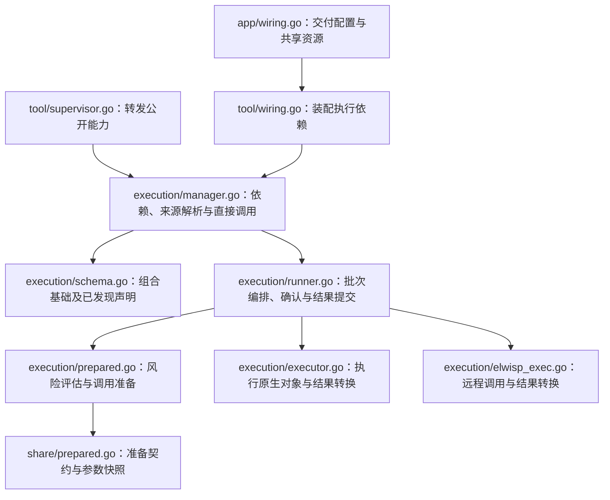

- 会话的 `discovered_tools` 保存完整 `DiscoveredTool` 数组，是已发现工具集合的唯一事实；名称从声明提取，以 CanonicalName 优先、否则 Name 作为合并标识。State 不持有 Registry 实例，恢复声明不按名称重新生成 schema。Agent 经根部 `Supervisor.DecodeState(raw)` 解码当前会话快照。
- ELyph 通用规则由 elyph/rules.go 提供，工具、Skill 与后台任务声明需求，输入／工具 Runner 在正文 Hook 后组装。首次展示状态与携带规则的消息原子提交，同 Session 共享，压缩新 Session 重置。
- 输入指令、发现与后台首轮预加载在一次提交中合并状态，失败保留原状态；准备在准入锁外，提交复核取消、binding、模式和压缩状态。
- tool.Info.APITypes 限制协议可用性，空集合不限；view_image 仅供 Responses。前台 chat 过滤工具、Skill 和 tag。
- Registry 统一筛选运行资格，Discovery 的 Resolve 接收已筛选对象并解析依赖，Preload 使用返回的同一批对象读取动态说明。标签授权展开只读取目录与配置成员，不按当前模型、权限或前后台事实缩减声明。
- Execution 的基础 schema 仅为通过 Registry 筛选的 discover_tool，限 Work 且未禁用基础工具；Chat 不开放工具，Background 只使用已发现声明。已发现 schema 不按目录重建，按输入顺序去重并复制；远程调用按 CanonicalName（为空时用 Name）定位，向端点发送原始 Name 与 EventKey。
- PrepareBackground 接收 BackgroundPreloadRequest；AllowedToolNames 仅约束本地根工具，nil 不额外限制，空切片禁止本地根工具。它复用 PrepareTools／PrepareSkills，合并说明、Skill 文档、wrapper 和 ELwispTools 声明，并经 Registry 的后台规则过滤 discover_tool、workspace 与 ForegroundOnly 工具，返回待提交状态。外部声明的 CanonicalName、EventKey 由适配方提供，schema 在预载时复制；ActivateTools 声明的可执行 Skill 直接加载自身 schema，纯文档 Skill 不生成调用接口。调用方迁移与续跑约束见 [后台工具统一预载](tasks.md#后台工具统一预载)。
- Tool 根部在内部构造 StateService，只向 State 交付 Store；装配结构 runtime、registerOptions、registerAll 及组件字段均为包内实现。App 交付完整配置和共享依赖，不取得 StateService。根部的 DecodeState、DiscoveredToolsForSession、Commit 转发状态能力；State 复用 Registry 的后台资格筛选规则，不查询目录重建声明。后台调用方的总管接线仍待完成，见 [后台工具统一预载](tasks.md#后台工具统一预载)。
- 普通预载由调用方经根部 Commit 提交；Execution 调用 State.PrepareUpdate，从当前会话快照生成仅含工具字段的元数据补丁，与工具结果原子提交，不另作独立状态提交。合并、名称集合、排序和存储字段编码均在 State 内部；PrepareUpdate 不进入总管公开接口。读取从元数据解码出独立对象；Commit 返回序列化后重新解码的状态，避免与输入声明共享 schema。

聊天历史由 `chat_history.Manager` 处理当前聊天范围、用户／时间筛选、数量限制和媒体选择。Builtin 负责 schema、参数规范化与结果展示；组件的 Backend 由根部 `chatHistoryBridge` 实现，根部直接查询 Storage 并转换历史记录与引用事实，并通过 Tool 媒体入口获取选中的媒体。查询仅整理媒体描述及已有 ID，不触发下载；同次媒体调用复用消息查询，保留请求顺序和重复项，未缓存媒体的获取尝试上限为 5。`view_image` 在获取前完成历史图片选择校验，获取后通过媒体入口校验图片内容。

下面是代码依赖图，箭头表示依赖方向：

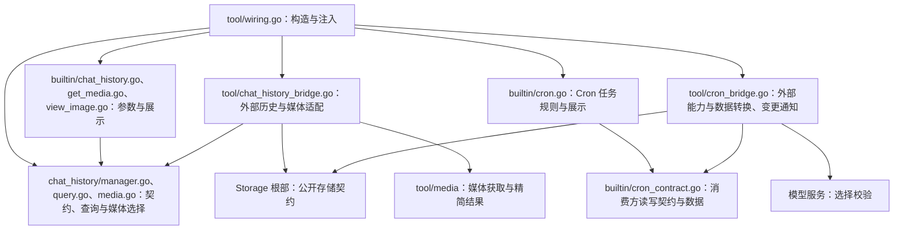

Cron 工具由 Tool 根部构造并注册。Builtin 使用 Tool 自有的 `CronRepository`、`CronSaveRequest` 和 `CronInfo`，负责参数、任务规则、更新合并与结果展示；模型校验通过单独注入的函数调用。根部 `cronBridge` 转换 Storage 任务定义、记录及状态投影，持久化 JSON、数据库任务名称和外部服务类型不进入 Builtin 或 Share。定义写入成功后，根部发布仅携带任务标识的 `CronChangedEvent`；`ObserveCronChanged` 的连接由订阅方持有。Tool 持有工具注册和信号生命周期，BeginClose 保留收尾调用，Close 释放自有资源。Background 根部持有订阅，回调只登记任务名称；Cron Manager 串行重新读库并刷新调度，见 [Cron 与后台任务](#cron-与后台任务)。

常驻记忆和 Elwisp 创建指引各自在现有 Builtin 文件声明所需契约，Tool 根部实现适配。`configBridge` 每次按装配时的配置路径重新读取，只交付地址、路径、授权工具、token 名称／环境变量名及读取错误；Builtin 根据配置事实或读取错误生成创建指引与告警。`residentMemoryBridge` 持有 Store，将当前 Actor 转为存储范围并转换数据和未找到错误。Builtin 不持有 Config、常驻记忆 Store 或 Session 范围。

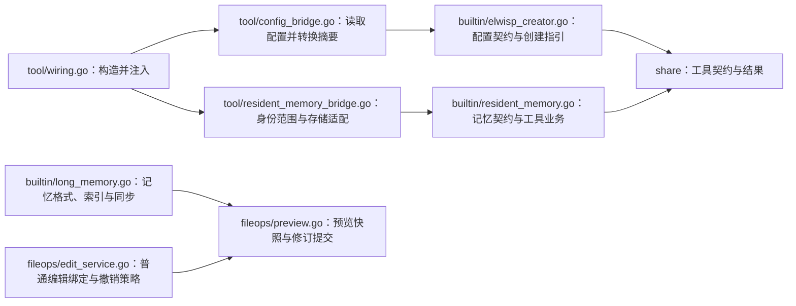

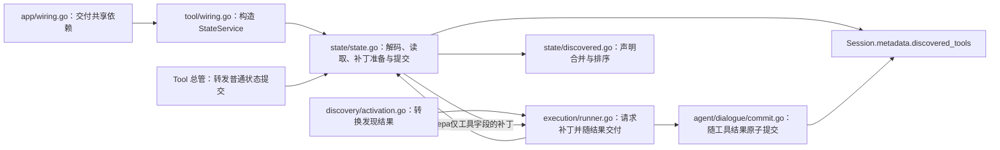

- fileops 统一处理工具及命令的编辑／撤销。context 只保存绑定，准备对象持有快照，提交校验显式传递。准备时短暂锁定目标，等待确认期间不持有文件或锁；预览不暴露批准写入的字节。
- PreparedFile 为业务文本更新保存原目标、原修订与批准字节。PrepareFile 的转换回调只运行一次，普通编辑与业务更新共用编码、换行、diff 和修订计算；长期记忆复用其提交，普通编辑继续由 Service 管理绑定、准入和撤销。长期记忆新文件写入复用 AtomicWriteFile。
- 文件提交锁顺序为目标路径 → Scope → SessionID → 备份状态；核对绑定、取消、权限、目标和 revision 后写批准字节。撤销仅在成功写入后登记，后台编辑不登记前台备份；外部进程不参与锁。/stop、切换和清理与提交互斥：先提交则完成，先取消或失效则拒绝。
- 目录 AST 先按扩展名／标准 Shell shebang 筛选，再完整读取候选，避免全文读取无关文件；Shell 文件优先采用有效 shebang 声明的方言。
- 目录 grep 由 rg 枚举文件并分批流式搜索，完整统计匹配数，只保留展示／index 所需候选，按相对路径和行号排序；大文件警告与实际搜索范围一致。
- 长期记忆同步批量读取索引，按文件名确定重复 ID 归属，先移除失效索引再更新；常规读取有 30 秒冷却，修改／删除找不到 ID 时强制同步，失败允许立即重试。格式错误分类只在当前 store 内存复用，重新打开后重验，不增加数据库字段。
- 网页提取合并同键在途请求，各调用独立取消／等待，无人等待时取消共享获取；强制刷新可加入在途请求，失败保留旧缓存，迟到结果不覆盖新请求。
- shell 收集 stdout／stderr 各保留 256 KiB，超限继续排空并丢弃多余输出。

### 公共资料与媒体边界

数据库是已提交会话的事实来源。Dialogue 负责公共消息投影、片段编解码、归档及请求副本，Chat／Responses 负责协议编码与循环。

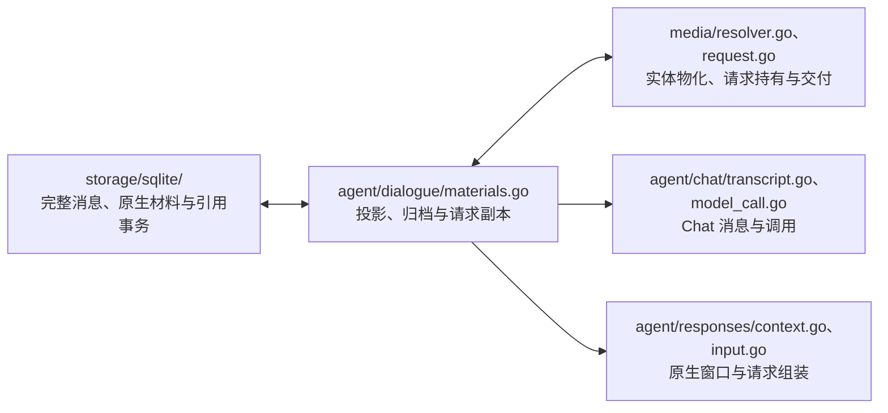

工具结果保留完整正文与 segments，提交成功后才进入活跃上下文。归档保存稳定媒体 ID，请求展开 URL／base64 仅供当次发送，不回写或从 HTTP 正文反向恢复归档。

### 媒体引用与清理

Tool 装配创建统一 `MediaRuntime`，Builtin、Skill 与 Execution 通过它访问媒体；内部媒体中心与缓存根目录为私有依赖。导入使用 `share.MediaImportOptions{Name, MIMEType}`，由入口转换为媒体中心参数；Builtin 通过入口的 IDPrefix、ValidID 识别媒体 ID。查询、导入、持有、导出及历史媒体批量结果仅向工具返回 `share.MediaInfo{ID, Name, MIMEType, Size}`；`storage.Media` 留在媒体实现内部。`ValidateImage` 请求中心验证图片并返回通用信息，图片宽高和实际格式仅由媒体中心内部消费。文件发送工具直接接收 Tool 媒体入口，负责名称、MIME 与发送输出的组织。

`share.MediaInput` 只处理 JSON 解码、字段类型与未知字段约束，不依赖媒体中心。Shell／Skill 将解码后的 ID 传给 Tool/media 的 CachedExport／Export，经 Retain 调用媒体中心 Metadata，复用中心已有的 ID 校验和查询；媒体准备失败时不启动命令。

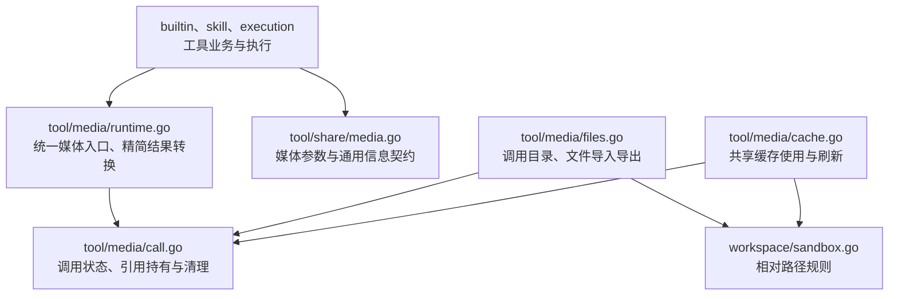

- 媒体按 SHA-256 去重，media_references 是引用事实来源；消息、工具参数、Fork、Cron、Elnis 和输出关联通过事务维护引用，读取／发送另持临时引用。
- MediaCall 按 ID 复用调用内元数据、持有和成功导出；OpenHeld 使用已持有记录，同次调用串行，Close 释放引用，失败释放可重试。
- 工具通过确认后、实际执行前关联 JSON 参数中的完整媒体 ID，不扫描自由文本；调用失败保留引用，执行前拒绝不建引用。
- PrepareMaterials 将完整请求一次交 AcquireForLLM，唯一 ID 只读及持有一次，大小按实际出现次数累计。hybrid 超限全部 S3，否则全部 base64；纯 base64 超限报错，持有持续到该次 HTTP 请求结束。
- 签名 URL 独立持久化；逐对象锁内按需上传和签名，剩余超过 5 分钟复用，否则按 1 小时刷新。签名或缓存故障返回业务出口报告。
- 只有实体确实缺失时生成请求占位文字并通知；权限、取消、超时或仓储故障仍报错。Fork／后台副本 seed 独立持有完整窗口素材，不打开媒体实体。
- 入库清洗名称与敏感来源，图片按限制转白底 JPEG。Chat History 查询不下载，get_media／view_image 限当前平台和 scope；历史批量获取最多尝试 5 个未缓存位置，缓存不占预算。
- 输出回执按媒体位置关联；缓存故障只记 WARN，不改送达事实或触发重发。跨库历史对账复用消息归属查询，查询故障保守停止。
- 最后引用释放后保留 1 小时；清理认领与新增引用互斥，按远端 → 本地 → 记录删除，失败留待重试。相同 ID 的导入／上传／删除互斥，每轮最多并行清理 4 个对象。
- 清理前发现引用异常即停止。启动先清理临时引用，再由 Elnis 裁决历史中断事件，即使禁用 Elnis 也执行；状态与引用释放原子提交，失败阻止启动，持久化 outbox 保留。

<!-- locator:skill -->
## Skill

- AgentSkill 使用 SKILL.md 和可选 ELBOT_SKILL.toml；原生 EL／Go Skill 使用 SKILL.elyph，Go runner 可配编译产物。
- 命令与 Go runner 每次读取技能根 .env；普通变量按技能 .env > 进程环境 > 配置根 .env 合并，PATH 按进程、配置根、技能追加去重。子进程 cwd 为技能根目录，Go 编译用启动时基础环境。
- Manager 接收明确的技能根目录、Registry、Tool 媒体入口和基础环境，私有持有 Scanner 与 Catalog；Scanner 只扫描候选记录，Manager 构造工具并提交注册替换，成功后更新 Catalog。扫描和注册失败均保留原活动目录。
- descriptor、commandTool 及其依赖为包内实现；GoRunner 通过 NewGoRunner(manager) 构造，Skill 不反向依赖 Tool 根包。
- 创建、修改、finalize、删除、重载与 AgentSkill manifest 提交由 Manager 的 writeMu 串行协调；准备和确认等待不持有写锁，普通技能运行也不持锁。文件准备复用 fileops，manifest 提交后重载失败由 Skill 恢复原文件。
- 创建预览已知源文件内容；finalize 准备校验和格式化结果，执行时复核源文件、提交格式化、编译并重载，无格式变化时跳过写入。创建或编译失败保留已有部分完成语义。读取实现位于 read_el_skill.go，进程、编译器查找及有界输出位于 process.go，源码处理位于 go_source.go。
- 媒体在执行阶段准备：shell 用 media_inputs／ELBOT_MEDIA_N，Go 用 payload.media_inputs，TOML 用 type=media 参数；stdout 媒体经 os.Root 校验后导入中心，普通文本 ID 不转换。
- shell 导出缓存跨调用保留，每次调用首次使用时校验文件并刷新时间，由 sandbox 维护任务清理；Go／TOML 使用调用私有目录，结束即删除。同次调用复用成功导出，不缓存失败结果，结束释放媒体引用。
- Skill 命令 stdout 保留 1 MiB、stderr 保留 16 KiB，超限继续排空；成功但 stdout 超限时报错，不解析残缺 JSON。

<!-- locator:hook -->
## Hook

Hook 根包拥有公开管理入口、装配、外部连接和生命周期；pipeline 先调用注入的 runtime 续接能力，再按事件点和优先级串行执行普通规则，并负责触发错误钩子，control 管查询、重载、进程管理及命令展示，runtime 管进程、RPC、waiting 与 SharedState。根包通过最小消费接口调用子包，不暴露内部组件。子包不得反向导入根包；工具、平台、媒体与日志／通知发布能力由根包装配注入。协议见[Hook 文档](../docs/hooks.md)。

CallOptions 显式携带 Woken、ReadOnlyCalls 和 Observe；Observe 只接收 context 与 handler 名称，桥接从 Agent 事实固定 SessionID，执行方决定实际 handler 的登记起止。runtime.Route 在选中有效续接后登记请求，返回 Event、是否续接、来源 LogResult 与 error。pipeline 将只读策略传给 Handler，由 rules 在每个动作后校验；调用快照供失败恢复使用。根部 fillEventFromContext 只转换并补入外部 context 事实。

pipeline 用 mergeLogResult 聚合续接与普通规则的来源结果：Skipped 不参与，Failed 优先于 Canceled，其余取后一个状态，正文按执行顺序连接；全部跳过时返回 no matching Hook。规则通过 share.RuntimeCaller 借用 Handle、MediaRequest、SharedRequest；control 通过 share.PipelineControl、share.RuntimeControl 查询、停止和管理插件。SharedState 由 runtime 私有持有，不通过 getter 暴露。

Tools 按消费点提供 ToolInfo、ToolSchema 和 CallTool，使用 Tool 根包公开类型，规则不需要 schema；Platform 提供 SendTo 和按平台名称调用的 CallPlatformAPI。根部 media.go 保留媒体中心契约，runtime/media.go 只声明所需的八个方法；Event 不携带服务能力。日志和通知通过根包装配的 Log、Notify 发布。插件配置、执行模式及校验归 share/runtime_config.go，运行状态枚举归 runtime；share.RuntimeInfo 仅提供查询展示字符串。根部 Loader 创建带日志、无续接的候选 pipeline，向 control 交付 ReloadCandidate 的查询信息、运行时配置和按插件提交闭包；control 决定提交时机，替换算法与活动 pipeline 接线保留。输出转换与 hook.v2 协议分别位于 share/output、share/protocol，子包不直接依赖兄弟实现。

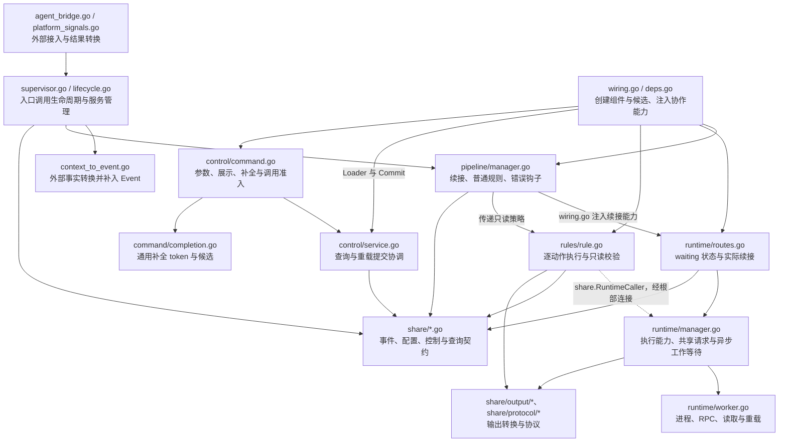

Hook.Start 串行等待加载与平台订阅完成后才标记启动成功，重复启动不会提前返回。Hook.BeginClose 停止新连接和平台订阅，保留 Agent 收尾回调和管理命令；命令 Handle 与 Complete 各通过根部准入一次并登记在途，Close 解除 Agent 注册、取消并等待根包已接纳的调用及平台队列，再关闭 runtime。Done 等待真实退出，关闭等待超时不提前宣告完成。

runtime 的 workWG 覆盖启动、进程等待、读取循环、插件请求、重载、重启等待和异步停止。任务登记与关闭入口共用锁；临时 worker 移出索引时先登记停止任务，已接纳任务在退出前登记必要收尾。关闭后拒绝新业务任务，取消工具调用上下文；后台调用保留独立超时，带来源调用保留原上下文信息及取消关系。等待所有工作及共享资源清理结束后才关闭 Done，worker.stop 不等待整个 Manager 的工作组。

Agent 通过 `RegisterHooks(agent.Points)` 接入一组提供方回调，返回解除注册函数。Points 声明消息、模型、工具和输出阶段，以及入站路由探测和取消能力；参数只包含业务数据，Agent 不构造 Hook 协议 Event。Agent 只消费 Hook 的标准命令；`control/command.go` 在 Hook 内部消费 HookService，查询结果不跨业务包公开。

- 未注册的处理点原样通过，通知点直接返回；重复注册报错。注册表按值保存，解除函数只影响自身注册，已进入的回调继续完成。Agent 不维护规则优先级或第二套插件流水线。
- 入站先计算唤醒事实、检查原始取消命令，再探测 waiting 并按需准备媒体；消息回调通过 pipeline 完成续接和普通规则执行。Agent 随后发送附加输出、处理消费结果，再检查改写后的取消命令并进入命令／模型流程。唤醒不因改写而重新计算。
- `Facts` 传递源身份、会话快照、唤醒结果和调用只读策略；原平台消息、引用及公共执行事实仍从所属包的 context 读取。初始 user 和新 pending 的编辑边界不变；Hook 协议转换和逐条规则校验归提供方。
- `StartHookRequest` 为一个实际 handler 建立子 Request，保留根请求关联、取消和完成登记。会话尚未绑定时也可登记；不参与 Agent 执行的平台全局工作不使用此入口。
- `BeginClose` 拒绝新注册，但保留在途生产者所需回调。App 等待平台输入和后台生产者后调用 `Close`，Agent 先结束内部生产者，再关闭回调调度和事实信号；`Done` 等待实际退出。

- 规则和持久配置先验证候选再替换，进程异步启动，失败按 runtime 重启策略处理。
- 进程环境直接使用 processenv；根包不再包装环境构造。首次规则加载在 Start 进行，配置失败由来源发布通知，不阻止总管启动。
- exec 使用 hook.v2 Pipe，默认直接启动 argv；超时／取消终止进程树，结合宿主终止事实与原生退出状态判断结果，不用已取消 context 覆盖独立故障；worker 先固定退出状态和原因，再唤醒等待者。进程环境在启动时固定，进程变量优先于 .env。
- Hook 来源保留显式值，再从公共事实补缺失；唤醒状态仅入口计算。llm.messages 深拷贝且只读，turn／request Hook 分别只改初始 user／新 drain 的 pending；改写保存后才发请求。
- 入站先尝试 waiting 续接，再按 StopPropagation 决定是否执行普通规则；整个阶段在命令与主模型前完成，/cancel 取消路由执行。waiting 状态与续接执行归 runtime，媒体临时引用随租约或 runtime 释放。
- Handler／Run 返回 Event、LogResult、error，Notify 返回 LogResult、error；来源先声明操作结果再包装错误，LogHook 只发布完整记录，Agent 不重复记录。
- 实际工具调用返回后立即记录 hook_tool_call，已运行记 INFO／succeeded；无效参数记 rejected，不补造调用 ID。工具输出发送另记 hook_tool_log，业务与日志结果分离。
- 工具审计 Actor 在授权默认值注入前固定；有 Session 时使用执行 Actor，无 Session 时使用原 contextinfo。输出、失败通知与进程关闭遵守各自来源和生命周期。

<!-- locator:output -->
<!-- locator:notification -->

## 输出与发送

正文、媒体、Hook 输出和后台报告的发送路由实现在 `platform/dispatch.Router → 平台发送器`；SendChat 回复原会话，SendTo 发送明确目标，返回实际 Receipt、LogResult 与 error。

推理文本流契约由 `delivery.ReasoningStream` 定义，提供 `Append` 和 `Finish`；Agent 消费该输出能力，Platform 实现展示。两侧引用同一公共契约，Platform 无需为推理流返回类型依赖 Agent 的 `dialogue` 包。

- ReplyCommitter 先执行最终展示 Hook 并发送正文，再保存模型原文与成功回执关联，最后发送附加输出。部分发送失败仍保存已有回执；无回执的发送失败直接返回，成功内容不重发。
- 流式回复合并 Replace／Finish 的回执，按平台、scope、消息 ID 去重并合并输出索引，保留部分成功，不共享平台回执切片。
- Dialogue 在归一取消、暂停和替换后统一 ReportFailure，记录 dialogue_failed 并通知一次；进入 Dialogue 前的操作由直接负责的入口使用同一报告函数。Hook、API 用量、工具和投递日志保留各自事实，转交错误不重复兜底。
- 生命周期取消按请求 context 的实际状态判定，不能仅按 error 类型静默；整轮超时由执行层通知。失败通知解除请求取消与旧 binding，保留捕获的原会话，投递失败只记日志。
- NotificationRequested 仅接纯文本；显式目标优先，否则用原 Conversation，通知管理器校验 binding 与后台策略。
- 全局单槽只做有序转交，不等待平台网络发送，避免慢平台阻塞其他平台；各平台独立使用 8 个发送槽、256 个等待项，同目标有序，满时拒绝且不重试。默认 30 秒覆盖路由、排队和发送，不逐层重置期限。
- 工具提示按工具保留完整段落，每段加一次 [tool] 前缀，合并后执行一次输出 Hook 并发送。状态观察不承担业务提交，入队不算送达。

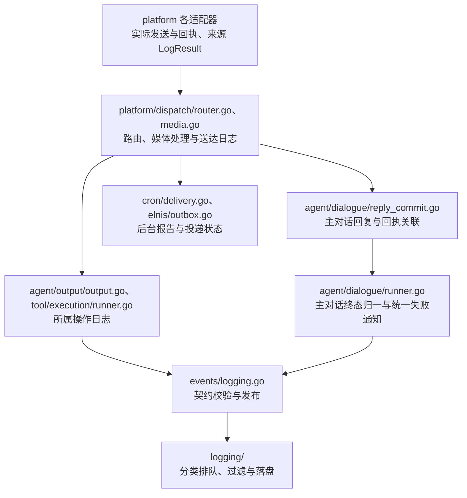

<!-- locator:platform -->
## 平台适配

平台负责输入归一化、历史与输出落地，支持本地／远程 CLI、QQ OneBot、QQ Official、Telegram 和 headless。

Platform 根部按下层目标契约实现总管、装配与公开能力；下层契约见 [App 包设计](app-design.md#platform-下层目标契约)。根部持有适配器与订阅，借用 App 持有的历史库，输入转换为 Agent 自有请求并保留延迟媒体解析。contracts.go 的公开 MessageContext 只表达原文、原生载荷与引用事实，运行能力留在内部。dispatch 只取得名称、发送及可选的 API、媒体解析能力，完整 Runtime 归总管；引用存储依赖通过根部闭包固定，不混入共享请求。public_api.go 将通用能力与原生透传分开路由，不解释平台协议。Share 已定义运行、入站、两类可选 API 和通知接收契约，并提供通知目标转换；CLI 已接入运行与通知，Headless 已接入无状态运行契约，其余适配器生命周期、capability_api.go 及调用方接线仍待子包阶段实现。旧 platform.go、module/、builtin/ 保留删除标记；旧反向依赖及调用方尚未迁移，整线尚不能编译接通。

- Platform Supervisor 管理适配器；服务模式各平台退出互不影响，全部退出后仍等待外部停止，本地 TUI 退出结束整线。独立故障记录错误并异步通知其他运行平台的配置超管。BeginClose／Wait 仅停止并等待接入；Close 最后释放 UI、通知和适配器资源，历史库由 App 在所有业务线退出后关闭，Done 表示最终清理完成。
- Headless 是 Service 模式的无状态主发送占位：Start 仅检查 context，BeginClose 无操作，Wait／Close 立即完成，两种发送入口保持拒绝输出。根部不启动它，只登记最终清理；Service 持续等待外部停止由根部负责，Headless 不持有接入、资源或常驻协程。
- CLI 已实现本地／远程服务的分阶段生命周期：同步确认终端或监听就绪，停止业务接入后保留展示与连接发送，最终 Close 等待终端和连接处理退出；管道读取可取消，终端以正常退出消息收尾。CLI 拥有自有事件契约和状态订阅，展示目标来自事件事实，状态版本与绑定版本分别处理。换绑清除旧绑定待发状态并拒绝迟到事件，已开始的发送允许完成，新状态随后串行发送；展示关闭等待在途发送，不取消共享连接上的写入。取消 Wait 观察时优先返回已记录的独立运行故障，不提前宣告接入退出。远程默认回复固定原连接，断开即失败，显式目标按多连接规则发送。客户端连接选择和结果分类归 CLI，已连接后断线结束展示并返回失败。
- 思考流直接接收原始增量与结束边界，每次调用独立，首个有效增量打开展示，结束／失败／取消收尾；逐增量刷新接管来源，不重放历史，展示错误不改变业务结果。
- 原始有序 segments 写入 Chat History 并清洗敏感来源，只在唤醒或 waiting continuation 时物化媒体。引用依次按输出关联、历史、平台能力恢复。
- 历史片段和引用事实由 Storage 的 ChatSegment、ChatReply 及编解码函数定义，适配器转换后直接写入历史库。Platform 根部及 AdapterDeps 只接收写入、单条身份查询和两项别名能力，refcontext 只接收历史身份查询；旧适配器构造与完整历史字段留待子包阶段替换，不反向放宽契约。Tool 根部直接查询并适配存储记录和错误，Builtin 根据内部引用事实展示；Platform 无历史查询或清理包装。Media 使用自有 PlatformMedia、HistoryMessage 和注入的解析函数，承担缓存、关联及获取上限，不依赖 Platform；目标平台解析由 dispatch 复用平台注册表执行。Agent 通过自有请求中的延迟解析函数物化媒体，按历史身份关联成功的媒体位置。
- 相同 actor／platform／scope 的最后一条 assistant 引用触发 Resume，较早回复触发 Fork。
- QQ Official 在适配器内解析 `message_scene.ext`、引用类型 `103` 和一层 `msg_elements`；入站 `msg_idx`、发送回执 `ext_info.ref_idx` 按平台／scope 映射到真实消息 ID，存入 Chat History 库并随历史清理。映射命中后复用公共引用恢复；未命中时只展示事件自带文本与附件，不触发 Resume／Fork。
- OneBot 私聊或显式引用 forward 展开一层，其余情况用占位；纯文本超过 3000 个 Unicode 字符时发合并 forward，失败不退回分条。Telegram 流式分页失败保留已发页回执，不重发整段；CLI 返回空回执。

<!-- locator:session -->
## Session 生命周期

- Session 唯一管理 current 和 Binding；切离后原 binding 永久失效，切回建立新 binding，删除使全部相关绑定失效。
- 准入锁顺序为 Scope → 排序 SessionID → 状态锁；模型、工具、Hook、发送及一般信号在锁外。执行中禁止普通切离／删除，维护跳过忙碌项。
- ForegroundActivated 在接管提交和新绑定建立后、释放准入前同步派发，订阅者只更新执行内存，不做 I/O 或再次获取准入锁；派发失败不回滚已提交接管。BindingChanged 在锁外发布并清理旧展示与撤销记录。
- 首次主对话准入保存 llm_origin 的 protocol、provider、base_url，失败拒绝调用；压缩／Fork／后台副本继承归属。
- 后台准备不激活 current，复用拒绝已接管会话；所属用户同平台私聊或 CLI 管理入口可恢复。永久接管改为前台 Scope／work，保留历史和 workspace，在途调用不重启；后续调用与发送使用刷新来源。
- 接管提示追加为请求末尾的合成 user 消息，解除后台无人值守、自动汇报及强制 JSON 要求，不写入 system prompt 或展示历史。

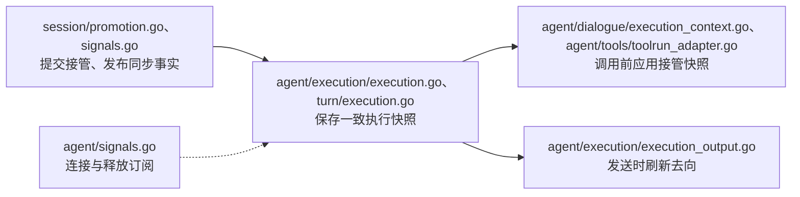

- Fork／后台复制在锁外准备材料，提交复核 binding、checkpoint、pending 和取消；Session、消息、seed 与媒体引用原子保存。Responses 按分叉时的不可变快照取材料，包含对应工具批次结果、排除之后追加的结果，不重跑历史工具；后台副本不激活前台或继承执行／工具状态。
- 命名受应用生命周期管理，Turn 结束不取消；Scheduled 表达调度，Completed 表达终态，取消后不写标题或 fallback。TTL 和 /new 只清除 current，下一条输入再建记录。

<!-- locator:llm -->
## 模型服务与客户端

- modelmgr 唯一持有模式／槽位、命名／压缩选择、厂商运行时与目录／窗口缓存；后台默认 work，Elnis 可选 elwisp1/2/3，Cron 可指定模型。
- 厂商重载串行准备全部客户端后原子发布，新快照拥有独立缓存；在途轮继续用旧快照，旧请求不回写新缓存。模型目录并行查询 provider，编号在筛选前分配，结果返回副本。
- 模型切换先原子保存 state.toml 再发布内存，失败保留旧选择；命名与摘要固定各自选择和 fallback，Prepared Hook 不改模型身份。
- httpclient 管代理、可取消的初始交换重试、SSE 与超时，断流不重放；鉴权、编解码与终态归客户端。Extra 只补字段，重名发送前拒绝；重试通知跟随真实调用 context。

<!-- locator:context -->
## 上下文与压缩

contextmgr 管历史、用量、阈值和压缩分派，通过 Selection 查询 modelmgr 的窗口；协议 Compactor 准备结果，执行层交接，Session 保存新会话。

- 手动／自动压缩共用开关、阈值与当前窗口。压缩中拒绝输入、允许停止，交接复核取消、binding、接管和 checkpoint；先保存新 Session 再切 current，后台仍无 current，继承 workspace 与命名信息并清除旧用量。
- Chat 使用文字摘要模型或对话 fallback，seed 在首条输入保存“摘要＋历史用户原话＋当前输入”后消费。
- Responses 固定当前模型，完整窗口末尾加 compaction_trigger，使用普通流、store=false、tool_choice=none；不带旧链 ID 或正文格式要求。必须返回唯一非空加密 compaction，seed 只含该项与素材引用，首个 checkpoint 成功才消费，根材料保留供恢复。
- 原生压缩失败不降为文字摘要或切换会话；自动压缩交接后继续已接受输入，手动压缩不自动聊天。
- Soul、记忆、工具和显式 tag 提示由公共 Prompt 来源组合，Chat 每轮构建 system message，不入历史。
- Usage 与活动时间在 Turn 收尾合并保存；未返回用量时只更新活动时间，保留原 Usage，保存失败仍保留内存已观测值。摘要与状态计数为可空 int64，未知存 NULL，明确零存 0；迁移保留既有数值，不把历史零值猜成未知。

<!-- locator:storage -->
## Storage 与 SQLite

- storage 定义领域模型与 repository 契约，SQLite 实现消息、Session、历史、工具、Cron、Elnis 与原生状态事务。主库使用单连接，工具状态随整份 Session metadata 合并更新，以保持事务和状态合并简单可靠；实测出现连接等待或编码瓶颈后再调整。
- 主库为空时，在同一事务中直接创建 `db_init.go` 的最新结构并记录已包含的迁移版本；已有数据库及结构快照之后的新版本由 `migrations.go` 补齐升级。普通测试也走这一建库入口，使用各自独立的内存库；迁移和文件重开测试保留专用夹具。
- Session 仓储的 Mutate 在短事务读最新行，只改负责字段，不做外部 I/O 或嵌套仓储操作；持久化值不变则跳过 UPDATE。metadata 保留未知字段和数值精度，损坏数据拒绝读写。
- segments 是结构来源，content 是文本投影；ToolBatch 用 tool_result_message_ids 保存调用与结果数组关联，复制时重映射全部 ID。
- 原生表保存 exchange／input／call／checkpoint／seed，Session metadata 保存归属、版本与引用；关键提交比较旧 checkpoint，原子合并消息、seed 消费与媒体引用。
- native_seeds.media_ids_json 始终为 JSON 数组，无媒体存 []；原生窗口按目标 checkpoint 批量读取，查询保留平台隔离、归档与 Fork 范围。

<!-- locator:elnis -->
## Elnis / Elvena / Elwisp

Elnis 接收事件，Elvena 定义公共协议，Elwisp 提供外部事件与工具；Elnis 复用 BackgroundRunner 和公共发送能力。

Elnis 独用的 EventRepository 与 Media 契约由 Background 根部转换；JSON 由 Elnis 解释，状态、回执与媒体引用事务由 Storage 完成。平台 API 通过函数注入，平台选择与调用由 Platform 公开能力负责。Cron 与 Elnis 共用 share.ReportMessageMap 和 MapReportReceipt，保留实际平台、scope 与消息 ID。

接收、去重、outbox 与恢复见 [Elnis 架构](elnis-elwisp.md)；配置和协议示例见[使用文档](../docs/elnis-usage.md)。

<!-- locator:cron -->
## Cron 与后台任务

Background 根部保留 `supervisor.go`、`deps.go`、`wiring.go`、`lifecycle.go` 四文件，负责门面、Store／ChatHistory／Models／Media／Logs／Agent／Tools／Platform 借用依赖、装配与生命周期。业务由 `execution`、`cron`、`elnis`、`maintenance` 承担；根部不取得 Agent 的 Session 或执行器，也不公开内部 Runner。Elnis 的存储、媒体和生命周期已接入；当前 Background 整包验证受 Elnis 的旧 Elvena 调用阻塞。

Cron 独用的 `JobRepository`、任务快照与运行事实放在 `cron/repository.go`，由根部 `cronBridge` 转换 Storage 记录与错误。Metadata、DeliveryState 作为原始 JSON 交给 Cron 按任务解析，坏记录单独记录失败，不阻断其他任务。Cron 不持有完整 Store 或 Session 服务；模型使用最小接口，发送、Agent.CopyBackground 和接管查询分别注入。Cron 与 Elnis 共用 `share.SessionTakenOver` 函数契约，查询由 Agent 调用自有 Session 完成，Share 不读库。广播复制按任务来源平台跳过源端，复制元数据保留 JSON 值类型。

Runner 只准备任务目录与后台来源并调用 Agent.RunBackground；会话、工具预载与执行上下文由 Agent 处理，报告解析与重试归 Cron、Elnis。Elvena、Elnis 和 Background 共享请求使用 Tool 根包工具声明类型，JSON 保留协议字段名并忽略内部关联字段。维护组件使用会话／历史清理函数、日志最小接口及媒体 Cleanup 接口；历史引用统一在媒体清理时对账。

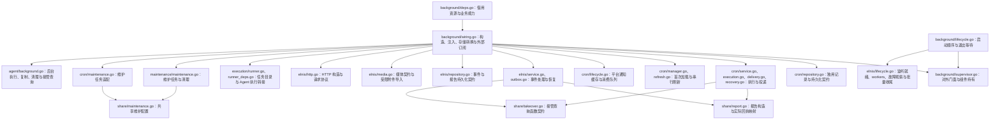

Tool 管理任务定义，Background 负责调度、执行与投递状态。构造时订阅 Tool 的任务变更，回调只合并名称、不读库。Manager.Start 首次加载后重新读取启动期间变更的任务，再启动调度；运行期间由单个 worker 刷新，读库期间的新通知保留到下一轮。修改、禁用、删除和同名重建均以最新存储记录为准。维护任务配置与执行结束后的调度更新也走这一入口。Stop 停止接纳并等待刷新、Handler 和收尾记账实际退出。

根部启动顺序为恢复 → SetupCron 配置维护任务 → Manager.Start → 启用的 Elnis 就绪 → Cron Service.Start。平台通知在 Service.Start 前按平台合并，并保留最新上下文的值，不继承发出方取消；此时不创建 worker。前置步骤成功后放行，同平台串行、不同平台独立，Start 不等待恢复任务完成。关闭清空缓存并取消队列，Close 超时不会提前关闭 Done；生命周期不关闭借用资源。

Elnis Start 同步重置投递状态、绑定监听并启动 workers；禁用时根部仍恢复中断执行。退出先关闭接入与连接、取消执行，等待 handler、Serve 和 workers 真实退出，再批量失败化未形成报告的执行并原子释放引用，保留持久化报告。收尾写入隔离取消并限时 5 秒，失败交回 Close，由下次启动恢复兜底。

Runtime.Wait 的致命运行故障由根部观察，触发 Background 整线 BeginClose 并通过 Background.Wait 及时交给 App；正常 Wait 等待实际 Done，取消等待不关闭组件。根部对订阅调用 BeginClose 并等待已接纳回调退出。Done 包含组件和观察工作真实退出，Close 只返回清理结果；单个事件或投递失败不升级为整线故障。

具体停止原因由下层组件归类，上层只依据生命周期结果协调退出。Background 的启动／等待取消路径直接通过 Runtime.Wait 获取已发布结果，不依赖异步转存、不解析 HTTP 错误；已取消的等待上下文使观察及时返回。Runtime 启动结果也保留已经发布的运行故障。

执行收尾只按本次开始时的任务 ID 写 LastRunAt、UpdatedAt，由 SQLite 原子递增 run_count。记账不写 Enabled 或 NextRunAt，不把旧任务的运行算进同名重建的任务。报告状态和实际发送回执在同一事务提交；即使投递令牌已过期，实际发送的消息映射仍保存，旧状态不会覆盖新状态。

- 每次调度新建后台 Session，同轮 JSON 修正复用 Session、首轮工具和固定模型；前台接管后等待真实 Execution 结果，停止后台修正、自动报告与未开始补投递。
- Cron／Elnis 后台 sandbox 的 shell 非 critical 风险自动确认；critical 拒绝执行并返回提醒。
- 任务 provider／model 成对校验，省略更新保留，同时清空回到 work；配置更新返回完整任务并保留运行事实，安排调度仅在下一次运行时间变化时保存。
- Handler 返回来源 LogResult 与原始 error，由调度器在状态保存后发布一份整体运行日志；触发、逐目标投递审计与正常对话日志独立保留。
- once 分开保存任务配置与 Delivery，TaskCompleted 表达任务结论，ReportReady 表达报告可复用，全部投递完成后才禁用。
- 连接恢复可为过期的一次性任务首次生成报告；同轮已有报告直接复用，不重跑 LLM。恢复使用最新配置和逐目标／output 状态，同任务投递互斥可取消。附件失败同轮降级文字，再失败等下次连接。
- 报告落库前可能重新执行，发送成功但回执未落库时可能重复投递。
