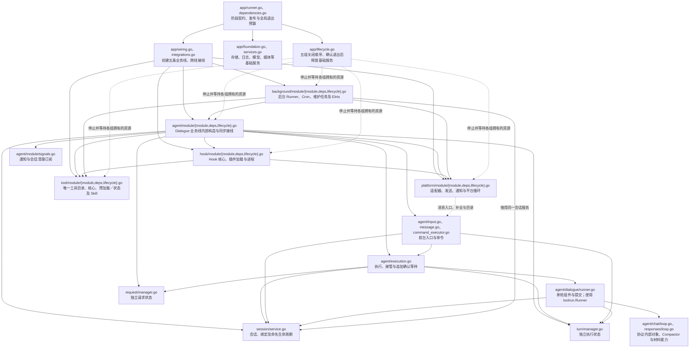
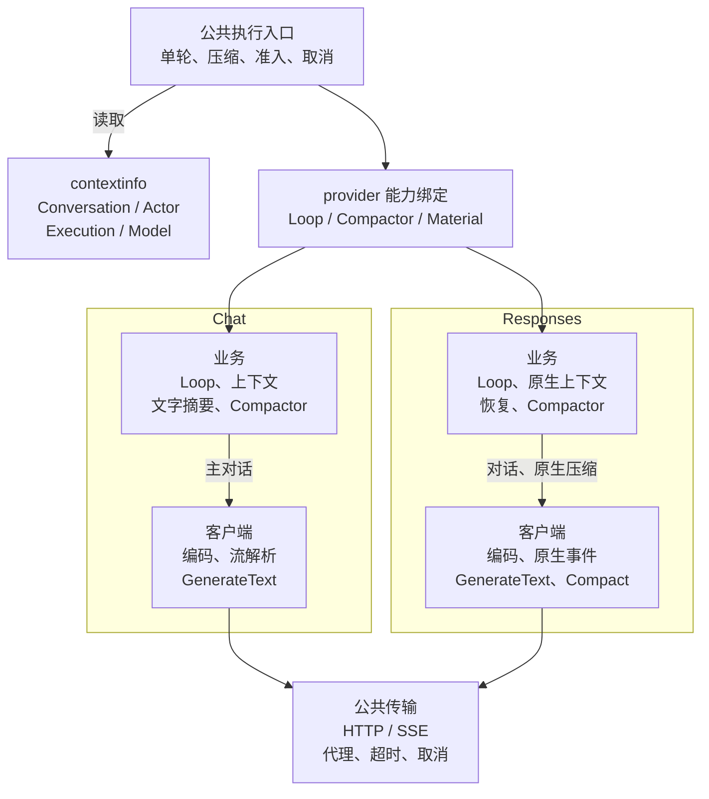
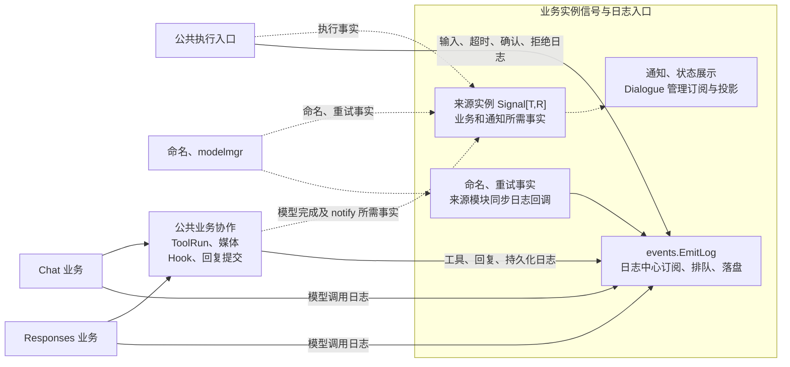
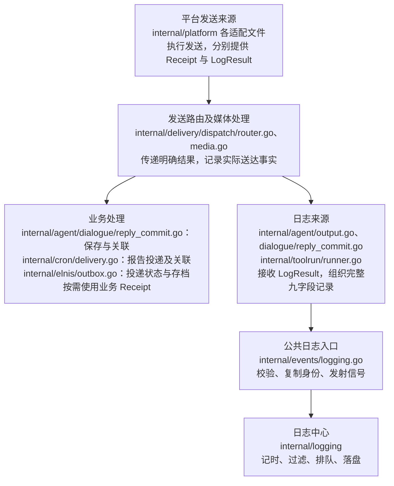
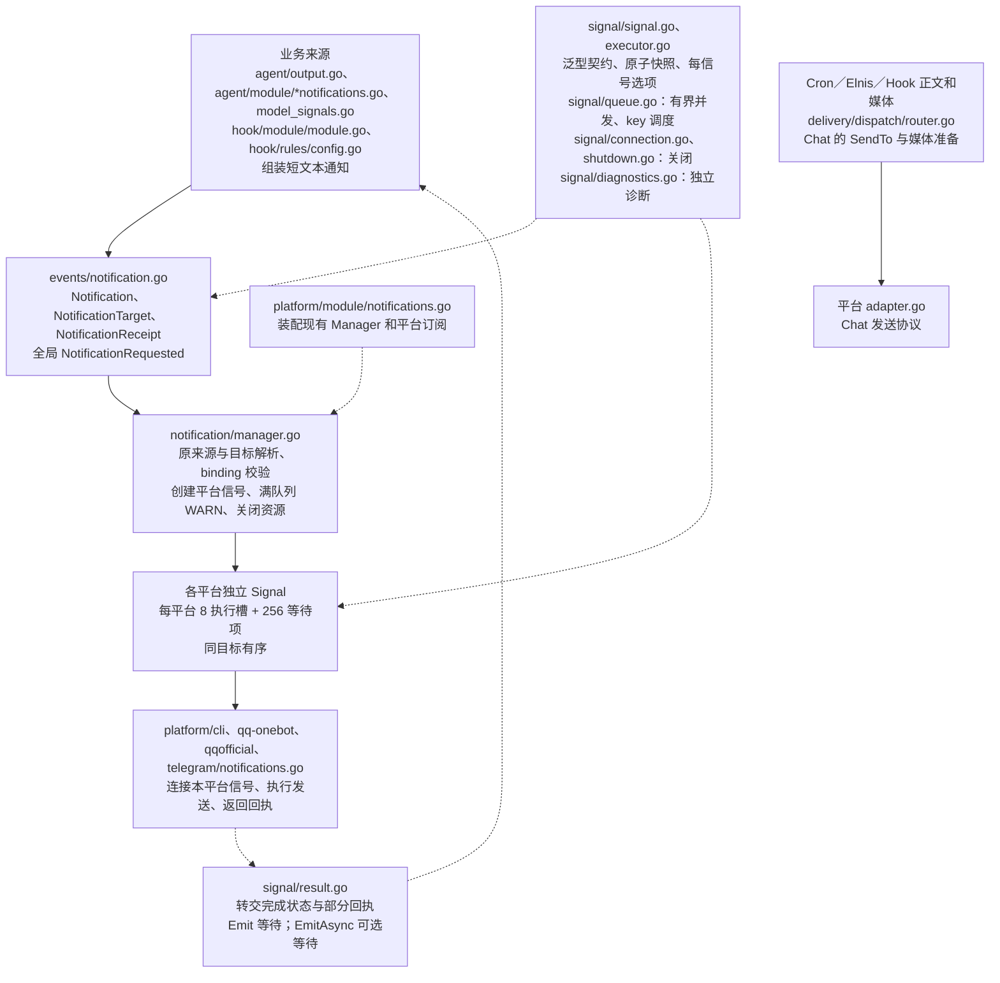
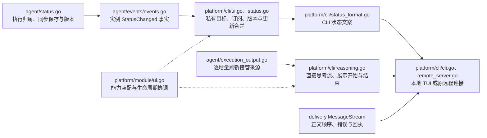
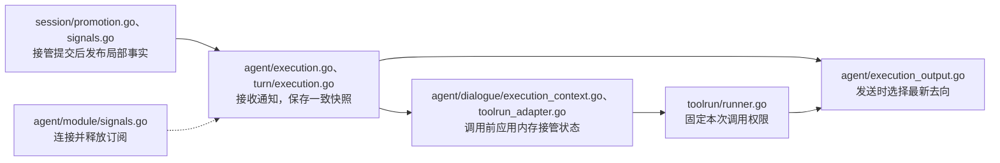

# ElBot 架构说明

本文说明模块职责、调用链和关键约束。代码入口见 [代码地图](code-map.md)。

## 定位方法

按 [代码地图的定位方法](code-map.md#定位方法) 选择 locator，再搜索本文件对应章节：

```bash
rg -n '^<!-- locator:tool-flow -->$' devdocs/architecture.md
```

按命中行号只读相关章节；需要具体文件入口时转到代码地图。

<!-- locator:startup -->
## 启动与装配

`main → launcher → app.Run / Runner → 五条业务线 → 各自的中层组件`。

- launcher 解析模式和参数；Runner 依次准备 Environment、Foundation、Models 和 Wiring。Foundation 只拥有配置、SQLite 与日志；`services.go` 创建共享模型、媒体、权限与诊断基础服务。
- `wiring.go` 只创建 Platform、Tool、Hook、Dialogue、Background 五个上层模块，并按各自的 `ModuleDeps` 提供消费能力。每次 App 装配只创建一份共享实例；没有全局单例、Service Locator 或向下传递的全量依赖集合。
- 每个组合包的 `module.go` 创建本业务线组件，`deps.go` 声明外部能力，`lifecycle.go` 只释放自己拥有的资源。中层继续用自身的窄 Deps 构造，各取所需；Session、Request、Turn 各自拥有状态，由 Dialogue 创建，Background 借用同一份实例。
- Tool 只构造工具目录、执行核心、预加载／状态、Skill、Memory 与文件服务。Hook 和 Background 将各自业务工具注册到共享目录；Cron 工具的注册由 Background 持有，可独立回滚。工具调用编排属于调用方的 `toolrun.Runner`，Tool 的 `Manager` 提供核心能力，不接收其他上层模块。
- `integrations.go` 只连接跨线回调、消息处理、补全与命令目录；模块间不导入兄弟组合包。构造依赖和入口回调分别连接，避免包循环。Dialogue 内部连接 Session／Execution，公共单轮自行构造消息、提交与 Prompt，Chat／Responses 自行构造协议内部对象及 Compactor。
- 全部模块构造并接线成功后，按 Tool、Dialogue、Hook、Platform、Background 启动。Hook 首次 Reload 此时才执行，常驻任务启动前已有 Wakeup／Observer 回调；加载错误仍按原策略记录并提示。平台循环提交启动后再异步启动 Cron；CLI-only 不启动调度器和 Elnis，仍恢复中断状态。服务模式的 Platform 模块持续等待外部停止，不依赖是否配置平台、是否仍有平台循环或是否启用 Elnis；直接启动的交互 CLI 拥有应用退出职责。
- Runner 统一发起 `BeginClose` 并使用同一个 30 秒退出预算；按 Platform、Background、Dialogue、Hook、Tool 等待各业务线停止，再释放基础服务、SQLite、日志及服务标记。Hook 核心在 Dialogue 的最终追加确认输出和命名任务退出前保持可用。
- 五条业务线使用明确的 `BeginClose / Close / Done` 契约；无独立资源的下层组件不增加空生命周期。部分构造失败也返回已取得资源的所有者。超时后保留仍被任务使用的依赖，不启动延后的清理链；重复关闭等待同一完成结果，关闭后不能重新启动。取消和预算耗尽按正常退出处理，真实错误继续返回。

图中实线表示组合或消费关系，从组装／消费方指向依赖；虚线表示 App 在构造完成后连接的入口回调及生命周期调度。



<!-- locator:contextinfo -->
## 公共上下文事实

`contextinfo` 唯一定义四组事实，getter 返回快照和存在标记；缺失不补全局默认值。

| 分组 | 内容与来源 |
|---|---|
| Conversation | 平台、平台会话、发送者、消息／回复 ID 与平台私有扩展，由入口提供 |
| Actor | ElBot 身份、角色及平台群角色，由 security 解析 |
| Execution | Session／当前、父、根 Request／Run／Attempt ID，由对应服务建立关联时提供 |
| Model | 固定 Selection 与 provider 绑定确定的 provider、model、protocol |

- 平台会话 ID 与 ElBot Session ID 分别表达。角色事实不授予权限，执行 ID 不替代 binding／attempt 有效性校验；公共包不持有凭据、配置、服务或原生载荷。
- `MessageContext` 安装公共 Conversation，私有 context 保存正文与 Sender，读取时重建投影。`PlatformData` 由平台提供不可变快照，公共层不解释或序列化。
- 前台接管替换 Conversation、Actor 和平台来源，清除新来源缺失的事实，并按新选择更新 Model；执行取消链保持不变。
- 远程 CLI 默认回复固定原连接，断开即失败；显式用户／管理员目标按多连接规则发送。

<!-- locator:signal -->
## 信号与订阅

来源模块拥有业务实例信号及事件类型，并在实际操作处确定日志结果。Agent 的输入、超时、确认、拒绝、模型、工具、回复及持久化在操作来源直接组织日志；没有业务消费者的日志中转事件和投影连接已删除。Session 命名和 Model Manager 重试自行维护同步日志连接；Dialogue 管理通知订阅，CLI 管理状态展示订阅，App 统一调度五条业务线生命周期。公共日志入口为 `internal/events.EmitLog`，日志中心自行订阅并持有分类队列。契约见[信号与日志系统设计](signals-and-logging.md)，实施进度与待办见[任务清单](tasks.md#信号与日志系统整改)。权限、可改写 Hook、Usage、工具记录和关键提交同步完成；信号发布观察事实。

- `Signal[T,R]` 使用原子订阅快照，连接变更时复制。`Emit` 等待实际结果，`EmitAsync` 返回入队错误与可等待的 `Emission[R]`；结果按订阅顺序排列。`Observe` 用于无业务返回值的事实消费者。
- 每个信号独立调度，默认 8 个执行槽、256 个等待项、30 秒总期限；满时拒绝。按 key 串行，不同 key 并发，等待同一 key 不占执行槽。超时取消 context 并完成调用方结果，回调实际退出前不释放执行槽或 key；不配合取消的回调最多占满自身信号，不能借超时不断增生 goroutine。
- `Disconnect` 不撤销既有快照，`Connection.BeginClose/Close` 取消并等待本连接已接纳的回调。信号关闭采用 CancelPending 或 Drain，`Done` 表示所属队列回调实际退出。来源明确选择传入业务 context，或用 `context.WithoutCancel` 发布需要保留的终态事实。
- 日志分类队列仍串行，容量 256，入队等待上限 500 毫秒，采用 Drain。公共发布解除请求取消；九字段契约由 `EmitLog`／`EmitLogAsync` 共用验证与身份复制。诊断 stderr 使用独立有界队列，阻塞时不占业务执行槽，诊断溢出合并计数。
- `LogRecord` 是九字段封闭契约：Category、Level、EventName、Module、Type、Content、ContentLimit、Identity、ResultStatus。三个整数枚举验证合法性，ResultStatus 零值表示未声明，Level 与结果相互独立。契约验证集中于 EmitLog，消费端不重复校验；格式化负责 text 字符限长、JSONL 编码和记录字节上限。
- 业务事件和 notify 保留自身字段及原始对象；日志通过独立 LogRecord 发布，专有事实写入 Content。需要字段查询的审计和 Elnis 日志使用 JSON，普通说明使用 text。
- 工具记录、持久化、回复送达及提交不保留无业务消费者的实例信号；实际保存和必要业务返回值保留，日志在操作来源组织并经所属管理口发布。日志等级和结果不改变业务停止、重试或权限判断。
- 后台来源的独立记录由 internal/background/logging.go 的 LogBackground 发布；工具记录由 internal/toolrun/logging.go 的 logTool 发布。两者只接收完整九字段，不猜结果或补身份。Cron／Elnis 调用工具仍走 toolrun，模型和回复仍由 dialogue 记录；RunBackground 只传业务结果与 error，不为日志贯穿整个执行完成链。
- Cron 触发与 Elnis direct／报告投递／恢复使用所属来源 LogResult，业务原始 error 和 Receipt 独立传递；nil error 不覆盖日志失败，取消不覆盖独立故障，不以日志结果改变补执行、接管或重试规则。
- Identity 的五个 `*string` 由业务显式填写。`events.EmitLog` 验证契约并复制身份指针，不从 context 补值；nil 身份省略，显式空字符串保留。Content 是来源组织的唯一正文。
- 日志中心接收时、等待入队前记时，并提交 runtime、audit、elnis 三个容量 256 的背压队列；解除请求取消的影响，按类别入队顺序排空。中心不替换全局信号实例，重复活动中心初始化被拒绝。
- 消费者先按 Level 过滤，再按 Type 格式化；runtime 使用配置等级，audit／elnis 独立保留。text 默认 256 个 Unicode 字符，ContentLimit 可指定长度，截断标记 `…` 计入上限。JSON 正文通过 RawMessage 作为原生值写入，保留来源的字段顺序和数值。
- 文件统一写 JSONL，时间为 RFC 3339。编码后连同行尾最多 64 KiB，超限报告设施失败，不删除字段凑入上限。日志中心只处理公共契约及正文，不解释业务错误。
- Signal／Queue 的设施故障直接写 stderr，不依赖业务 Logger 或全局日志信号；文件写入错误由队列检查并报告，短写按 `io.ErrShortWrite` 报告，后续记录继续处理。非法日志类别的诊断保留整数枚举值。中心关闭超时不关闭仍在使用的文件，也不释放活动中心名额，后续显式关闭可继续清理。
- Reader 按日期和文件写入位置倒序查询，每块读取 64 KiB，满足条数立即停止；每次读取与逐行处理检查取消。打开文件后固定本次读取大小，支持跨块行及 LF／CRLF；单行上限 16 MiB，读取失败或超限返回错误。查询不改变日志记录等级。
- Reader 兼读 JSONL 与历史文本，公共字段与 Content 业务条件分别匹配，匹配后计入上限；损坏 JSONL 单独计数并继续，raw 样本保留整行且限 10 条／256 KiB。工具调用 Content.run_source 由 Runner 在调用前固定，区分 foreground／cron／elnis；/audit --run_source 复用 ContentFields，识别 JSON 键或 toolrun 的固定 text 开头标记，缺失来源不补造。命令普通展示时间、等级、事件、内容与结果，raw 与最低等级独立；用量统计保留整数精度，未知与溢出只传播到相关统计项。
- 平台直接发布全局 `events.PlatformConnected`；Hook 协调模块与 Cron 通过自身 `StartPlatformEvents` 订阅，App 只在依赖装配完成后、平台启动前调用生命周期入口。事件仅携带平台名称，不缓存、不重放。
- Hook 与 Cron 各自按平台惰性创建容量 256、满时拒绝的独立队列；保留发射 context 的值、解除其取消影响。重复连接继续交给业务处理，Cron 自行维护补跑、互斥和投递状态。
- 消费者在 `BeginClose` 或应用取消时断开订阅、停止准入并取消待执行／在途任务；`Done` 表示实际退出。Agent 关闭同时等待平台 Hook 与 append 等待任务，Cron Service 关闭等待连接恢复；共享 30 秒预算耗尽时不释放活跃消费者仍在使用的依赖。

<!-- locator:config -->
## 配置与运行数据

配置查找顺序为 `--config → ELBOT_CONFIG_FILE → 平台配置目录`。配置和资产说明见 [配置文档](../docs/configuration.md)。

- `app.toml` 为主配置；同目录 `providers.toml` 定义客户端，`api_mode` 为 chat／response，缺省 chat。协议与 Session 的 chat／work／background 模式独立。
- `state.toml` 保存模型状态，命令修改后持久化，不自动重载外部修改；`tool_tags.toml` 保存工具标签。
- 用户资产位于配置目录的 `memories.toml`、`long_memory/`、`skills/` 和 `plugins/`。Hook 入口为 `plugins/hooks.toml`，插件配置为 `plugins/<plugin-id>/hook.toml`。
- `api_key_env` 优先读取系统环境，再读取配置目录 `.env`。
- 配置要求由所属模块声明，平台和 Hook 定义由 app 装配。`Load` 与 `Inspector` 共用读取、默认值、合并和校验；配置包不依赖具体业务模块。
- `/doctor` 仅超管可用，检查磁盘配置与内置资产并按文件报告；不读取密钥、不初始化文件、不启动 runtime。内容比较忽略 CR/LF，TOML 按原文解析。

<!-- locator:agent-chat -->
## Agent 对话链路

`平台输入 → 唤醒／入站 Hook → 命令或普通输入准备 → 执行准入 → 单轮准备 → 模型／工具循环 → 回复提交 → 跨轮收尾`。

| 层 | 职责 |
|---|---|
| 独立入口组件 | MessageHandler 分发输入；InputCoordinator 准备与预加载；BackgroundRunner 准备后台身份和资源；CommandExecutor 编排命令 |
| ExecutionCoordinator | 前后台准入、attempt／Request、追加确认、pending 续跑、压缩交接和 Execution 完成 |
| dialogue.Runner | 登记前加载材料、登记后准备与保存用户输入、取得 Loop、收敛结果、提交回复 |
| chat／responses Loop | 各自的上下文、模型／工具循环、pending 和接管刷新 |
| dialogue 公共协作 | Prompt 来源、模型 Hook、ToolRun、消息事务和 ReplyCommitter |
| 根包协作组件 | 身份、确认、Hook、发送及状态记录 |

- 组件分别通过消费接口协作，不提供中心 Agent 门面，也不访问其他业务线的内部字段；依赖与配置按实际消费注入，共享层不保存协议私有状态。Session／Request／Turn 保留状态所有权，通知和展示只维护观察投影。
- 准入先检查 provider 能力和模型兼容性，登记会话归属与 attempt。材料加载在 Request 登记前；Prompt、Hook、媒体归一及用户保存使用登记后的 Request context，检查取消。
- 每轮固定 Selection。普通 `/model` 不影响在途循环；前台接管刷新模型、工具和来源。解除后台要求的合成 user 提示位于请求末尾，不写入 system prompt 或展示历史。
- 工具阶段收到的输入进入 pending；下一次模型请求前合并，最终模型调用期间新收到的 pending 在本轮结束后自动开启下一轮。
- 用户／pending 和工具 transcript 通过共同提交口保存。每个实际调用与结果组成不可变 ToolPair，保存真实参数及媒体引用，同事务成功后才进入下一工具；没有结果不预写展示调用头。
- CommitGate 在本地事务内复核原 binding、活跃 Execution／attempt；Responses 同时比较预期 checkpoint 并提交原生状态。API 审计事实独立归档。
- 回复前再次刷新接管来源，发布 sending 状态，由 ReplyCommitter 提交；发送／落库顺序见[输出链路](#output)。
- 单轮结果保留 Outcome、Usage 和实际提交事实。协调器负责 Touch、用量、状态、压缩提示、pending、Execution 结果与命名，Runner 不结束跨轮 Execution。

<!-- locator:protocol-routing -->
## 协议路线与原生上下文

`llm/chatcompletions` 与 `llm/responses` 各自编码请求和消费原生流；`llm/httpclient` 提供传输。`agent/chat` 与 `agent/responses` 各自实现业务 Loop、Compactor 和材料准备，路线之间不互相导入。

- 公共 `llm.Client` 提供模型列表与独立 `GenerateText`；`Selection` 固定 Provider、Model、Client。命名和 Chat 摘要可使用任一文本客户端，独立文本不续接主会话或执行工具。
- 公共 `llm.Usage` 的四项 token 计数为可空 `int64`：nil 表示未知，非 nil 的零表示明确零；不推算缺失总量。Agent、contextmgr 和 CLI 状态队列的用量快照逐项复制计数指针，发布后只读。Chat 和 Responses 解析保留整数精度，非法用量不使模型响应失败；Chat 的非法或 null 别名继续回退，明确零立即采用。状态展示分别保留总量与缓存计数的已知／未知状态，明确零作为已知值参与上下文比例判断。
- `routes.Registry` 按 provider 绑定 Origin、Client、Loop、Compactor、Material，并独立登记源协议能力。查询由 dialogue／contextmgr／session 的窄接口完成；重复绑定、错误接线、封闭前查询及封闭后修改报错。
- CallObservation 分别持有业务 Event 和日志 LogRecord。Chat／Responses 在操作分支填写独立错误与整体结果，本地保存失败不标为上游错误；Chat 取消时保留部分输出。实际模型请求各写一条 llm_usage，失败与取消另保留 llm_error，准备失败不计调用。视觉回退和 Responses 重放各自结束观察，HTTP 内部重试通过独立重试信号记录。
- 主对话按目标 provider 查询 Loop，压缩与分支按持久化源 Origin 查询能力；不从摘要目标或当前配置推断来源。缺失主对话能力在压缩、保存输入和模型请求前拒绝。
- `CanSwitch` 纯比较身份：Chat 可跨 Chat provider，同一 provider 节点的 Responses 可换模型；跨协议及涉及 Responses 的跨 provider 切换拒绝。命令提交选择前预检，执行及接管后的调用再次检查；永久接管在变更 metadata 前检查 work 模型。
- provider 节点名确定厂商身份，base_url 用于续链地址校验。注册表不持有执行状态或完整依赖容器。

### 主调用链

实线表示能力调用，协议业务与客户端各自分包。



### 公共协作与事件

虚线表示业务事实的发布与消费，实线表示业务调用或日志提交。实例信号与全局日志入口各自独立，各订阅者管理自己的连接和生命周期。



### Responses

展示消息用于业务观察，原生 items、推理材料和 checkpoint 用于真实续接；二者通过业务消息关联，不能互相替代。

- HTTP 请求前归档实际编码 JSON，显式请求 `reasoning.encrypted_content`，完整保存响应及未知 items。失败、取消、incomplete、提前 EOF 不推进 checkpoint；本地关键提交成功才消费输入与推进游标。
- 每次调用重新构建 instructions。默认沿 `previous_response_id` 只发送新增输入与工具输出；实际请求或响应表明 `store=false` 时，发送完整窗口且不带旧链 ID。主对话默认 store=true，独立文本固定 false。
- 目标 base_url 与来源 checkpoint／seed 的地址不同时重建窗口。明确旧链失效且尚无新内容时，以同厂商完整材料重试一次；网络、鉴权、含糊错误及部分流不触发恢复。复用已准备的输入、Hook 结果与 Selection，不重跑历史工具。缺推理、原生记录或素材时拒绝。
- schema 以 developer `additional_tools` 输入冻结，新增定义持久化；相同定义不重复，同名变化要求新会话。定义按历史位置回放，新增定义位于工具输出／用户输入之后、接管提示之前。
- 请求不发送顶层 tools；当前权限与 tool_choice 相交生成允许集合，响应调用再次校验。历史定义不恢复工具权限。只使用 ElBot function 工具。
- 工具调用集合、ID、名称和参数对 Hook 只读，改写在副作用前报错；Chat 允许参数改写。公共 Hook 通过注入策略校验，不识别协议。
- 工具副作用前保存原生响应和调用状态；结果与展示 ToolPair、原生输出及不可变历史快照同事务提交。历史快照不推进活动游标，Fork 只读当时结果；中断调用仅在原生材料补未执行／结果未知输出。
- 窗口由 seed 根、checkpoint 链和有序输入／输出重建，媒体重新解析并持有。首次调用失败后可复用完整待提交输入；格式版本、归档、定义或素材不一致时拒绝。

<!-- locator:commands -->
## 命令链路

`commandExecutor → Router → builtin 模块 → 领域服务`；Continuation 交给 inputCoordinator。参数帮助归 `command.Info.Help`，平台补全统一使用 completion，CLI 本地文件补全优先。

- 改变 Session 的命令声明 `SessionEffect`，执行器据此处理压缩与确认冲突；Session 规则由 Session 服务判断。
- 命令直接消费领域服务；手动压缩、运行查询和提交准入通过窄接口接入执行层。
- 普通用户的请求查询／停止限定当前 Session，超管可管理全局；取消前复核原 binding 与目标请求。参数补全使用解析后的 Actor。
- 列表展示状态按 Scope 隔离。用户命令说明见 [commands.md](../docs/commands.md)。

<!-- locator:request-turn -->
## Request、Turn 与状态

- Request 管活动请求树、父子关系、取消、超时和清理；LLM、工具、压缩与后台请求均登记，Hook／工具子请求保留根关联。
- Turn 管 Session 当前阶段、pending、确认和工具计数；Execution 管跨追加确认与压缩的 RunID、接管来源和一次性结果。attempt 防止迟到完成覆盖新执行，续接间隙的 pending 保持忙碌状态。
- Session、Execution、attempt、Request 分别承担归属、逻辑执行、尝试隔离和取消职责；接管、确认续跑与压缩交接保留这些独立边界，由组合场景测试约束状态转换。
- 风险确认先在锁内登记 attempt 与响应通道，再锁外发提示；响应、取消和迟到清理只操作固定等待对象。追加确认同样固定 AppendWait，等待及过期提示受应用生命周期管理。
- StatusRecorder 同步校验执行归属、保存状态并发布单调版本；发布已提交事实时解除请求取消。记录能力直接注入执行协调器、协议路线和工具桥接，不属于输出接口，也不携带展示开关。CLI 按 Session 和原始展示目标合并更新，远程连接分别处理；后台没有 CLI 私有目标，因此只记录状态。绑定失效清理积压，接管只展示之后的状态与增量。

<!-- locator:tool-flow -->
## 工具调用链路

`路线 → ToolExecutor → ToolRun → Tool Runtime → 完成 Hook → ToolPair 提交 → 路线续跑`。

- ToolRun 使用 prepared Hook 后的真实参数，做命名解析、可见性、权限、风险确认和请求登记；Runtime 兜底检查 Actor／Policy。
- 工具业务解析保留原始结果、Error 与拒绝事实。原生／远程执行的 ExecutionStarted 记录进入调用边界，不证明业务副作用已完成；业务 ResultStatus 和日志调用结果分别表达，不直接投影。
- 完成 Hook 只处理已实际执行的结果；预检失败或拒绝不触发。结果以 Content／Segments 回灌模型，Data 仅供内部消费；输出意图交发送层。
- 工具业务与日志分离：Tool.Call 分别返回业务 Result、独立 logContent 和原始 error，具体工具不填写日志结果或等级。执行入口保留真实 ExecutionStarted，把正文放入 ExecutionResult.LogResult.Content；未进入调用时声明明确结果及原因。Runner 在调用前从刷新后的 context 固定 run_source，在 Execute 返回后由 newRecord 复用基础九字段与当次身份，recordCall 填写调用结果、正文及查询事实，参数日志限 256 字符，仅发布 audit，早于后续发送／完成 Hook／保存发布；已进入调用统一 INFO／succeeded。internal/toolrun/logging.go 只接收完整记录并发布，Execute 不发布调用日志。请求登记、媒体引用准备、调用记录和 transcript 保存、发现状态保存等其他操作分别返回独立 LogResult 与原始 error，Runner 直接使用所属来源结果；后续失败不回改调用结果，Segments 不自动成为日志正文。进度见[3.1](tasks.md#31-其他-bug-修复)。
- 普通工具已运行的调用日志为 INFO／succeeded，缺 key、shell 非零及业务返回错误在正文说明；调用故障导致根本未运行时为 ERROR／failed。发送、完成 Hook、保存记录各自操作，不回改调用事实；实际保存日志等返回后记录，批次失败不伪造逐工具调用。
- 工具发现状态成功提交后才更新调用快照；已完成工具动作不因状态保存失败回滚或重跑。
- 每次工具准备前从 Execution 内存快照应用接管变化，不读取数据库；只合并归属、模式及接管元数据，保留后续工具状态提交。本次调用的权限、沙箱和调用日志来源固定，输出由 executionTurnOutput 在发送时选择当前去向；刷新错误通过 RunResult.Err 返回。
- Chat 的 tool message 只发文本，工具图片在同批 tool messages 后生成 user 多模态输入；图片标签和该派生消息不持久化。Responses 私有路线编码原生结果。
- 风险与确认供内部权限判断，不暴露给 LLM。文件调用在预检时固定目标、参数和 revision，执行前变化或绑定失效即拒绝。

<!-- locator:tool -->
## Tool Runtime、工具状态与文件

Runtime 管注册、schema、权限与执行器；ToolRun 管当前工具视图、路由及确认。`StateService` 唯一解释 Session 的工具缓存、发现、tag 和规则卡状态；`PreloadService` 只返回待提交状态与展示材料。

预载日志由 PreloadService 显式填写身份和正文；普通包装工具与后台预载跳过分别使用 `skill_wrapper_preload_skipped`、`background_preload_skipped`，整体结果为 skipped，具体原因在 text 正文。

- `@tool`／`@skill`、发现及后台首轮预加载各自在一次提交中合并状态，失败保留原状态。耗时准备在准入锁外，提交前复核取消、原绑定、模式和压缩状态。
- `tool.Info.APITypes` 声明适用的 `llm.APIType`，空集合不限；有的工具如view_image仅限在Response api下使用则可声明。
- 前台 chat 不读写工具状态或注入 Skill／tag；请求和响应边界均过滤工具。后台只使用首轮授权缓存，续跑忽略新工具参数，禁止 discover_tool、workspace 和 ForegroundOnly 工具，Hook 不能扩大集合。
- `tool_list_names` 优先匹配工具／Skill，再匹配 tag；只有显式 tag 注入提示。Elnis 展开后的根工具仍受 allowed_tools 限制，任务正文不能扩大权限。
- discover_tool 激活对应 Skill wrapper；read_file／edit_file 的隐藏 rollback_file 依赖同样受权限及前台限制。schema 返回独立副本，Fork 不复制工具状态。
- shell 在收集时分别限制 stdout／stderr 为前 256 KiB，超出部分继续排空并丢弃，截断流尾部附说明；输出量不再决定收集缓冲区的增长。

`fileops.Service` 统一处理工具与命令编辑／撤销，workspace 提供路径契约，sandbox 限制后台路径。

- 文件提交锁顺序：目标路径 → Scope → SessionID → 备份状态。读取、diff 和准备在 Session 准入外；提交内复核绑定、取消、权限、解析目标和文件身份后写入。
- /stop、切换、删除和清理与提交互斥，先提交则完成操作，先取消／失效则拒绝。外部进程不参与这些锁。
- 撤销按 Scope／当前 Session／目标保存原始字节，仅成功写入后登记，内存上限 256 MiB／1024 条；执行时复核备份、路径和 revision。后台编辑共用目标锁但不登记前台备份。

### 媒体引用与清理

- 本体按 SHA-256 去重，`media_references` 是引用事实来源。消息、工具参数、Fork、Cron、Elnis、outbox 和输出关联通过事务维护引用，读取／发送另持临时引用。
- 工具通过确认后、实际执行前，递归关联最终 JSON 参数中完整有效的媒体 ID 到 Session；不扫描自由文本。执行失败保留引用，执行前拒绝不建立引用。
- 中心统一清洗名称和来源敏感信息；下载使用原始参数。图片入库前按大小／边长限制转白底 JPEG，ID 对应实际保存内容。LLM 请求副本按配置选择 base64／S3／hybrid，S3 按需初始化。
- Chat History 查询不下载；get_media 与 view_image 限当前平台／scope。媒体中心 `GetHistoryMediaBatch` 统一处理缓存、去重、下载预算及关联，同次最多尝试 5 个未缓存位置，失败计数，缓存不占次数，超限后仍返回缓存。主库按历史内部 ID 和媒体位置保存关联，历史删除后释放引用；跨库对账故障保守停止。
- 媒体中心负责导入与图片校验。结果使用稳定 MediaID 的 Segments，经原生 function_call_output 输出图片并随工具结果保存，不产生 delivery.Outputs。消息默认取首张图片，显式序号沿用全部媒体编号。
- Elnis 排队 URL 不下载，LLM 执行时物化，direct 实际发送才导入；outbox 保存稳定 ID。输出回执保留有序媒体位置，缓存期限使用 retention_days，非正值不缓存。
- 最后引用释放后保留 1 小时。清理认领与新增引用互斥；物理删除按远端 → 本地 → 记录执行，失败保留可重试状态。同媒体 ID 的导入／上传／删除互斥，不同 ID 可并行，每轮最多清理 4 个对象。
- 清理前检查缺失引用与悬空 owner，异常保守停止。应用启动在 worker／工具运行前依次清理媒体临时引用并调用 Elnis 恢复裁决，即使 Elnis 禁用也处理历史中断事件；任一步失败即停止启动，步骤可重复执行。事件状态与引用释放由事件仓储原子完成，持久化 outbox 保留；取消清理等待已启动任务退出。

<!-- locator:skill -->
## Skill

- AgentSkill 使用 `SKILL.md` 和可选 `ELBOT_SKILL.toml`；原生 EL／Go Skill 使用 `SKILL.elyph`，Go runner 可配编译产物。
- scanner 构建 catalog；discover_tool 展示详情或激活 wrapper。原生 Skill finalize 执行 lint、gofmt、build、reload。
- reload 串行验证完整候选，在 registry 单次替换后更新 catalog；失败保留活动快照。AgentSkill manifest 写入后 reload 失败则恢复原文件。
- 媒体只在执行阶段准备：shell 使用 media_inputs／ELBOT_MEDIA_N，Go 使用 payload.media_inputs，TOML 使用顶层 type=media 参数。stdout 媒体经 os.Root 校验和中心导入；普通文本 ID 不转换。
- shell 导出缓存复用 sandbox 清理；Go／TOML 使用 Skill cwd 下的调用专属目录，执行后释放临时文件与引用。

<!-- locator:hook -->
## Hook

普通 Manager 按事件点与优先级串行执行。`hook/control` 管列表和 reload；持久 Runtime 管进程、双向 RPC、waiting 和 SharedState。协议与配置见 [hooks.md](../docs/hooks.md)。

- 规则与持久配置先构建候选，校验通过才替换活动索引和 handler；进程异步启动，启动失败由 runtime 重启策略处理。
- exec 使用 hook.v2 单次 Pipe，默认直接启动 argv；超时／取消终止整棵进程树。取消结果结合本次宿主终止事实与原生退出状态，不以已取消 context 覆盖独立进程故障。Worker 先固定退出状态与原因，再唤醒等待者。进程环境在启动时固定，系统环境优先补 .env，PATH 同时用于解析 argv。
- Hook 来源保留显式值，再从公共事实补缺失；无聊天来源的事件保留空 Scope／Actor。唤起状态在入口计算一次，不因正文改写重新推断。
- llm.messages 深拷贝且只读；turn Hook 只改当前初始 user，request Hook 只改新 drain 的 pending。当前消息 segments 在请求前保存，工具完成 Hook 改写进入工具结果。
- Hook 返回控制字段和输出意图；waiting 消息在平台 Hook 后、命令与主模型前路由，/cancel 仅取消路由执行。
- Go Hook 使用宿主 MediaAPI，进程 Hook 使用媒体 RPC；临时引用随租约或 runtime 释放，媒体清理使用调用方关闭预算，进程保留自身配置的关闭流程，全局媒体清理归维护任务。
- Handler／Run 返回 Event、LogResult、原始 error，Notify 返回 LogResult、error；未处理明确 skipped。continuation 在 runtime/routes.go 记录所属点结果；重载 commit 独立返回 LogResult、error，worker 使用来源结果。来源先声明所属操作事实，再包装业务错误；Agent／Runner 不重复发布 Hook 记录。
- internal/hook/logging.go 的 LogHook 只解除取消并发布完整九字段。manager、rules、runtime 和 Agent 桥接各自组装记录；发布处不接业务对象、不补身份、不猜结果。
- rules/action.go 与 runtime/tool_bridge.go 在 Tool.Call 返回后立即发布 hook_tool_call，等级 INFO、结果 succeeded、正文使用独立 logContent；工具业务错误仍按原业务流程返回。输出发送独立发布 hook_tool_log，使用发送来源 LogResult 和同一实际 tool_call_id。rules 使用 storage.NewID，runtime 沿用现有生成方式；没有实际工具调用的 output.send 不补造工具 ID。
- 工具请求参数无效或工具名为空仍发布 INFO／rejected 调用记录，未进入调用不补造 ID。来源提供完整日志 text，由中心限长；JSON 高膨胀字符串在来源按 Unicode 字符限长并保留 …，业务数据不改写，中心检查整条 64 KiB 上限。
- 工具审计 actor_id 在授权默认值注入前固定：有 Session 使用触发 Session 的执行 Actor，无 Session 使用原始 contextinfo；默认 Hook 权限主体不充当日志 Actor。

Hook 日志职责图见[Hook 统一发布](signals-and-logging.md#32-hook-结果判定与日志统一整理)。

<!-- locator:output -->
<!-- locator:notification -->
<a id="output"></a>
## 输出与发送

Chat 使用 `业务输出 → delivery/dispatch.Router → 平台发送器 → Receipt、LogResult、error`。`SendChat` 回复原会话，`SendTo(ctx, Target, []Output)` 发送到明确目标；正文、媒体、Hook 输出及 Cron／Elnis 报告均为 Chat。最终对话提交归 ReplyCommitter。命令的 `result.Content` 通过 `NotificationRequested.Emit` 同步发送，成功后才执行 Continuation；发送时清除旧 Session binding，保留原会话和连接，允许切换会话的命令返回结果。

- App 为 Chat 注入共享 Router。通知业务只依赖 `events.NotificationRequested` 和通知实体，不注入通知管理器。显式目标优先，否则使用捕获的原 Conversation；后台通知抑制及原 context 的 binding 校验由通知管理器执行，不从当前 Session 重建历史目标。
- `events.Notification` 统一纯文本、等级、平台、会话类型、目标 ID／ScopeID 和可选 Origin；不接媒体或大文件。`notification.Manager` 连接全局信号并持有各平台发送信号；平台仅连接并返回实际回执和错误。重试通知随真实模型调用取消，失败事实通知明确解除请求取消。无来源本地提示走 CLI，service 提示交日志中心。
- 平台通知的发送失败归 Delivery：消息平台调用 Delivery.Manager，CLI 保留专用通知协议并复用 LogSendResult。日志使用发送来源的 LogResult，保留部分送达事实；通知发布方不重复记录失败。
- 全局通知路由只有一个短处理槽，用于保持投递顺序；它只转交完成结果，不等待平台网络发送。各平台独立使用 8 个发送槽、256 个等待项，相同目标按接纳顺序串行；平台队列满时返回错误并写 WARN，不重试。默认 30 秒覆盖路由、排队及发送，不在各层重新延长期限。
- 发送前归一为 MediaID，临时解析发送副本。成功回执提供真实 platform／scope／message ID／output indexes；部分失败同时返回成功项和 error，关联失败记录但不重发。
- 业务与日志分开返回：需要两者的接口返回 Receipt、LogResult、error；仅业务保留业务结果与 error；仅日志结果的 Toolrun／Dialogue SendOutputs 返回 LogResult、error。LogResult 仅含来源明确的 ResultStatus、Content，上层不从错误或回执猜结果。正文与流式回执用于业务关联和部分送达；发送来源在 Content 中保留消息及媒体索引，不改变重发规则。



- 最终 Hook 只改变展示文本，不改模型原文和历史正文。直接回复先发送及延迟 outputs 再落库；缓冲回复先落库再发送、关联和延迟 outputs。错误仍保留实际提交／回执，已成功内容不重发。
- 流式回复合并 Replace 与 Finish 的回执：平台消息 ID 去重，实际消息按平台、scope、消息 ID 合并并合并输出索引；保留 Finish 部分失败时已经发出的消息，合并结果不共享平台回执中的切片。
- 状态与发送观察事实在同步保存或实际提交后发布；通知失败不再触发通知。发送必须等待实际回执，入队不算成功。
- 发送后的媒体回执缓存失败记录 WARN，保留实际发送结果和部分回执，不触发重发；无来源通知直接组织 text 日志，不把通知对象传入日志信号。



<!-- locator:platform -->
## 平台适配

平台负责输入归一化、历史记录和输出落地，支持本地／远程 CLI、QQ OneBot、QQ Official、Telegram 与 headless。

Platform Module 维护运行中的适配器集合。服务模式下各平台（含远程 CLI 服务）退出互不影响，全部退出后仍等待外部停止。非预期退出先记录平台及原始错误，再通过 NotificationRequested 异步通知其他运行平台的配置超管，目标去重；正常结束和应用关闭取消不告警。未配置平台或超管不补造通知目标。

CLI 拥有展示目标、订阅、更新合并和格式化。`platform/module/ui.go` 在所有组件构造后、平台启动前连接实例状态信号；关闭停止准入、取消展示并等待真实退出。应用整体退出不承诺向已关闭 UI 补发终态。

思考与正文保留两个直接接口：`dialogue.ReasoningStream` 只接收原始增量与结束边界，展示错误不改变业务结果；`delivery.MessageStream` 保留追加、替换、结束及正文回执。每次模型调用独立持有思考流，CLI 在首个有效增量时打开展示，在正常结束、失败或取消时收尾。执行层逐增量刷新接管来源，不重放历史增量；展示固定原连接。高频增量不经过信号队列。



- 原始有序 segments 写入 Chat History，去除敏感／临时来源；只在唤起或 waiting continuation 时物化媒体。Telegram／OneBot 按需解析，QQ Official 的 URL 直接导入中心。
- 引用按输出索引 → Chat History → 平台能力恢复媒体。相同 actor／platform／scope 的最后一条 assistant 触发 Resume，较早回复触发 Fork；即使 current 被清除也能恢复来源。
- OneBot 私聊直收或显式引用 forward 共用一层展开，嵌套及非图文使用占位；未引用群聊 forward 和历史保留占位。展开只进入 Context／DisplaySegments，原始媒体位置不变；去唤醒词或工具指令保持图文顺序。
- OneBot 纯文本超过 3000 个 Unicode 字符时合并 forward，只关联外层消息 ID，失败不退回分条。语音输出在其他不支持的平台使用文字 fallback。
- Telegram 流式分页失败返回已发页回执和错误，不重发整段。CLI 返回空回执。

<!-- locator:session -->
## Session 生命周期

- Session 唯一管理 current 与 Binding。切离后原 binding 永久失效，切回获得新 binding；删除失效全部相关绑定。输入、工具、确认及提交沿用原 binding。
- 准入锁顺序为 Scope → 排序 SessionID → 状态锁；模型、工具、Hook、发送及一般业务信号在锁外。ForegroundActivated 在接管提交及绑定建立后、准入释放前同步派发，接收方只更新内存，不做 I/O 或再次获取准入锁。执行中禁止普通切离／删除，维护跳过忙碌项并复核归档、置顶及时间。
- BindingChanged 在状态及准入锁外解除请求取消并发布已提交变化；Dialogue 清理旧绑定的撤销记录，CLI 清理展示积压，清理延迟不影响同步失效。一般字段更新不发布绑定变化。
- `llm_origin` 在首次主对话准入保存 protocol、provider、base_url，不含模型或凭据；保存失败拒绝调用。已有完整归属固定，压缩／Fork／后台副本继承。
- 后台准备不激活 current，复用拒绝已接管会话。后台仅所属用户同平台私聊与 CLI 管理入口可恢复；永久接管改为前台 Scope／work，保留历史与 workspace，运行中的 Execution 同步刷新来源但不重启在途请求或工具。
- Session 的局部 ForegroundActivated 信号只通知已提交的接管事实；Agent Module 连接 ExecutionCoordinator 更新 turn.Execution 的上下文和会话快照。派发错误原样返回，已提交接管不回滚。在途工具保持本次权限，下一次调用使用前台权限，输出使用发送时状态。



- Cron／Elnis 等待接管后 Execution 的真实结果，记录接管并停止 JSON 修正、自动报告与未开始补投递；不直接算作后台任务成功。
- Fork／后台复制在锁外准备源材料，提交时复核 binding、checkpoint、pending 与取消；新 Session、消息、seed 和素材引用原子保存后才激活。Responses 使用分叉时的不可变 checkpoint，工具调用头边界包含对应结果、排除后续结果，seed 独立持有完整窗口；不重跑历史工具。后台副本不激活前台，也不继承执行或工具状态。
- 命名受应用生命周期管理，Turn 结束不取消；关闭拒绝新任务，等待终态发布后断开日志连接。Scheduled 表达调度，Completed 统一表达流程结束，保留生成、保存与兜底事实；生成失败但兜底保存成功为 succeeded/WARN。取消后不写标题或 fallback，事件保留实际模型来源。
- TTL 和 /new 只清除 current，下一条输入再建记录；恢复刷新活跃时间。模式、分页选择及权限按 Scope 隔离。

<!-- locator:llm -->
## 模型服务与客户端

- `modelmgr.Service` 唯一持有模式／槽位、compact／naming 选择、provider 客户端和模型目录；不依赖 Agent／Session。后台默认 work，Elnis 可用 elwisp1/2/3，Cron 可指定任务模型。
- 模型目录并行查询各 provider，合并配置项，编号在筛选前分配；目录及选择返回独立快照。
- 切换串行构建候选，原子保存 state.toml 后才发布内存状态，失败保留旧选择；保存时不阻塞读取旧快照。命名和摘要固定各自的选择与 fallback，Prepared Hook 不改模型身份。
- httpclient 负责 HTTP、代理、可取消初始交换重试、SSE 分帧及超时；鉴权、编解码及终态归客户端，断流不重放请求。Extra 只能补字段，覆盖或重名发送前拒绝。
- HTTP 来源填写重试结果，Model Manager 固定 Identity 并发布 ModelRetrying；同步日志独立于 App 通知订阅，对话／压缩／命名共用通知接线。通知跟随调用 context，客户端配置启动后固定。

<!-- locator:context -->
## 上下文与压缩

contextmgr 管历史、窗口、用量、阈值及压缩分派；协议 Compactor 准备结果，executionCoordinator 管 Request／Turn 与交接，Session 保存并激活新会话。

- 手动和自动压缩共用 compact_enabled／compact_trigger_ratio 及当前模型窗口。压缩中拒绝输入、允许停止；交接复核取消、原绑定、接管和源 checkpoint，先保存新 Session，再更新前台 current。后台保持无 current，继承 workspace 与命名信息，清除旧用量。
- Chat 用独立文字摘要模型或对话 fallback。新 Session 暂存文字 seed，首条输入保存为“摘要＋历史用户原话＋当前输入”后消费 seed。
- Responses 固定当前模型，完整窗口末尾加 compaction_trigger，使用普通 Responses 流，store=false、tool_choice=none、不带旧链 ID 或正文格式要求。终态必须含唯一非空加密 compaction，新 seed 仅保存该项与素材引用，不拼历史原话或续旧链；首个本地 checkpoint 成功才消费 seed，根材料保留供恢复。
- 原生压缩不支持、材料缺失或提交失败时报错，不降为文字摘要，也不切换当前会话。自动压缩交接后继续已接收输入，手动压缩不自动聊天。
- Soul、记忆、工具和 tag 提示由共同 Prompt 来源组合；Chat 每轮构建一次 system message，不入历史。Usage 按 Session 返回副本并更新所属 metadata，保存失败仍保留已观测值。
- 压缩状态及摘要记录的四项 token 计数同样为可空 int64；SQLite 保存未知值为 NULL，明确零为 0。数据库迁移保留既有数值，不将历史零值推断成未知。

<!-- locator:storage -->
## Storage 与 SQLite

- storage 定义领域模型和 repository 契约，SQLite 实现消息、Session、聊天历史、工具记录、Cron、Elnis 和原生状态事务。
- 主库使用单连接，工具状态随整份 Session metadata 在事务内合并更新，以保持事务与状态合并简单可靠；实测出现连接等待或编码瓶颈后再调整存储与并发方式。
- Session 字段修改使用 `Mutate` 在短事务读取最新行，只改负责字段；回调不做外部 I/O 或嵌套仓储操作。RawMessage 保留未知 metadata 和数值精度，损坏数据拒绝读写。
- 多模态 segments 为结构来源，content 为文本投影；非空 segments 优先。ToolPair 保存调用／结果关联，复制消息时重映射 ID。
- `native_exchanges`、`native_inputs`、`native_calls`、`native_checkpoints`、`native_seeds` 保存原生记录，Session metadata 只保存归属、版本和引用。关键提交比较旧 checkpoint，材料事务同时保存 Session、历史及媒体引用；查询保留平台隔离、归档与 Fork 范围。

<!-- locator:elnis -->
## Elnis / Elvena / Elwisp

Elnis 接收并分发事件，Elvena 定义公共协议，Elwisp 提供外部事件和工具。Elnis 作为 app runtime 复用后台执行与发送服务，不充当聊天平台或管理外部监听器。

- 未形成持久化报告的中断执行保守标记失败，避免重放已产生的工具副作用；持久化报告恢复投递，接受部分发送成功或回执未落库时的重复投递。

内部链路、去重和投递约束见 [Elnis 架构](elnis-elwisp.md)；配置与协议示例见 [使用文档](../docs/elnis-usage.md)。

<!-- locator:cron -->
## Cron 与后台任务

Cron 管持久化任务、调度与运行，在实际状态保存返回后组织整体日志，独立读取／保存故障不能被调用取消覆盖；maintenance 集中注册维护任务。Cron 与 Elnis 共用 Agent 后台执行、sandbox 和 JSON 结果能力。

- 每次实际调度新建后台 Session，同轮 JSON 格式重试复用 Session、首轮工具状态和固定模型。后台 shell 非 critical 风险自动确认，critical 返回提醒。
- 任务专用 provider／model 成对校验；省略更新保留、同时清空回到 work，不修改全局选择。
- once 的配置与 Delivery 分列保存，按仍启用的 RunID／报告 Session 条件更新。TaskCompleted 记录任务结论，ReportReady 表示报告可复用；全部投递完成才禁用。
- 平台连接恢复与正常发送共用逐目标／逐 output 状态；已有报告只补发，不重跑 LLM。补发读取最新配置，由连接触发；附件失败同轮降级文字，失败后等下次连接。
- 同任务投递互斥且可取消。报告落库前可能重新执行，发送成功但回执落库前崩溃可能重复投递；不承诺 exactly-once。
