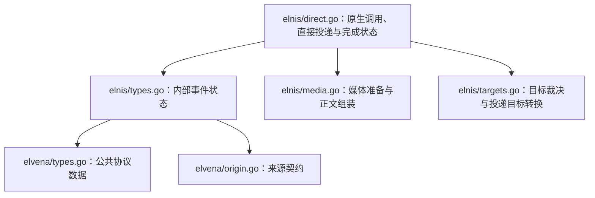

# Elnis / Elwisp 监听架构

<!-- locator:elnis -->

Elnis 接收并分发事件，Elvena 定义协议，Elwisp 提供外部事件和工具。宿主裁决授权、执行与投递，不管理外部监听器生命周期。

配置和协议示例见[使用文档](../docs/elnis-usage.md)，文件入口见[代码地图](code-map.md#elnis--elvena--elwisp)。

## 接收与分发

`HTTP → 鉴权 → 规范化与授权 → 持久化去重 → record / direct / llm`。

- Runtime 接收 POST /elvena/v2/events 和 /elvena/v3/events，提供 /healthz；限制 body 大小，仅接受单个 JSON object。
- Bearer 或 X-Elnis-Token 鉴权；token 名用于审计，Elwisp 身份取 elwisp.name，日志不记录 token 原文。
- 唯一键为 elwisp.name + source + id；重复不分发，同键不同 hash 只告警，不覆盖原事件。
- record 只记录；direct 在当前请求内依次执行原生 calls，再发送文本／segments；调用失败或取消时停止后续调用和发送，calls-only 不额外发消息；llm 落库后入内存队列，HTTP 不等待模型完成。
- RecoverInterrupted 将 accepted／queued／running 中未持久化报告的事件标记失败并原子释放引用；工具可能已有副作用，因此不重放。已有报告按 outbox 恢复投递。Background 根部在 worker 启动前调用恢复，禁用 Elnis 时也执行。

## 来源、工具与投递裁决

- 未配置的 Elwisp 默认启用，显式 enabled=false 拒绝；单 Elwisp 可限制 token、覆盖内部工具白名单、禁用外部工具或目标。
- 内部工具按全局 allowed_tools 或单 Elwisp 覆盖值，经 Tool 根部 BackgroundSelections 展开工具／Skill／tag，执行前仍校验根工具权限。
- 外部工具用 `elwisp.<name>.<tool>` 命名空间，随 payload 显式注入 Session，不经 discover_tool 发现；统一走 ToolRun 路由、记录与结果回灌。
- native 工具执行宿主权限和风险策略；远端 Elwisp 工具按无人值守 low 风险执行，其副作用属于远端环境。
- targets、全局／单 Elwisp 禁用目标和启用平台共同裁决投递范围；platform-only 请求指向平台管理员，platform-only 禁用项屏蔽整个平台。
- 事件保存请求与解析后的目标，关联使用平台实际返回的 scope／message ID。

## 后台 LLM

Elnis 位于 `internal/background/elnis`，通过 `background/share.Runner` 契约调用公共后台执行，由 `background/execution.BackgroundRunner` 准备任务目录与后台来源并调用 Agent.RunBackground；Session、权限、模型和首轮工具由 Agent 准备，JSON 结果解析与 Cron 共用。

- Session 为 background，模型使用 elwisp1/2/3，未指定或未配置回退 work；native 工具在 `elnis/<elwisp>` sandbox 执行。
- 后台不读取工作目录中的 AGENTS.md，不开放 workspace／discover_tool；Prompt、工具权限与规则卡遵循[公共工具约束](architecture.md#tool-runtime工具状态与文件)。
- 首轮提交工具／Skill／外部工具状态，续跑与 JSON 修正复用该状态；失效远端工具保留历史 schema，调用返回不可用。
- 结果解析 completed、need_report 和报告内容；有内容与目标时先保存结果和 outbox，再立即投递，无需报告则完成。
- 前台接管后等待真实 Execution 结果，停止后台修正、自动报告及未开始补投递；复用 Session 不恢复后台身份。

## 依赖边界

Elvena 的 types.go 定义公共请求、响应、片段、目标及原生调用声明，origin.go 定义来源契约。Call 只包含 platform、api、params，沿用现有请求解析机制；API 与参数由平台解释，不在 Elnis 增加映射或重复校验。Elnis/types.go 定义内部 Event，持有规范化请求、去重信息、目标快照及时间事实。targets.go 的 toDeliveryTarget 供直接发送与报告投递共用，media.go 的 directText 组装正文。

Elnis 的 repository.go 定义 EventRepository、最小事件／投递记录和独立写入请求，Background 根部 elnisBridge 转换 Storage 类型与未找到错误。JSON 由 Elnis 解释，终态引用清理、报告准备及回执映射由 Storage 原子提交。平台调用由根部注入 CallPlatformAPI 函数；Elnis 去除显式平台名称首尾空白，未指定时选择首个解析目标的平台，原样转交上下文、API 和参数。执行结果记录成功、失败或取消，原生响应正文不作为额外消息发送。

Cron 与 Elnis 共用 share/report.go 的 ReportMessageMap 和 MapReportReceipt；只映射 SentMessages，不根据未归属的消息 ID 猜测发送位置。

## 报告 outbox

`queued → running → result_ready → delivering → completed`；入队／执行失败为 failed，无需报告时跳过投递。

- elnis_events 保存事件、目标、工具、状态、Session、结果与错误；elnis_report_deliveries 按 event_id／ordinal 保存有序投递项。
- 结果和逐目标／output 项同事务保存，进入 result_ready，投递前 claim 为 delivering。
- 同目标连续未完成项合并发送，部分成功保留关联，其余待重试；全部 delivered 才 completed。
- Runtime 定时重试，启动将中断 delivering 恢复为 result_ready；发送成功但回执未落库可能重复，采用至少一次投递。
- 终态与引用释放使用独立于调用取消的有界 context，在同事务完成。

## 媒体与 workspace

- image／file 接受 HTTP(S)、data URI 和完整媒体 ID；prepareEvent 在协议入口分类为 delivery.Output/Source，Event.Segments 保存明确来源。原始 Request 仅供协议记录、去重和审计。
- record、重复、拒绝和排队 URL 不下载；排队已有 ID 建事件引用，LLM 执行时物化，direct 有实际目标才导入。
- 后台报告在 ParseJSONResult 中分类来源并规范化受限相对路径；outbox 本地附件经 os.Root 打开并检查普通文件，导入后立即建立事件报告引用，只保存稳定 ID；远端工具只操作远端文件。
- Elnis 的 Media 契约包含 Info、ImportURL、ImportReader、ImportBytes、AddEventReference，由根部适配媒体中心；每次导入传递大小及超时限制，返回公开 MediaInfo。已有 ID 在协议入口校验格式，建立引用时由对象服务与存储保证对象可用。
- 引用、输出关联和清理遵循[媒体中心约束](architecture.md#媒体引用与清理)；已发送缓存使用 retention_days，非正值不缓存。

## Runtime 生命周期与审计

Background 根部 `wiring.go` 装配服务、仓储、媒体和平台调用函数。Elnis 的 `http.go` 负责 HTTP 构造与协议，`lifecycle.go` 提供 RecoverInterrupted、Start、Wait、BeginClose、Close、Done。Start 同步重置中断投递并绑定监听后发布就绪；监听失败直接返回。

BeginClose 停止接入、取消执行并关闭连接，等待真实 handler、Serve 和 workers 退出，再批量失败化残留 accepted／queued／running 并释放引用，保留 result_ready／delivering 报告。数据库收尾使用取消隔离和 5 秒上限；写入失败由 Close 返回，并由下次启动恢复兜底。未启动的 Runtime 不额外执行退出更新，Close 超时不会提前关闭 Done。

HTTP 服务致命故障通过 Wait 立即上报 Background；根部发起整线关闭并由自身 Wait 上报 App，触发统一 30 秒清理。Wait 的运行错误与 Close 的清理错误分开，正常关闭等待真实 Done；取消 Wait 只停止等待。单次事件、模型执行或报告投递失败仍按业务结果处理。

Runtime 负责区分正常关闭与致命故障，已发布故障优先于等待取消，启动结果也保留发布前已经发生的运行故障。Background 在启动／等待被取消时通过 Runtime.Wait 读取已发布结果，使用已取消上下文立即完成观察，不等待清理或观察协程转存；根部只协调关闭，不解释 Elnis 内部错误。

审计覆盖接收、拒绝、去重、执行和投递，JSON 正文保存 Elwisp、source、event ID、mode、目标等查询事实，Session 关联写入 Identity；日志遵循[公共日志契约](architecture.md#信号与订阅)。
