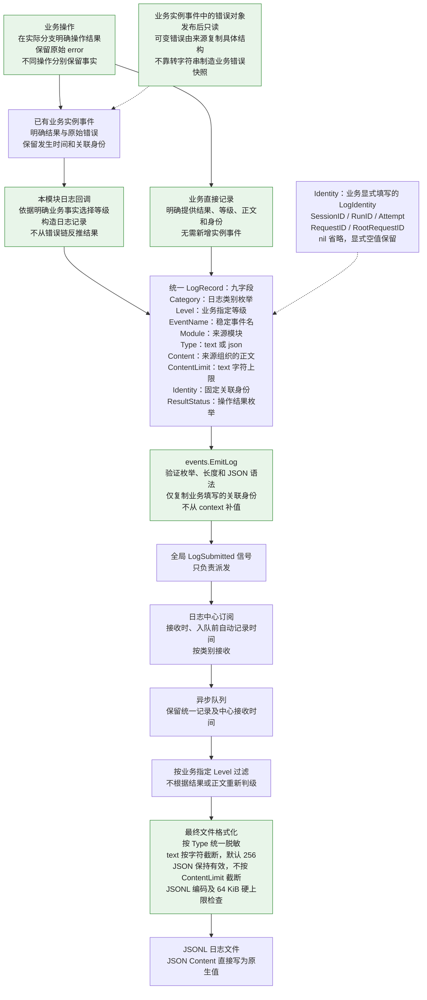
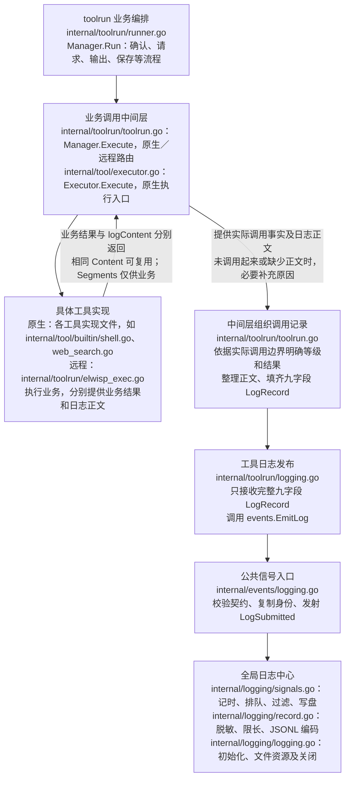
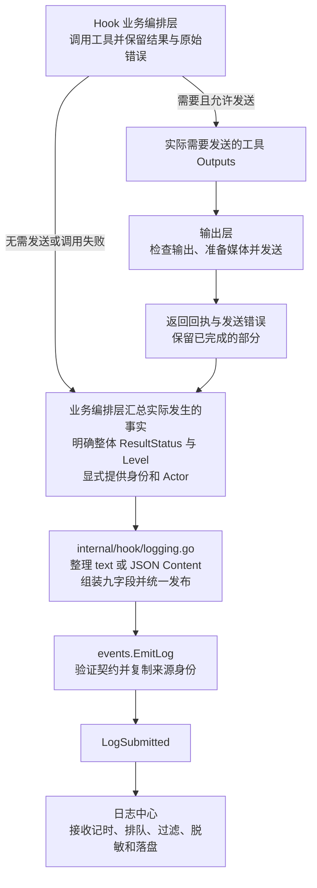

# 信号与日志系统设计

本文定义信号与日志系统的职责、契约和处理规则。实施进度、待办及验证结果统一见 [任务清单](tasks.md#信号与日志系统整改)，实际代码职责见 [架构说明](architecture.md#信号与订阅) 和 [代码地图](code-map.md#信号与订阅)。

## 设计原则

- 信号机制参考 Godot 的声明、发射和连接方式，是通用能力，未来可以服务日志以外的系统。
- 全局契约集中定义，各业务和中心自行连接。业务日志通过全局日志信号交给日志中心，不经 App 转发，也不逐层注入 Logger、日志发布器或同一全局信号。
- 业务决定日志等级和操作结果，原始错误保留在业务返回值和业务实例事件中。日志的 `Level`、`ResultStatus`、`Content` 各有职责，不能相互机械推导。
- 操作结果由掌握上下文的业务来源确定，来源事件完整传递事实。日志回调、信号和日志中心不通过错误树、错误文案或事件名反推取消、拒绝和失败。
- 日志来源组织正文，将错误原因及必要诊断写入 `Content`；普通日志优先 text，需要业务字段筛选、统计或解析的记录使用 JSON。JSON 由来源构造并先控制体积，公共日志只传递固定字段和已组织的正文。
- 不新增 Go 包，不建设共享错误分类器、取消判断器或错误树检查设施；不为未知需求预先增加抽象。
- 所有日志使用统一的九字段封闭契约、同一个发布入口和处理规则；Content 是唯一正文，Identity 由业务显式填写。
- 日志和 notify 各自负责自己的输出。日志中心不决定是否向平台通知，也不生成通知摘要；来源独立组织面向用户的通知。
- 底层定义型字段必须在 Go 注释中说明用途、填写方、零值和约束。

## 处理链路



“日志回调”是业务事件到 `LogRecord` 的转换代码。它归来源模块、同步执行，不另建异步中转队列。没有业务事件的直接记录点不必为日志新增事件。通知、状态等消费者可独立订阅业务事件。

业务实例事件保留原始错误和事实发生时间。来源在构造日志时将错误原因和必要诊断写入 `Content`，显式填写关联身份；公共日志的时间由中心接收时记录。日志与 notify 各自负责内容组织和输出。

## 信号所有权与依赖边界

| 所有者 | 职责 |
| --- | --- |
| `internal/signal` | 类型化信号、连接、执行器、队列、背压、断开和排空，不认识业务或日志 |
| `internal/events` | 全局信号及数据契约，不持有业务管理器、文件、配置或数据库，不反向依赖业务和日志中心 |
| 来源模块 | 确定业务事实和结果，发布事件，维护自身实例事件及日志回调 |
| 订阅模块／中心 | 自行连接、处理事件，持有并清理自己的连接与队列 |
| App | 服务装配、启动和关闭协调，以及自身通知和状态订阅，不转发全局日志或平台连接事实 |

业务和中心共同依赖显式的全局契约，不建立“字符串事件名 + 任意载荷”的通用事件注册表。保留已有 `Signal[T]`、`Emit`、`Connect`、`Disconnect` 等机制名称和显式生命周期。

全局信号适合多个独立系统共同观察的进程级事实；实例内部状态仍归实例。全局信号不缓存、不重放，不承担持久消息总线职责。定义和发布属于掌握事实的模块或公共契约，消费属于需要该事实的中心，不能为了日志倒置依赖。

| 场景 | 已确认边界 |
| --- | --- |
| 日志提交 | 全局日志信号，日志中心自行订阅 |
| 已有平台连接成功事实 | 全局信号，各平台直接发布，Hook 和 Cron 自行订阅 |
| 模型重试 | 客户端自己执行；保留模型实例信号、来源日志和独立通知，不新增全局重试信号 |
| 会话／请求状态 | 保留实例边界，活跃 `Binding` 等执行对象不能直接搬进全局载荷 |
| 权限、可改写 Hook、Usage 和关键持久化 | 同步完成，不依靠广播保证业务结果 |
| 查询 Reader、维护清理、Elvena 请求派发 | 需要返回结果的调用保持同步调用语义，不改成广播 |

## 公共日志字段与命名

`LogRecord` 定义于 `internal/events/logging.go`，仅包含以下九个字段。Go 注释说明用途、填写方、零值含义和约束。

| 字段 | 类型或约束 | 含义与输出 |
| --- | --- | --- |
| `Category` | `LogCategory`，受验证的枚举；来源必填，零值非法 | runtime／audit／elnis，决定日志类别与文件，落为 `category`，不判断业务结果 |
| `Level` | `slog.Level`；来源指定，Go 零值为 INFO | 业务指定的关注等级，落为 `level` |
| `EventName` | `string` | 稳定事件标识，落为 `event` |
| `Module` | `string` | 来源模块，落为 `module` |
| `Type` | `LogContentType`，受验证的枚举；零值为 text | 正文格式，落为 `type`，不猜测正文是否像 JSON |
| `Content` | `string` | 唯一正文；自然文本或来源编码的有效 JSON，落为 `content`；JSON 直接写为原生 JSON 值 |
| `ContentLimit` | `int`；负数非法；零值默认 256 个 Unicode 字符 | 来源控制 text 保留长度；截断标记计入上限，不落盘；JSON 不使用此限制，来源先控制体积 |
| `Identity` | `LogIdentity`；五个 `*string` | 固定关联身份，区分未提供与显式空值，具体见下表 |
| `ResultStatus` | `ResultStatus`，受验证的枚举 | 业务明确的操作结果，非零落为 `result_status`；零值表示未声明，不默认成功 |

公共记录仅含上述九字段。时间由日志中心在接收记录、进入类别队列前自动记录，以 RFC 3339 时间写为 `time`，业务不填写。

### 枚举与稳定标识

`ResultStatus` 采用 `uint8` 和 `iota` 枚举形式：

```go
type ResultStatus uint8

const (
    ResultUnspecified ResultStatus = iota
    ResultSucceeded
    ResultFailed
    ResultCanceled
    ResultRejected
    ResultSkipped
)
```

写入时分别映射为不输出结果字段、`succeeded`、`failed`、`canceled`、`rejected`、`skipped`。零值明确为未声明，不默认成功。操作结果日志必须由来源填写；普通提示、启动过程和进度可以不填。失败结果不强制伴随 Go `error`。

`LogCategory` 同样使用 `uint8` 和 `iota`：`LogRuntime=1`、`LogAudit=2`、`LogElnis=3`，分别输出 `runtime`、`audit`、`elnis`。保留已有常量名称及文件类别，零值非法，不能默认为 runtime。

`LogContentType` 使用 `uint8` 和 `iota`：`ContentText=0`、`ContentJSON=1`，分别输出 `text`、`json`，普通文本为默认值，不增加 plain 别名。

三个枚举均提供 `Valid() bool` 和 `String() string`。未声明结果及非法值的 `String()` 返回空字符串；非法值必须由验证拦截，不能静默写入或纠正。

Go 的整数枚举不能阻止强制转换非法数值，因此发布入口仍要验证。非法结果、类别或正文类型，以及负数长度、无效 JSON，均属于契约错误，走设施诊断和提交错误返回，不默默纠正、不推断业务结果、不递归发送日志。

事件名由来源代码显式定义，不从正文替换空格生成，不随展示文案改变。`Module` 与事件名描述来源和事实，不用来猜等级。新增命名仍须按用户要求讨论，不建立全局字符串分类表。

### 身份与正文

- `Identity` 包含 `SessionID`、`RunID`、`Attempt`、`RequestID`、`RootRequestID`，由业务在构造日志时显式填写，写入时展开为下划线字段名。与日志有关的身份由来源负责提供；没有对应身份的日志可留 nil。

| `LogIdentity` 字段 | 类型 | 落盘字段 |
| --- | --- | --- |
| `SessionID` | `*string` | `session_id` |
| `RunID` | `*string` | `run_id` |
| `Attempt` | `*string` | `attempt` |
| `RequestID` | `*string` | `request_id` |
| `RootRequestID` | `*string` | `root_request_id` |

`nil` 表示未提供，落盘时省略；非 nil 且指向空字符串表示明确为空，落盘时保留空字符串。`EmitLog` 仅复制业务填写的指针值，不从 context 补齐身份。来源后续修改自身变量不能改变已发布身份；所有订阅者只读，异步消费不查询当前会话来补身份。

- `Content` 是唯一正文。普通日志尽量使用 text；需要业务字段筛选、统计或解析时，由来源构造 JSON 并明确填写 `Type=json`。不按具体业务扩充公共字段，也不统一把所有日志改成 JSON。
- `Type=text` 按自然文本脱敏，不因外观像 JSON 而解析或结构化改写；`Type=json` 才按 JSON 处理。JSON 递归脱敏保留非敏感数据。正文内的业务键不提升为公共字段，即使包含 `level`、`event` 或 `result_status`，也不能覆盖外层正式字段。
- 原始错误留在业务返回值及实例事件中；日志来源将错误原因与必要诊断组织为正文，不将错误对象放入公共记录。组合操作的单条日志由 ResultStatus 表达来源确定的整体结果，Content 写清各操作事实、具体原因和错误。普通说明优先 text，需要业务字段查询或统计时使用 JSON。
- 不向公共日志提交任意 Go 对象、map、切片、延迟求值器或 `slog.Value`，不建设反射转换器。正文已经是不可变字符串，身份指针由发布入口复制。

### 错误诊断与通知边界

来源在构造 `Content` 时调用错误的文本接口或编码必要 JSON，将错误原因和必要诊断组织为正文。日志中心只处理固定公共字段和 text／JSON 正文，不认识具体协议错误。

协议来源负责选择与错误有关的载荷，不把完整请求、响应正文或媒体数据塞入诊断。错误原因及必要诊断进入业务组织的正文，不参与日志中心的业务结果分类。

日志和 notify 是独立链路。给平台返回的内容或简短说明由通知来源组织，发送决策由业务作出。日志查询需要的展示由查询命令处理。

## 业务结果与错误所有权

### 来源确定结果

业务在实际成功、取消、拒绝、跳过或失败的分支确定结果。来源收到的底层错误由该业务结合上下文解释，不能把缺失的信息留给日志回调补猜。事件类型本身已明确表达的结果可以直接使用，不给所有实例事件统一添加 `ResultStatus` 或 `slog.Level`。

普通工具调用的日志与工具内部业务结果分别表达。工具已实际调用起来，包括缺 key、shell 非零退出码或业务返回错误，调用日志使用 INFO／succeeded，具体业务结果和原因写入工具提供的日志正文；工具不存在或入口故障等根本未调用起来的调用故障使用 ERROR／failed。调用前正常拒绝、取消及跳过分别使用 rejected、canceled、skipped，等级为 INFO。确认通过、拒绝、停止及等待过期使用 INFO，并按实际确认事实填写日志结果；确认提示发送的独立故障使用 ERROR。发送、持久化及其他来源按自身操作事实确定等级，不重新解释工具调用是否已运行。不能仅凭 Go error 非 nil、业务 ResultStatus 或正文判断日志等级和调用结果。

日志结果不反向控制业务。确认过期的日志为 failed，但业务仍按原流程停止；等级和日志发布链整改不改变权限、执行、停止、重试及 Cron 补执行规则。完成 Hook 执行边界和 Responses 部分内容丢失两项已确认的业务缺陷另按步骤 3.1 修复。日志中心不强制 failed 对应 ERROR，也不根据 canceled 自动降级。

| 场景 | 必须保留的事实 |
| --- | --- |
| 调用成功、保存成功 | 两项均为 succeeded，整体成功 |
| 调用成功、保存失败 | 两项实际事实均保留。普通工具调用日志保持 INFO／succeeded，保存来源独立记录 failed／ERROR；其他业务的整体记录不能归为上游调用失败 |
| 调用取消、保存成功 | 调用为 canceled，保存为 succeeded；保留调用中断及部分内容已保存的事实 |
| 调用取消、保存失败 | 调用为 canceled，保存为 failed，各自保留错误；整体失败，取消不能覆盖保存故障 |
| 工具策略拒绝 | 解析阶段保留拒绝事实和类型化错误，复用已有 `PolicyDeniedError`；不能降为原因字符串再重建普通错误 |
| 工具拒绝、记录保存成功 | 拒绝记录保留 INFO／rejected；保存成功不代表工具已经执行，保存记录只表达自身操作 |
| 工具拒绝、记录保存失败 | 拒绝记录保留 INFO／rejected；保存来源记录独立 failed／ERROR，各自原因保留，不能反向改变拒绝事实 |
| 工具已运行、内部业务返回错误 | 工具调用日志为 INFO／succeeded，工具正文说明业务问题；原始业务结果和 error 保留，不能因日志成功改写业务结果 |
| 工具根本未调用起来 | 工具不存在或入口故障的调用日志为 ERROR／failed，中间层填写已知原因；工具运行后发现缺 key 的说明属于其日志正文，调用日志仍为 INFO／succeeded |
| 命名失败、兜底保存成功 | 以获得可用标题为整体目标，ResultStatus 为 succeeded；正文保留生成失败原因、兜底已生效及所用标题 |
| 命名失败、兜底保存失败 | 两项均为 failed，原始命名失败不被兜底失败覆盖 |
| 回复发送成功、持久化失败 | 发送为 succeeded，保存为 failed；整体失败，保留用户已收到消息的事实 |
| 回复持久化成功、随后发送失败 | 保存为 succeeded，发送为 failed；整体失败，保留消息已经保存的事实 |
| 回复发送和持久化成功、消息关联失败 | 发送和保存为 succeeded，关联为 failed；保留各项结果、已发送回执和具体关联错误 |
| 前序失败、后续操作未执行 | 省略未执行操作的结果，不补造成功或 skipped；需要说明流程中断时在正文写明原因 |
| 单项操作部分完成 | 例如多条消息中部分发送失败，保留失败结果及已发送回执，不能抹去已完成部分 |
| Chat 为保留部分输出返回空错误 | 仍显式传递取消或失败事实，不能由 nil 错误推导成功 |
| 重试或视觉回退 | 保留本次尝试失败、次数或回退事实，不把 retrying 增加为结果种类 |

### 整体结果与正文

公共日志仅用 ResultStatus 表达整体结果，保持九字段契约，不增加次结果、原因码或统一子结果结构。Level 表达关注等级，Content 说明具体原因、各操作事实、错误及部分完成情况。

业务事件传递业务和 notify 所需的事实及原始 error；日志所需的其他事实由操作来源直接组织为正文。正文不要求逐字段复刻业务事件的名称和结构，也不强制为组合操作嵌套各项结果。普通说明优先 text；需要业务字段查询或统计的正文使用来源与消费者约定的 JSON。日志回调和中心不从错误链或正文反推业务结果。

组合记录只表达该记录描述的业务操作，结果由掌握其完整事实的来源确定；不能把组合操作的结果投影回另一项独立操作。普通工具调用与后续发送、保存分别记录，各操作保留自身结果。回复等确有整体提交目标的组合记录中，取消伴随独立保存失败时为 failed，正文同时保留两项事实。命名兜底标题保存成功时，以获得可用标题为整体目标记录 succeeded，正文保留生成失败和兜底事实，等级由命名来源确定。

### 业务错误与日志正文

业务返回值和业务实例事件保留原始错误对象、各操作事实和必要的发生时间。来源在日志构造边界把错误原因及必要诊断写入 `Content`；全局日志信号和队列只传统一记录，不传错误对象，也不把日志文字重新包装成业务错误。

业务实例事件中的错误发布后只读，所有订阅者也只读。来源若持有可变错误结构，必须复制自己掌握的具体结构及其可变成员再发布，不能发布后继续修改。Go 的 `error` 没有通用克隆能力，本设计不承诺自动深复制任意错误类型，也不通过反射拆解或字符串化来伪装成保留原始错误。

业务返回值可以携带合并错误；来源在合并前保留日志所需的独立操作事实和错误原因。业务事件按消费者需求传递原始错误，日志回调不遍历合并错误重新分类。日志提交失败不能替代或覆盖原业务结果。

业务实例事件的错误所有权与日志正文转换分开：原始错误供业务处理，日志、数据库持久化及用户回复分别在各自输出边界生成内容；不能把这些输出文字回读为业务处理所需的原始错误。

## 日志与业务来源边界

九字段只约束发送给日志系统的 LogRecord。业务内部及 notify 使用的事件、返回值保留实际需要的专有字段、原始错误及结果对象，不要求与 LogRecord 同形。

来源提供实际操作事实及独立日志正文，由本模块的日志整理处组织九字段记录并发布。工具调用中间层只按明确的调用边界使用已确认的定级和结果规则，不重新判定工具内部业务成败。Hook 点、工具参数和诊断、模型信息及各阶段错误等专有信息进入 Content；日志信号和全局中心不接收原始业务对象。业务 Content 可以在含义一致时被显式复用为日志正文，业务 Segments 不自动转成日志正文；不为日志新增庞大中转事件、类型化 Content 包装或任意对象转换设施。

底层字段注释说明用途、来源、零值及部分完成语义。业务保留原始错误，日志只接收其解释和必要诊断；发布后的业务事件按只读约定使用。

### 会话命名

`internal/session/types.go` 定义命名事件，命名信号只有 Scheduled 和 Completed。

| `NamingScheduledEvent` 字段 | 类型 | 语义 |
| --- | --- | --- |
| `Identity` | `events.LogIdentity` | 来源填写的命名身份 |
| `TriggeredAt` | `time.Time` | 命名检查触发时间 |
| `MessageCount` | `int` | 已读取的消息数量 |
| `TriggerStep` | `int` | 本次调度使用的触发步长 |

| `NamingCompletedEvent` 字段 | 类型 | 语义 |
| --- | --- | --- |
| `Identity` | `events.LogIdentity` | 来源填写的命名身份 |
| `TriggeredAt`、`CompletedAt` | `time.Time` | 检查触发、流程完成时间 |
| `Scheduled` | `bool` | 本流程是否实际发布过 Scheduled |
| `MessageCount` | `*int` | 已知消息数量；读取失败时 nil |
| `ResultStatus` | `events.ResultStatus` | 以获得可用标题为目标的整体结果 |
| `PreparationOperation` | `string` | 实际准备操作，未执行为空 |
| `PreparationResultStatus`、`PreparationError` | 结果／错误 | 读取消息等准备操作 |
| `GenerationResultStatus`、`GenerationError` | 结果／错误 | 标题生成调用 |
| `Provider`、`Model` | `string` | 实际生成来源，未知为空 |
| `GeneratedTitleRaw`、`GeneratedTitleNormalized` | `string` | 生成原文、规范化标题；不表示保存成功 |
| `TitleValid` | `*bool` | 标题验证结果，未验证为 nil |
| `InvalidReason` | `string` | 验证未通过的具体原因 |
| `PersistenceResultStatus`、`PersistenceError` | 结果／错误 | 生成标题的保存 |
| `FallbackTitle` | `string` | 回退保存所用标题 |
| `FallbackResultStatus`、`FallbackError` | 结果／错误 | 回退标题的保存 |
| `Title` | `*string` | 实际读取或保存得到的最终标题，未知为 nil |
| `CancellationError` | `error` | 操作之间取消的原始错误 |
| `FailureCount`、`MaxFailures` | `int` | 本次流程对应的失败计数与上限 |

准备失败也发布 Completed，但不伪造 Scheduled；禁用、不满足条件等尚未启动的正常检查不发布 Completed。生成期间用户已改名时整体 skipped，保留生成事实，独立失败不能被 skipped 覆盖。生成失败但回退保存成功为 succeeded/WARN；两者失败分别保留原始错误。关闭时先等待已启动任务在共同退出预算内完成终态发布，再释放相应日志订阅。

### 用量与模型调用

`internal/llm/client.go` 的 `Usage` 中，`PromptTokens`、`CompletionTokens`、`TotalTokens`、`CacheHitTokens` 均为 `*int64`。nil 表示缺失或未知，非 nil 的零表示上游明确报告零；负数、溢出、非法值为未知，不因此使模型调用失败。不从其他值推算缺失总量。协议解析保留数字精度与字段存在性，所有消费者保留未知语义，事件发布复制指针值。

每次业务实际发起的模型请求分别记录结果与用量；视觉降级和 Responses 重放是新请求，客户端内部 HTTP 重试不增加业务调用次数。准备失败不生成用量记录；实际请求已发出时，即使用量未知也计一次调用。来源在调用流接口前将日志事件设为 `llm_usage`，失败或取消时同时保留 `llm_error`；统计只读取 `llm_usage`，每次请求计一次。

现有 `CallObservation` 分别持有业务 `Event` 和九字段 `LogRecord`。各操作来源填写结果及正文，发布时固定身份、深复制用量；日志字段不挤入业务事件。Chat 流关闭时检查实际取消状态，保留部分输出和既有空错误返回约定。

日志正文保留实际请求来源、原始及交付文本、工具调用数量、用量、耗时、回退事实和必要错误。调用、输出、验证、Hook 与保存的独立失败由掌握对应分支的来源组织，不从最终合并错误重新猜测。`ModelCallCompletedEvent` 承载业务消费者所需的模型完成事实，日志通过独立的 LogRecord 发布。

Chat 用量别名按既有顺序取第一个合法非负整数；缺失、null 或非法值继续尝试后续别名，明确零立即采用，不继续回退。顶层缓存别名均无有效值时再查嵌套详情。用量对象形状非法时保留未知用量，不因此使模型响应失败。

Responses 在现有 `internal/llm/responses/response.go` 中以 `ResponseUsage.UnmarshalJSON(data []byte) error` 和 `parseUsageCount(value json.RawMessage) *int64` 容错解析用量，计数字段使用 `*int64`。非法用量不破坏其他有效响应内容。

`CompactState` 和 `ContextSummary` 的 `SourceTokens`、`SummaryTokens`、`TotalTokens`、`CacheHitTokens` 同样使用 `*int64`。SQLite 对应列允许 NULL，新未知值写 NULL，明确零写 0；历史零值原样保留，不猜测其原始含义。数据库迁移 `nullable_context_summary_tokens` 保留已有记录、外键和索引。

`RetryEvent.ResultStatus` 表达 HTTP 来源确定的本次尝试结果；`ModelRetryingEvent.Identity` 固定发布身份。协议来源把必要诊断写入 Content，日志消费者不依赖协议错误接口。

### 工具解析、执行与完成

工具业务返回与日志返回独立。业务的 `ResolvedTool`、`ExecutionResult`、原始 `Error`、结果对象和 `ExecutionStarted` 继续供执行编排使用；`PolicyDeniedError` 保留业务拒绝事实。日志的 ResultStatus 不覆盖同名业务字段，也不改写工具记录的业务成功标志或上层停止、重试规则。

具体工具的 `Call(ctx, req)` 分别返回 `result *Result`、`logContent string`、`callErr error`；业务 Result.Content／Segments 保持给业务与模型使用。两处 ExecutionResult 的 `LogContent string` 只传递独立日志正文，空串表示未提供。含义一致的业务 Content 可以直接复用；不从 Message 或 Segments 自动生成日志正文。

普通工具调用记录只表达工具是否实际调用起来。已调用起来的业务错误、缺 key 和 shell 非零使用 INFO／succeeded；未调用起来的调用故障使用 ERROR／failed。正常拒绝、取消和跳过按控制事实使用 INFO。中间层保留调用事实，并在工具未运行或未提供日志正文时按需要补充已知原因；正文不能用来反推调用结果。

中间层根据实际调用事实组织等级、结果、关联身份、已有查询事实及完整九字段记录，并控制来源正文体积。发布归已确认的 `internal/toolrun/logging.go`：`logToolCall(ctx context.Context, record events.LogRecord)`、`logToolOperation(ctx context.Context, record events.LogRecord)` 只接收完整记录并调用 `events.EmitLog`，不接收工具、Actor、风险或错误对象，不重组正文或反推结果。Runner 保留业务编排，在准备、发送、保存等所属操作返回处按明确事实组织独立记录；工具调用记录由 Execute 中间层组装。具体工具只返回正文，不自行包日志对象。文件职责图及迁移待办见[步骤 3.1](#31-其他-bug-修复)，具体工具及调用者已使用独立正文接口，调用记录在 Execute 返回时发布；后续发送和保存独立记录。

工具调用、后续发送、完成 Hook 及保存按各自操作记录，部分结果和原始错误保留；后续失败不把已经运行的调用改成未调用成功。`RunnerDeps.RecordToolCall(...) error` 继续同步保存业务工具记录并返回原始保存错误，实际保存的日志等保存返回后记录。批次准备失败只记录 tool_batch_prepare_failed，不为未调用工具伪造调用记录。

### Elnis

Elnis 的业务失败和状态保存失败分别保留；保存返回值使用 `persistenceErr`，写入 JSON 正文的键为 `persistence_error`，独立保存失败使整体为 failed。

### 回复发送与提交

回复业务和 notify 保留各自所需的事件与返回值；发送、Hook、保存、关联和部分回执由对应来源在日志 Content 中说明。

前台保持发送→附加输出→保存，缓冲路径保持保存→发送→关联→附加输出；发送、主保存或消息关联发生独立故障时整体为 failed；纯取消为 canceled，同时保留已成功发送与保存的事实，不重发已送达内容。辅助媒体回执缓存失败单独 WARN，发送成功仍为 succeeded。

流替换与结束返回的部分回执都要保留，按 platform、scope、message ID 去重并合并输出索引。原始错误继续供业务处理，不能以日志文字替代。平台既有发送接口不因日志迁移引入通用发送结果设施。

正文示例：`回复已发送并保存；关联 Telegram 消息失败：database is locked。不会重新发送已送达内容。`；`模型调用已取消；保存响应失败：database is locked。已收到的部分输出仍保留。`；`标题生成失败：请求超时；已保存回退标题“新会话”。`。正文解释事实，不要求复刻上述 Go 字段。

## 发布、消费和生命周期

- `LogSubmitted` 在进程生命周期中保持同一实例；生产日志通过 `EmitLog` 发布，不能绕过公共入口直接发射全局日志信号。
- `EmitLog` 验证枚举、非负长度和 JSON 语法，仅复制业务填写的关联身份，不从 context 补值，不写文件、不读取当前日志级别、不创建队列、不接收业务错误对象。
- 公共日志正文是不可变字符串，身份在发布前复制。业务实例事件中的错误遵循上一节的只读所有权约定。
- 不向异步消费者传递业务管理器或活跃执行对象。身份在发布时固定；中心在接收记录、入队前记录时间。队列消费时不重新取当前时间或当前会话覆盖已固定值。
- 日志中心自行订阅，拥有 runtime、audit、elnis 三个串行队列，每个容量 256，满时等待容量，关闭采用 Drain。按成功入队顺序处理，同类别之外不保证总顺序。
- 单次请求取消不撤销已发布事实，也不解除日志背压；中心停止准入唤醒等待者。过滤、正文脱敏、text 限长和文件格式化在中心消费者中执行。
- 进程内只允许一个活动日志中心。初始化失败清理已取得的连接、队列和文件；重复构造不能形成双写；关闭不替换全局信号实例。
- App 先建立日志中心和消费订阅，再启动会发日志的业务。中心建立前的初始化失败直接返回主程序报告。
- 所有退出共享既有的 30 秒预算：停止准入、取消运行并唤醒生产者，等待生产者和消费者，最后关闭已不被使用的资源。超时不能声称排空成功，也不能强行关闭仍被回调使用的文件或依赖；剩余工作交给进程退出处理。
- 全局订阅测试不得并行争用同一入口；多个完整应用实例需要进程隔离。纯格式化、查询及无全局状态的测试可以并行。

各阶段的具体职责如下；图中业务事件保留错误和发生时间，与公共日志接收已组织正文、由中心记时的边界一致。

| 阶段 | 职责 |
| --- | --- |
| 业务来源 | 确定事实、结果、等级、正文类型及内容，显式填写关联身份；text 指定所需长度，JSON 自行控制体积；独立组织 notify |
| `EmitLog` | 验证公共契约，仅复制来源填写的身份，发射统一记录；不从 context 补值 |
| `LogSubmitted` | 只负责派发，不分类、不持久化、不重放 |
| `handleRecord` | 接收时记录时间，按类别入队；消费者按来源等级过滤并调用写入 |
| `formatRecord` | 按 Type 脱敏，text 按字符截断，JSONL 编码和记录硬上限检查 |
| 查询命令 | 按公共字段及已知 JSON 业务契约筛选、统计或展示；所有条件匹配后计入数量上限 |

### 设施故障

信号派发、回调、文件写入、非法公共契约及未完成排空等设施问题直接走独立 stderr，由终端或服务管理器收集，不受运行日志级别过滤，不递归发送日志信号，不依赖业务文件 Logger。

文件写入和短写错误必须被检查并返回；初始化和关闭错误返回生命周期调用方。运行期故障沿既有策略报告，不新增自动重启或一律崩溃的策略；初始化失败返回主程序退出。提交成功不等于持久化成功，正常取消与真实设施失败不能相互覆盖。

## 记录内容与查询

| 项目 | 约定 |
| --- | --- |
| 运行级别 | `runtime.log_level` 只过滤运行日志，中心使用业务提供的等级 |
| 审计与 Elnis | 独立保留事实；`llm_usage` 和 `/usage` 数据不因运行级别升高而丢失 |
| 正文 | 通过等级过滤后统一按 Type 和 ContentLimit 处理，不由中心在非 DEBUG 时额外隐藏或缩短；调试内容由来源明确使用 DEBUG |
| 最终上游失败 | 通过审计保留诊断，不受运行级别过滤；不改变给用户的简短错误提示，不修改上游重试策略 |
| text 长度 | 按 Unicode 字符截断，ContentLimit 为零时默认 256，正数由业务指定；超限保留前 limit−1 个字符并追加单字符 `…`，标记计入上限 |
| JSON 长度 | 业务先控制体积，不按 ContentLimit 截断，保持完整有效 |
| 单条记录 | JSONL 编码后连同行尾最多 64 KiB；超限明确报告设施失败，不写半条记录，不截坏 JSON |
| 脱敏 | 先脱敏再截断，覆盖嵌套结构、凭据、认证头、cookie 和媒体内嵌载荷；保留 token 用量等业务元数据 |
| 文件 | 新记录统一写 JSONL；保留现有文件前缀、按日轮转、保留天数和配置，不改写历史记录 |

来源组织正文；最终写入阶段统一脱敏、text 限长、JSONL 编码和记录硬上限检查。普通正文直接使用 text，需要 JSON 的来源自行编码。`Type=json` 的正文写入原生 JSON 值，数值处理必须保持精度。所有来源使用统一公共契约与发布入口。提交成功只表示准入，异步格式化或写盘失败由设施诊断报告。

runtime、audit、elnis 分别使用 `elbot-日期.log`、`audit-日期.log`、`elnis-日期.log`。Reader 的读取契约包含历史键值文本和 JSONL，包括同一文件内混合的两种格式。正文内的键不提升为公共字段，不能覆盖外层事件、等级、身份或结果。

Reader 保留从文件末尾按 64 KiB 分块读取、日期从近到远和文件内写入位置倒序筛选的行为。达到数量立即停止；读取和处理行时检查取消；打开文件后固定范围，不追赶追加数据，不按事件时间重新排序。支持跨块中文、长行、LF／CRLF、无末尾换行和跨日筛选，旧记录单行读取上限保持 16 MiB，超限报错。

Reader 遇到无法解析的 JSONL 行时继续查询。正常展示跳过损坏行，提示本次实际扫描发现的损坏行数量，以及查询结果或用量统计可能不完整；该数量不代表整个文件或日期范围的损坏总数。原始模式可查看损坏行原文并标注损坏，不能将其作为有效业务记录参与统计。正常数量上限只计入条件匹配的有效记录，损坏行不会提前占满有效记录数量；文件读取失败及超过单行读取上限仍返回错误。

- `/log`、`/audit`、`/elwisp` 使用 `--raw` 开启原始记录展示，只改变展示方式，不改变等级筛选或实际日志记录等级。
- `--level` 按 Level（DEBUG／INFO／WARN／ERROR）设置最低查询等级，不按 ResultStatus 筛选；`-d/-i/-w/-e` 分别是最低等级的快捷方式，均不自动开启原始展示。选项顺序不改变等级与展示方式相互独立的含义。
- 普通展示统一包含时间、等级、事件、内容和结果，不显示 Type。时间、等级、事件和结果集中展示，正文独立排版；text 展示解码后的文本，JSON 正文格式化展示。结果采用便于阅读的说明，零值或历史记录缺少结果时显示“未声明”，不默认成功。Type 仍用于内部解析，原始模式保留文件里的完整物理记录。
- `/log` 的 `-u`、`-a`、`--system` 行为保持。
- `/audit` 不提供 `-u`、`-a`；`--event` 按真实事件名筛选。
- `/log --hook`、`/audit --hook` 按 `module=hook` 与其他条件取交集；帮助与补全使用实际事件，不虚构 `hook` 事件。
- Hook 工具调用使用 `hook_tool_call` 和 `source=rules|plugin` 来源事实；操作结果由来源填写 `ResultStatus`。正常业务状态属性与通用操作结果各自表达对应事实。
- 普通与后台预载跳过分别使用 `skill_wrapper_preload_skipped`、`background_preload_skipped`，结果为 `ResultSkipped`。
- 整体结果从公共字段读取，组合操作的各项结果和错误原因从正文读取，不为历史日志补造字段。命令按 Type 解码正文，`--raw` 展示物理记录原文。
- `/usage` 对缺失、null、非法数字或溢出等无法统计的用量值统一显示 `null`，不替换为 `unknown`，不按零处理，也不静默排除异常记录。受该值影响的分组和总计对应项保留 `null`，其他可确定的统计项正常展示；明确报告的零保留 `0`，已知数字保留千分位，已知耗时保留秒数排版。

### Reader 类型与筛选接口

在现有 `internal/logging/reader.go` 中使用以下完整接口：

```go
type LogQueryResult struct {
    Entries []LogEntry
    DamagedCount int
    DamagedLines []string
}

func (r Reader) Query(ctx context.Context, query LogQuery) (LogQueryResult, error)

type LogEntry struct {
    Time time.Time
    Category events.LogCategory
    Level string
    EventName string
    Module string
    Type events.LogContentType
    Content string
    Identity events.LogIdentity
    ResultStatus events.ResultStatus
    Raw string
    LegacyFields map[string]string
}

type LogQuery struct {
    Prefix string
    Limit int
    Days int
    MinLevel string
    Since *time.Time
    Until *time.Time
    Fields map[string]string
    ContentFields map[string]string
    ContentFieldContains map[string][]string
    Contains string
    ContentContains string
    Raw bool
}
```

`Entries` 只含有效且匹配的记录；`DamagedCount` 是本次实际扫描遇到的损坏行数量；`DamagedLines` 仅在 Raw 模式收集，最多 10 条完整物理行、合计 256 KiB，不截断样本，继续扫描和计数并提示未展示数量。坏行单独展示，明确标注“无法判断是否匹配筛选条件”，不能声称符合身份或等级条件。

`LogEntry.Level` 保留历史未知或缺失值，不默认为 INFO；`Content` 为解码文本或保持数值精度的有效 JSON；`Raw` 保留仅去掉行结束符的物理原文。`LegacyFields` 仅存历史键值字段，新 JSONL 为 nil。其他字段分别对应公共字段，历史缺失项不补造。

`Fields` 对公共外层字段做等值匹配；`ContentFields` 对 JSON 顶层业务字段做等值匹配；`ContentFieldContains` 要求业务数组包含给定的全部值。历史业务条件查询 LegacyFields，不能将正文覆盖外层字段。`Contains` 检索解码正文与原文，`ContentContains` 只检索正文。`Raw` 只影响坏行收集及展示，不改变有效记录匹配规则。Prefix、Limit、Days、MinLevel、Since、Until 保留已有范围和边界语义。

### 哪些来源使用 JSON

| 命令 | 需要 JSON 的来源及业务字段 | 可优先使用 text 的记录 |
| --- | --- | --- |
| `/usage` | `llm_usage`：provider、model、prompt_tokens、completion_tokens、total_tokens、cache_hit_tokens、elapsed_ms；按模型、日期、会话筛选和统计；未知 token 明确为 null，实际调用仍计数；未知或溢出仅使受影响的分组及总计字段保留 null，明确零保留 0 | 用量正文必须可解析，不另建统计存储 |
| `/audit` | 需要按 tool、actor_id、risk 等业务字段筛选或结构化展示的审计记录 | 只需公共事件、模块、身份、结果或全文检索的记录 |
| `/elwisp` | Elnis 业务事件：elwisp_name、source、source_id、mode、event_key、event_id、token_name、tags 等筛选字段 | 不携带上述业务事实的运行提示 |
| `/log` | 只有确实需要结构化读取的正文才填写 JSON | 用户消息、模型回复、系统提示、通知、启动、重连、清理等普通运行日志 |

组合操作按[整体结果与正文](#整体结果与正文)表达，正文类型由查询和统计需求决定，不因包含多个操作就强制使用 JSON。不需要结构化读取的内容尽量用 text。JSON 业务条件必须在计入查询条数之前匹配，不先取满条数再过滤，也不将业务 JSON 字段并入外层公共字段。

### 落盘模拟

以下每行是一条 JSONL 记录。`ContentLimit` 不落盘；没有提供的身份省略，显式空身份输出空字符串，未声明结果不输出。

```jsonl
{"time":"2026-10-07T15:00:00+08:00","category":"runtime","level":"INFO","module":"app","event":"startup","type":"text","content":"ElBot 启动完成。"}
{"time":"2026-10-07T15:00:02+08:00","category":"runtime","level":"ERROR","module":"delivery","event":"notice_output_failed","type":"text","content":"Telegram 通知发送失败：连接超时。","session_id":"sess-demo","request_id":"req-demo","result_status":"failed"}
{"time":"2026-10-07T15:00:03+08:00","category":"audit","level":"INFO","module":"agent","event":"llm_usage","type":"json","content":{"provider":"demo","model":"demo-model","prompt_tokens":1200,"completion_tokens":300,"total_tokens":1500,"cache_hit_tokens":800,"elapsed_ms":2100},"session_id":"sess-demo","request_id":"req-demo","result_status":"succeeded"}
```

JSON Content 直接作为原生 JSON 值写入，避免整段重复转义；text 中的引号和换行仍按 JSON 标准转义。命令展示解码后的内容，原始模式保留物理记录。

#### 组合记录示意

以下示例使用单一整体结果和 text 正文，事件名仅用于示意，不作为新增事件名的确认。公共代码字段 ResultStatus 对应 `result_status`，具体原因和各操作事实由 Content 表达：

```jsonl
{"time":"2026-10-08T15:00:00+08:00","category":"audit","level":"ERROR","module":"agent","event":"example_combined_operation","type":"text","content":"模型调用已取消：context canceled；保存已有输出失败：database is locked。","session_id":"sess-demo","request_id":"req-demo","result_status":"failed"}
{"time":"2026-10-08T15:00:01+08:00","category":"runtime","level":"WARN","module":"session","event":"example_combined_operation","type":"text","content":"自动生成标题失败：上游请求超时；已成功保存兜底标题“新会话”。","session_id":"sess-demo","result_status":"succeeded"}
```

第一条整体失败，正文保留调用取消和保存失败的原因；第二条以获得可用标题为整体成功，正文保留生成失败与兜底事实。text 遵守默认 256 字符和 ContentLimit 约定，来源按所需说明长度设置上限；需要结构化查询的来源可使用 JSON。所有记录仍遵守脱敏及整条 64 KiB 硬上限。

### 查询展示示意

以运行日志中的 `notice_output_failed` 记录为例，普通展示如下。使用 `-d`、`-e` 或 `--level` 只调整最低等级，保持这种展示方式：

```text
2026-10-07 15:00:02  ERROR  notice_output_failed  失败
Telegram 通知发送失败：连接超时。
```

增加 `--raw` 后展示文件原文，Type 等已落盘字段保留在原始记录中：

```jsonl
{"time":"2026-10-07T15:00:02+08:00","category":"runtime","level":"ERROR","module":"delivery","event":"notice_output_failed","type":"text","content":"Telegram 通知发送失败：连接超时。","session_id":"sess-demo","request_id":"req-demo","result_status":"failed"}
```

`/audit` 和 `/elwisp` 使用相同的展示规则。原始展示不会恢复落盘前已经截断或脱敏的内容。

## 来源职责与平台连接

Agent、工具、Session、模型客户端与 Model Manager、Hook、平台、发送、Cron、Elnis、媒体、命令、通知、维护和 App 的直接发布点及实例事件日志回调均遵循统一契约。

Agent 的输入、超时、确认及拒绝直接由来源发布日志，不保留仅供日志转换的实例信号或投影连接。Session、Model Manager 维护有实际消费者的实例事件及同步日志回调和连接释放。模型重试日志独立于 App 通知订阅；没有通知订阅者也不能漏日志，调用结束后不显示过期重试通知。Hook Manager 记录原始执行失败，Agent 保留通知与自身桥接故障，同一错误不因迁移重复记录。终端交互是用户界面，不强行改成文件日志。

平台连接全局信号属于保留的现有能力：

- `PlatformConnectedEvent{Platform string}`、`PlatformConnected` 位于现有全局契约，携带平台名称，不持有适配器或业务对象，不缓存重放。
- CLI、Telegram、QQ OneBot、QQ Official 在既有连接成功边界直接发布；QQ Official 的 READY 发布，RESUMED 不发布；不扩展 headless、远程 CLI 或断开／恢复等新事件。
- Hook 协调模块和 Cron 自行订阅、管理按平台惰性创建的队列。既有 `StartPlatformEvents` 在装配完成后、平台启动前调用，重复启动不重复连接，关闭后不重启。
- 每个平台队列容量 256、满时拒绝，同平台串行，跨平台和跨消费者隔离。保留发射 context 的值，解除单次调用取消；关闭采用 CancelPending，App 取消时停止消费。
- `BeginClose` 停止准入、断开连接并取消队列；关闭前已取得的发射快照不能在关闭后接纳任务。`Close` 使用共同预算等待，`Done` 表示实际退出。
- Hook 执行及输出、Cron 状态与过期一次性任务补执行保持原业务规则，不新增去重、补跑或调度策略。未退出任务仍使用的依赖保留到进程退出。

## 实施接口

文件职责按[代码地图](code-map.md#信号与订阅)定位；实施约束与未完成项见[任务清单](tasks.md#信号与日志系统整改)。

### 已确认的位置与实施接口

| 名称／签名 | 位置及约定 |
| --- | --- |
| `LogIdentity` | `internal/events/logging.go`，五个已确认的 `*string` 身份字段 |
| `LogCategory`、`LogContentType`、`ResultStatus` | 同一文件中的 `uint8`／`iota` 枚举，分别提供 `Valid() bool` 和 `String() string` |
| `EmitLog(ctx context.Context, record LogRecord) error` | 沿用公共发布入口，返回日志提交错误，不承载业务结果 |
| `Tool.Call(ctx, req) (result *Result, logContent string, callErr error)` | `internal/tool/tool.go`，业务结果、独立日志正文及原始业务错误分别返回；正文可以显式复用相同业务文本 |
| `ExecutionResult.LogContent string` | `internal/tool/executor.go`、`internal/toolrun/toolrun.go`，中间层传递日志正文，空串表示未提供 |
| `logToolCall`、`logToolOperation` | `internal/toolrun/logging.go`，接收中间层已组织好的完整九字段记录并发布；不接收业务对象、不参与业务控制 |
| `handleRecord` | 沿用中心接收方法，在入队前自动记时 |
| `formatRecord(ctx context.Context, record events.LogRecord, at time.Time) ([]byte, error)` | 最终格式化函数，接收中心记录的时间 |
| `defaultContentLimit` | `internal/logging/record.go`，text 默认字符上限 256 |
| `NamingScheduledEvent`、`NamingCompletedEvent` | 沿用 `internal/session/types.go` 与 `internal/session/naming_signals.go` 的位置；Scheduled 表达调度，Completed 统一表达命名流程结束，由来源填写整体结果 |

## 设计参考

- [Godot：Using signals](https://docs.godotengine.org/en/stable/getting_started/step_by_step/signals.html)
- [Godot：Signal](https://docs.godotengine.org/en/stable/classes/class_signal.html)
- [Godot：Singletons / Autoload](https://docs.godotengine.org/en/stable/tutorials/scripting/singletons_autoload.html)
- [Godot：Autoloads versus regular nodes](https://docs.godotengine.org/en/stable/tutorials/best_practices/autoloads_versus_regular_nodes.html)

ElBot 借鉴信号的使用和所有权方式，不复制 Godot 节点树和帧循环。Go 的 context、队列、背压、连接清理和退出预算使用本项目的显式生命周期。


## 步骤3

本节记录整体复审后的用户要求、已确认结论和后续整改事项，不代表代码已完成整改。进度直接维护在[任务清单的步骤 3](tasks.md#步骤-3整体复审整改与收尾)，不把待办写入验证记录。后续工作分为 3.1 其他 bug 修复和 3.2 Hook 结果判定与日志统一整理；Hook 自身的结果猜测随 3.2 一起整改，不在 3.1 重复列项。

### 复审与实施要求

- 复审同时检查业务逻辑、字段及注释、落盘内容、包依赖、文件职责、方法调用和生命周期边界；不能只看测试是否通过，也不能用旧代码反推目标设计。
- 所有日志继续采用九字段封闭契约；专有业务事实和错误原因写入 Content，落盘键使用 snake_case。只有一个整体 ResultStatus，不增加次结果、原因码或统一子结果包装。
- 原始错误和部分结果保留在业务中。来源在合并错误之前保留各操作事实，由实际业务编排层确定整体结果和等级；日志整理代码、日志信号、中心及输出层不重新校验工具业务结果。
- 来源显式填写关联身份，发布入口仅复制，不从 context 补值。业务实例事件只保留实际消费者需要的事实，不为日志新增庞大的中转事件或任意业务对象转换设施。
- 当前按用户要求做静态代码复审，不运行测试；测试安排另行明确后执行。后续代码整改时补齐底层定义字段注释，每完成一部分就同步 architecture 和 code-map，并删除过时或矛盾说明。本次不修改 CHANGELOG、AGENTS.md、英文镜像，不自动提交。

### 3.1 其他 bug 修复

| 项目 | 整改要求 |
| --- | --- |
| 无用途的实例事件链路 | 清理没有生产订阅者的 PersistenceFailed、ToolCallCompleted、ReplyDelivered、ReplyCommitted，以及仅供日志转换的 ConfirmationChanged、UserInputReceived、TurnTimedOut、ToolDenied，包括定义、装配、载荷复制、发射及仅服务这些链路的字段和方法；确认来源直接发布九字段日志。保留实际业务持久化和所需返回值，不为测试或假设中的消费者保留旧链路。 |
| Hook 之外的结果猜测方法 | 整改 FailedOutcome 以及 Cron isContextCancellation 等共享结果分类或错误树判断路径，由掌握各阶段事实的来源确定结果；最终超时为 failed，取消伴随独立失败仍为 failed。Cron Handler 返回独立的 ResultStatus、Content 和原始 error，调度器直接使用来源结果及正文；不增加 canceled 布尔值。请求停止与送达补执行继续依据真实 context、任务和 DeliveryState／DeliveryToken，不建设替代分类器。 |
| Cron 无用途的错误存储 | 删除 CronJob／CronJobRunState 的 LastError、调度器 lastError 推导、数据库读写及旧断言；SQLite 使用迁移删除 last_error 列。任务启用状态、调度时间、运行计数和送达状态保留。错误原因由来源 Content 记录；LastError 不参与补跑，不保留兼容读写。 |
| 风险确认超时与终态 | 来源直接在日志中明确确认通过 succeeded、拒绝 rejected、纯停止 canceled、过期和最终超时 failed，以上使用 INFO；发送提示的独立故障使用 ERROR。不把 Stopped 或合并错误用作日志结果猜测，也不为了日志结果改变原有停止和错误返回行为。等待及命令意图允许不声明结果，实际接受响应后才记录确认终态。RiskConfirmationWait.Wait 在实际状态转换处声明现有 ResultStatus，保留原响应和接受 bool；nil／失效等待为 skipped，不通过外层 Session 快照猜停止原因。 |
| 输出回执传递 | 上层 SendOutputs 保留底层已有的 `(delivery.Receipt, error)`，整改丢弃回执和用空回执描述实际发送的路径。工具与回复日志保留部分已发送消息及输出索引，不重发已送达内容；平台既有发送签名不变，不给 Receipt 增加 ResultStatus，不新增通用发送结果包装。 |
| 工具完成 Hook 边界 | 只有 ExecutionStarted=true 的执行结果进入完成 Hook，预检失败、拒绝或执行入口权限复查拒绝均不触发。调用日志和后续操作分开，实际保存操作的日志等待保存返回并保留独立错误，不伪造未执行事实。 |
| 取消与独立故障 | 工具输出及完成 Hook 的纯取消按各自操作记录，独立发送、Hook、保存故障保留自身失败；不回改已运行的工具调用记录。回复等组合路径在错误合并前保留事实，不能因合并错误含 context.Canceled 而掩盖独立失败。 |
| Responses 部分内容 | 接收 text／refusal 等增量时保留已收到内容；在 output_item.done 之前失败或取消，也要使业务结果、完成事实、日志及响应保存保留部分内容，不伪造完整响应或成功终态。 |
| Elnis 终态日志 | 补齐运行成功后终态保存失败、媒体准备失败但失败状态保存成功等漏记分支；业务失败与状态保存失败分别保留。不能只返回错误而由 worker 忽略，已完成事实及独立 persistence_error 进入来源日志。 |
| 查询所需业务字段 | 工具日志保留已有工具名、调用 ID、actor_id、风险、参数、来源和耗时等查询事实。Hook 工具审计补齐已确认来源的 actor_id；Elnis 失败及组合记录保留已知 elwisp_name、source、source_id、mode、event_key、event_id、tags。 |

#### 工具业务与日志分离

本节描述工具业务与日志的职责。具体工具和调用者使用独立正文接口；工具调用记录由 Execute 组装，发布集中在 logging.go。其余整改进度在 tasks 的 3.1 跟踪。

- 沿用现有调用中间层：toolrun.Manager.Execute 负责原生／远程路由，tool.Executor.Execute 负责原生执行入口。中间层继续做业务，保留原始结果、错误和实际调用事实。
- 具体工具返回业务结果与独立日志正文。已确认 Tool.Call(ctx, req) 返回 (result *Result, logContent string, callErr error)，两处 ExecutionResult 通过 LogContent string 传递日志正文；空串表示未提供。业务 Result.Content 和 Segments 的用途不变；相同文本可以直接复用，不从业务 Message 或 Segments 自动提取日志正文。
- 中间层在工具未调用起来或未提供正文时，按需要根据已知事实补充日志说明；不猜测业务正文含义，不从错误类型、文案或合并错误树判断调用结果。
- 新增 internal/toolrun/logging.go，沿用 toolrun 包。已确认私有方法名 logToolCall、logToolOperation，分别发布工具调用记录和操作记录；两个方法均只接收 ctx 与完整 record。中间层负责九字段组装、明确等级与结果、已有查询事实及体积控制；新文件只接收完整记录并调用 events.EmitLog，不接收业务对象、不重新组织正文。工具调用记录的组装迁出 Runner；Runner 仅在准备、发送、保存等所属操作返回处组织独立操作记录。不新增队列、独立中心或 Logger 注入。
- 普通工具已实际调用起来，包括缺 key、shell 非零和工具业务返回错误，工具调用日志为 INFO／succeeded；具体业务结果与原因写正文。工具不存在或入口故障等根本未调用起来的调用故障为 ERROR／failed。执行前正常拒绝、取消、跳过按对应控制事实使用 INFO；不因日志结果改写业务 error、ResultStatus 或停止规则。
- 工具调用、发送、保存分别记录各自操作。发送或保存失败不会把已经运行起来的工具调用改成未调用成功；各自的错误和部分回执继续保留。实际保存操作的日志等待保存返回，未执行的操作不补结果；批次准备失败不伪造逐工具调用。
- 工具名、调用 ID、actor_id、风险、参数、来源和耗时等已有查询事实由中间层组织进 Content，落盘键使用 snake_case；具体工具的日志正文保持来源含义。既有 text／JSON、脱敏、限长和整数精度契约保持。
- 日志发布方法只接收完整九字段记录，不引入错误分类类型、传入工具的日志对象、庞大中转事件或类型化 Content 包装。Hook 日志迁移仍归 3.2，本节不扩大其业务规则；两个发布方法只接收 ctx 和 record events.LogRecord。



#### 用量 null 与查询展示

- 公共 Usage 继续使用四个 `*int64`；上游没有返回、返回 null、非法值或溢出均为未知，日志统一写 JSON null；明确报告的 0 写数字 0。不引入字符串 `unknown` 用量或新的未知／不存在状态类型。
- 修复 `CallObservation.Publish` 在整份 Usage 为 nil 时省略 token 键的问题；prompt_tokens、completion_tokens、total_tokens、cache_hit_tokens 四个键都保留，未知写 null。实际请求仍计一次调用，准备失败不补造调用。
- `/log`、`/audit` 的 JSON 展示保留原生 null；`/usage` 的未知项及受影响的分组、总计对应项也显示 null。删除把未知数值替换成 `unknown` 的展示代码，保留已知数字的千分位与已知耗时的秒数排版。
- 保留整数精度、明确零、非法别名回退、逐项未知传播和加法溢出检查；不能为简化展示把未知当零或排除异常记录，也不能从其他字段推算缺失总量。其他可确定的统计项正常显示。

### 3.2 Hook 结果判定与日志统一整理

- 新增文件位置已确认：`internal/hook/logging.go`，沿用 hook 主包，统一整理 Hook 相关日志并调用 `events.EmitLog`。rules、runtime 及外部 Hook 桥接来源调用主包中的日志整理方法，主包不反向依赖 rules 或 runtime，不经 App 转发，不新增日志中心、异步中转队列或 Logger 注入。
- 迁移范围包括 Hook 流水线、规则及工具调用、插件配置与注册、插件进程和重载、插件主动日志、stderr、协议及响应写入故障、Hook 桥接故障，以及 Hook 自身资源释放故障。删除各来源中迁移后重复的日志组装与直接发布代码。
- Hook 自身的结果猜测与本节日志统一整理一起整改。工具调用、发送、资源释放和其他业务操作仍由各自来源执行。来源提供已确定的 ResultStatus、Level、关联身份、各操作事实、原始错误及部分结果；新文件整理唯一 Content、控制来源正文体积、组装九字段并发布，不通过错误树、文案或事件名反推结果。普通说明优先 text，需要查询的审计事实使用 JSON。
- Hook 工具审计沿用 3.1 补齐的 Actor 来源规则：`actor_id` 跟随唤起 Hook 的 Session 的执行 Actor；没有 Session 时，从 `contextinfo.ActorFromContext` 获取。沿业务入口固定 Actor，不把 Session.OwnerID、默认本地身份或默认 Hook 权限主体当成触发者，也不由公共日志层补身份。缺少 Actor 时不补造。
- 插件工具的 `hook_tool_call` 必须在调用和实际执行的输出发送结束后发布。工具调用成功但输出发送故障时，整体为 failed，Content 同时保留工具成功结果、发送失败原因及部分回执；纯取消沿用 canceled 语义，独立失败不能被取消覆盖。没有执行的操作不补造结果。
- 整体判断属于 `worker.callTool` 等业务编排层：它掌握工具调用与输出发送两项事实，收集后再交给新文件整理发布。输出层负责输出并返回回执和错误，只记录自身操作事实，不校验或改写整条工具日志；原始 Hook 执行失败不经 Agent 或 App 重复记录。
- Hook Runtime 的媒体桥接继续负责插件 `media.*` 请求、临时引用及导出文件租约；过期或关闭时释放自身引用和临时目录。`prune_hook_media` 等自身资源释放日志纳入统一整理；全局媒体清理仍由维护任务调用媒体中心执行，业务职责不迁入日志文件。



#### 尚待确认的实施接口

Hook 统一整理发布的文件位置和职责已确认；跨包调用的新方法名称、完整签名及必要参数尚未确认，进入相关代码实施前须讨论。不得自行新增庞大的日志中转事件、类型化 Content 包装、公共错误分类设施或未讨论的生产名称。测试代码的名称和实现仍可自行决定。
