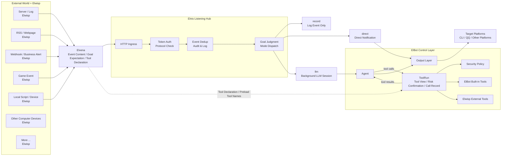

<!-- This file is auto-translated from docs/elnis.md. Do not edit manually. -->

# Elnis Listening Hub

Core Idea:

- Let ElBot control everything.
- Let Elnis manage everything.
- Let Elwisp observe everything.

Elnis is the event listening hub of ElBot. Like a star, it catches signals from the constellation of Elwisps, and ElBot then decides whether to record, notify, analyze, or execute background tasks.

## What problem does it solve

Ordinary chatbots usually only respond to user messages. Cron can respond to time, but it doesn't know what is happening in the outside world.

Elnis allows ElBot to respond to the external world.

For example:

- When a server anomaly occurs, let the LLM analyze the logs and determine whether to send a notification.
- When an RSS feed updates, automatically summarize the content and push it to the target platform.
- When a game server generates an event, let ElBot record it, send a notification, or execute background tasks.
- When a Webhook receives a business alert, pass it to ElBot first to determine the severity.
- When a local script detects a state change, send the result to ElBot instead of sending messages haphazardly.

Simply put, Elnis expands ElBot from a "bot that waits for users to speak" into an "Agent hub capable of perceiving the external world."

## Architecture Diagram



## Media Resource Boundary

Elwisp's own files are managed by external processes; The Elnis workspace stores temporary computations and general work files. Media that actually enters the LLM, persisted reports, or direct platform outputs are managed by a shared Media Center and identified using `media:<sha256>`, avoiding redundant sandbox download copies from direct platforms.

In Elvena v3, the image/file segment fills HTTP(S), data URIs, or full `media:<sha256>` in `url`, without adding a separate `media` field. Elwisp does not obtain media management RPCs, and external tools will not receive host-exported files. The report outbox uses stable media sources; references for retries are independent of the time-limited sent cache. See [Media Usage and Cleanup](elnis-usage.md#下载与存储) for details.

## Three Roles

| Role | What it is | Responsibilities | What it does not do |
| --- | --- | --- | --- |
| **Elnis** | The internal event entry runtime of ElBot, assembled at the same level as the platform runtime and Cron runtime. | Receives Elvena requests; validates tokens and protocol fields; performs persistent deduplication based on `elwisp.name + source + id`; records logs and audit logs; determines the deliverable platform; executes `record` / `direct` / `llm` according to the mode. | It is not a chat platform and does not implement PlatformAdapter. External events cannot bypass the Agent, Tool Runtime, Security Policy, and Output Layer. |
| **Elwisp** | External sub-listeners: shell scripts, resident processes, RSS pollers, Webhook forwarders, game server plugins, log listeners, hardware collectors, or any program capable of converting external signals into HTTP JSON. | Responsible only for observing and reporting. | Does not directly control ElBot, does not send messages directly to chat platforms, and does not decide whether to call the LLM or tools. |
| **Elvena** | The JSON over HTTP protocol used by Elwisp to deliver events to Elnis. | Transforms "what happened outside" into a unified event: source, event ID, content, expected processing method, and expected delivery target. | — |

The scope of Elwisp's observation is not limited by type: operating system events, file and log changes, server status, game or business service events, RSS / web pages / Webhooks, database or queue messages, devices and sensors, local script output—anything a computer can receive, read, listen to, or generate. They can be numerous, small, and scattered, with only one responsibility: to tell Elnis what happened externally.

Elvena endpoint:

```text
POST /elvena/v3/events
GET  /healthz
```

## How events are processed

| Mode | Function | Suitable Scenarios |
| --- | --- | --- |
| `record` | Only record events, without calling the LLM or sending notifications. | Event archiving, integration testing, low-priority signals. |
| `direct` | Directly send text notifications to the target determined by Elnis. | Simple alerts, readable messages already generated by external systems. |
| `llm` | Enters a background LLM Session, where the model analyzes it to decide whether to report. | Events that require analysis, induction, judgment, or the use of tools. |

HTTP requests in `llm` mode return quickly, and the actual processing is executed by a background worker; the LLM must return a structured result:

```json
{
  "completed": true,
  "need_report": true,
  "report": "result"
}
```

When not taken over, `need_report=true` will send `report` according to the adjudicated target. After the associated user restores the background Session via a private chat on the same platform (or the CLI management entry), the Session is permanently converted to a regular foreground Session, execution switches to foreground logic, and it will no longer automatically report or re-deliver.

## View Elwisp logs

`/elwisp` reads `elnis-YYYY-MM-DD.log` and supports filtering by Elwisp name, event source, event ID, mode, and time range, for example `/elwisp server-watchdog -n 20` and `/elwisp --source minecraft-main --mode llm --since 2h`. For full options, see [Logs and Audit](commands.md#日志和审计).

## Relationship with Cron, ELyph, and Skill

| Capability | Trigger Source | Function |
| --- | --- | --- |
| Cron | Time | Execute direct or LLM tasks when the time is reached. |
| Elnis | external event | Receive events delivered by Elwisp and distribute them for processing. |
| ELyph | Task text | Describe tasks, steps, and constraints in a structured manner. |
| Skill | Reusable capabilities | Condense experience or code into discoverable and callable capabilities. |

## Creating Elwisp Auxiliary Tools

In work mode, the superadmin can have ElBot assist in creating Elwisp using the built-in tool `elwisp_creator`: it returns creation guides, Elvena event templates, Elnis configuration snippets, listener scaffolding, curl test commands, and security checklists; Actually writing files or running commands is still handled by the file tool and shell tool. For ready-made examples, protocol documentation, and templates, see [Elwisp Showcase](https://github.com/Elfreese/elwisp-showcase).

For enabling Elnis, configuring Elwisp policies, sending Elvena requests, as well as request fields and delivery boundaries, see [Elnis Configuration and Usage](elnis-usage.md).
