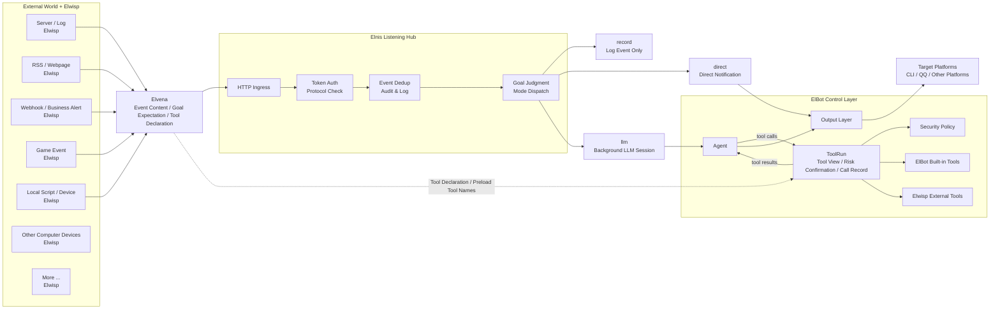

# Elnis 监听枢纽

核心思想：

- 让 ElBot 掌控一切。
- 让 Elnis 管理一切。
- 让 Elwisp 观测一切。

Elnis 是 ElBot 的事件监听枢纽。它像一颗恒星，接住来自各处 Elwisp 群星的信号，再由 ElBot 决定是否记录、通知、分析或执行后台任务。

## 它解决什么问题

普通聊天机器人通常只会响应用户消息。Cron 可以响应时间，但不知道外部世界发生了什么。

Elnis 让 ElBot 可以响应外部世界。

例如：

- 服务器异常时，让 LLM 分析日志并判断是否通知。
- RSS 更新时，自动总结内容并推送给目标平台。
- 游戏服务器产生事件时，让 ElBot 记录、通知或执行后台任务。
- Webhook 收到业务告警时，先交给 ElBot 判断严重程度。
- 本地脚本发现状态变化时，把结果送入 ElBot，而不是直接乱发消息。

简单说，Elnis 把 ElBot 从“等用户说话的机器人”扩展成“能感知外部世界的 Agent 枢纽”。

## 架构图



## 媒体资源边界

Elwisp 自己的文件由外部进程管理；Elnis workspace 保存临时计算和普通工作文件。真正进入 LLM、持久化报告或 direct 平台输出的媒体由共享 Media Center 管理，使用 `media:<sha256>` 标识，不重复保留 direct 的 sandbox 下载副本。

Elvena v3 的 image/file segment 在 `url` 中填写 HTTP(S)、data URI 或完整 `media:<sha256>`，不新增独立 `media` 字段。Elwisp 不获得媒体管理 RPC，外部工具也不会收到宿主导出文件。报告 outbox 使用稳定媒体来源，待重试引用独立于有限期的已发送缓存。详见 [媒体使用与清理](elnis-usage.md#下载与存储)。

## 三个角色

| 角色 | 是什么 | 职责 | 不做什么 |
| --- | --- | --- | --- |
| **Elnis** | ElBot 内部事件入口 runtime，与平台 runtime、Cron runtime 同级装配。 | 接收 Elvena 请求；校验 token 与协议字段；按 `elwisp.name + source + id` 持久化去重；记日志与审计；裁决可投递平台；按模式执行 `record` / `direct` / `llm`。 | 不是聊天平台，不实现 PlatformAdapter。外部事件不能绕过 Agent、Tool Runtime、Security Policy 和 Output Layer。 |
| **Elwisp** | 外部子监听器：shell 脚本、常驻进程、RSS 轮询器、Webhook 转发器、游戏服务器插件、日志监听器、硬件采集器，或任何能把外部信号转成 HTTP JSON 的程序。 | 只负责看见并上报。 | 不直接控制 ElBot，不直接向聊天平台发消息，不决定是否调用 LLM 或工具。 |
| **Elvena** | Elwisp 向 Elnis 投递事件的 JSON over HTTP 协议。 | 把“外面发生了什么”变成统一事件：来源、事件 ID、内容、期望处理方式、期望投递目标。 | — |

Elwisp 观察的范围不限定类型：操作系统事件、文件和日志变化、服务器状态、游戏或业务服务事件、RSS / 网页 / Webhook、数据库或队列消息、设备与传感器、本地脚本输出——任何计算机能接收、读取、监听或生成的内容。它们可以很多、很小、很分散，职责只有一个：把外部发生了什么告诉 Elnis。

Elvena endpoint：

```text
POST /elvena/v3/events
GET  /healthz
```

## 事件会怎样被处理

| 模式 | 作用 | 适合场景 |
| --- | --- | --- |
| `record` | 只记录事件，不调用 LLM，不发送通知。 | 事件归档、接入测试、低优先级信号。 |
| `direct` | 按 Elnis 裁决后的目标直接发送文本通知。 | 简单告警、外部系统已生成可读消息。 |
| `llm` | 进入后台 LLM Session，由模型分析后决定是否报告。 | 需要分析、归纳、判断或使用工具的事件。 |

`llm` 模式的 HTTP 请求快速返回，实际处理由后台 worker 执行，LLM 需返回结构化结果：

```json
{
  "completed": true,
  "need_report": true,
  "report": "result"
}
```

未被接管时，`need_report=true` 会按裁决后的目标发送 `report`。所属用户在同平台私聊（或 CLI 管理入口）恢复后台 Session 后，该会话永久转为普通前台会话，执行变为前台逻辑，不再自动汇报或补投递。

## 查看 Elwisp 日志

`/elwisp` 读取 `elnis-YYYY-MM-DD.log`，支持按 Elwisp 名称、事件来源、事件 ID、模式和时间范围过滤，例如 `/elwisp server-watchdog -n 20`、`/elwisp --source minecraft-main --mode llm --since 2h`。完整选项见[日志和审计](commands.md#日志和审计)。

## 与 Cron、ELyph 和 Skill 的关系

| 能力 | 触发来源 | 作用 |
| --- | --- | --- |
| Cron | 时间 | 到点执行 direct 或 LLM 任务。 |
| Elnis | 外部事件 | 接收 Elwisp 投递的事件并分发处理。 |
| ELyph | 任务文本 | 用结构化方式描述任务、步骤和约束。 |
| Skill | 可复用能力 | 把经验或代码沉淀成可被发现和调用的能力。 |

## 创建 Elwisp 辅助工具

work 模式下超级管理员可让 ElBot 用内置工具 `elwisp_creator` 辅助创建 Elwisp：它返回创建指南、Elvena 事件模板、Elnis 配置片段、监听器脚手架、curl 测试命令和安全检查清单；真正写文件或运行命令仍由文件工具和 shell 工具处理。现成示例、协议文档和模板见 [Elwisp Showcase](https://github.com/Elfreese/elwisp-showcase)。

启用 Elnis、配置 Elwisp 策略、发送 Elvena 请求，以及请求字段和投递边界，见 [Elnis 配置与使用](elnis-usage.md)。
